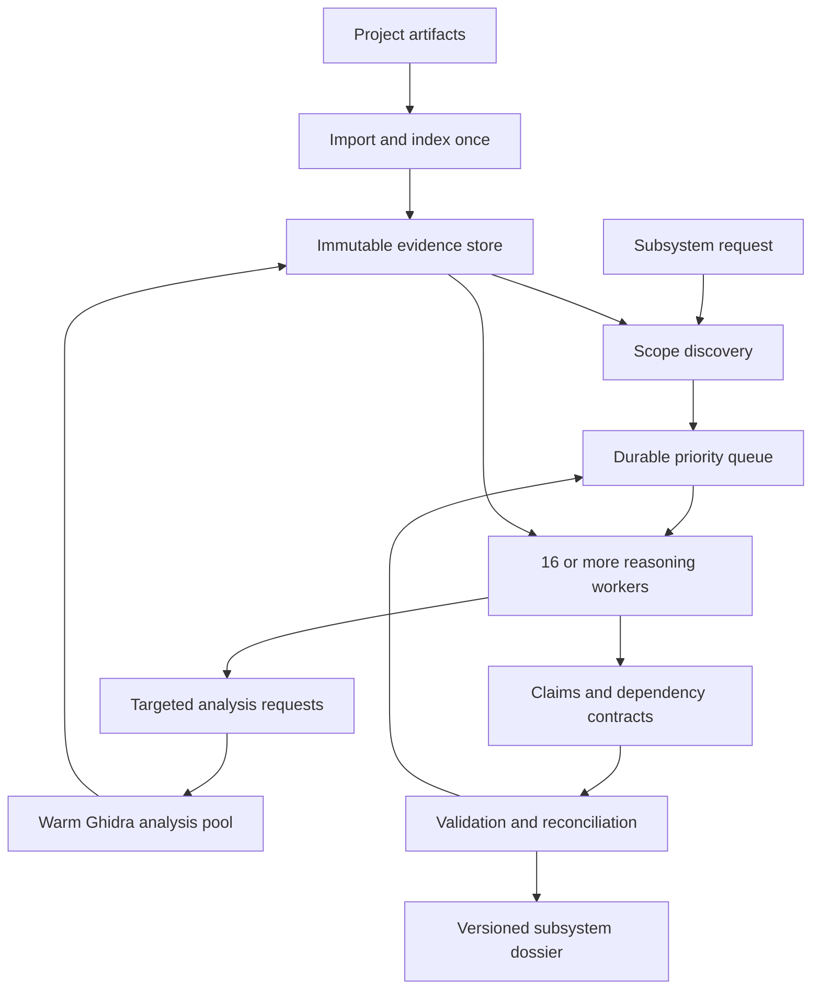

# Decompilation engine architecture

Status: implementation in progress. Updated 2026-10-24.

Implementation sequence: [DECOMP_IMPLEMENTATION_PLAN.md](DECOMP_IMPLEMENTATION_PLAN.md).
The earlier review of the separate Rev checkout is preserved as
[historical context](docs/archive/rev-engine-review-2026-10-24.md); its global FIFO,
exhaustive annotation, and project-publication policies do not govern this design.

## Objective and completion policy

Recover enough supported behavior to write a specification for a selected subsystem.
Support entire-project campaigns through multiple subsystem scopes and shared evidence.
The engine must support at least 16 concurrent reasoning workers, including workers on
separate hosts. A small request need not manufacture 16 tasks to occupy the fleet.

The deliverable is a behavioral dossier: interfaces, readable pseudocode, state transitions,
side effects, dependency contracts, evidence-linked claims, examples, and open questions.
Reconstructed C need not compile. Compilability, exact original names, exhaustive local
renaming, and cosmetic cleanup are not completion requirements.

A scope is ready for specification when its identified observable behaviors have supported
contracts, consequential dependency assumptions are resolved, and independent review finds
no unresolved blocker to specifying the requested behavior. Nonblocking unknowns remain
visible. Budget exhaustion produces a partial dossier, never a successful completion claim.
Readiness is relative to the declared boundary and evidence revision; it is not proof that
all possible runtime behavior was discovered.

## Current implementation and remaining design

The Python engine now imports and indexes each binary by analysis identity, exports
immutable function evidence, discovers bounded scopes, and runs semantic and independent
review work through a durable PostgreSQL queue. Original-binary probes and partial
dossiers are implemented. The rename-attempt path remains a diagnostic with a private
Ghidra project per attempt.

Conflict reconciliation, warm analysis pooling, multi-host recovery, and a durable job
API remain planned. The implementation plan lists their acceptance gates. Proposed
records there are design requirements, not proof of an implemented runtime interface.

## Architecture

Use Python for the engine implementation alongside the launcher, PostgreSQL
for durable control state, and content-addressed files for immutable artifacts. Preserve
an artifact-store interface for later shared object storage. A future API or client should
consume engine job state rather than build a second scheduler. Logical components may run
in one service initially, while worker processes remain independently deployable.

### Import and evidence extraction

Hash each input artifact. Record architecture, compiler/language selection, Ghidra/backend
versions, analyzer settings, and analysis revision. A project manifest identifies all modules
and dependencies; function identity includes module identity, address space, and relative
address, with a generation for boundary changes.

Build a broad index of discovered functions, imports, strings, references, and call edges.
Decompile selected functions on demand. Cache immutable decompiler output, address mappings,
disassembly, relevant types, and P-code where needed. Include extraction failures and omitted
regions explicitly. Do not treat truncated evidence as a complete body.

Reuse warm decompiler contexts. Ghidra supports persistent `DecompInterface` instances and
parallel function decompilation. Use distinct interfaces for concurrent contexts. These API
capabilities must still be verified against the pinned backend/version in the integration gate.

Most workers need no writable project. Type, prototype, and function-boundary experiments
use isolated copies of a closed snapshot. Validated changes create a new analysis revision
and invalidate affected evidence. Never share one writable project across worker processes.

### Scope discovery

Locate candidate entry points from user seeds, symbols, strings, imports, routes, or traces.
Expand through calls, relevant data dependencies, callers, initialization, shared globals,
callback registration, and dispatch tables. A call graph alone is insufficient.

Record included entities, observable outputs, boundary contracts, exclusions with reasons,
and unresolved scope edges. Expansion stops at a dependency whose relevant behavior is
adequately established, rather than walking its entire implementation. New evidence may
expand or revise the boundary; preserve scope revisions and reasons for changes.

For project-wide campaigns, use multiple bounded scopes with shared helper contracts and
cross-module identities. Publish each ready subsystem progressively and retain unexplored
areas in the campaign inventory. Completion cannot be inferred from an empty ready queue.

### Tasks and scheduling

A task answers a question about an operation, function group, branch, state transition, or
uncertain dependency. Use independent tasks where possible; small recursive cycles may be
analyzed together. Large functions/cycles require bounded subquestions with explicit shared
state assumptions and a reconciliation task.

Prioritize scope relevance, uncertainty reduction, dependent work unlocked, and estimated
cost. Start with deterministic priority classes and aging to prevent starvation. Do not claim
numerical precision for an uncalibrated information-gain score.

Use transactional leases, attempt IDs, heartbeat renewal, fencing epochs, bounded retries,
and idempotent submissions. Deduplicate dependency requests. Persist partial findings before
finishing or timing out. A late result can be retained as stale evidence but cannot mutate a
newer lease. Every task pins its evidence and dependency contract versions.

Workers can proceed from provisional contracts if assumptions are explicit. Schedule review
when those assumptions change. Do not impose a global dependency barrier or repeatedly
retry unresolved cycles without new evidence. Stop with partial/stalled status when progress
or budget is exhausted.

### Evidence, findings, and publication

Keep raw tool evidence, semantic interpretation, and downstream specifications separate.
A claim records its subject, statement, evidence references, assumptions, dependency versions,
review/probe results, and unresolved alternatives. Raw tool output is not automatically a
correct semantic interpretation.

Use immutable artifact hashes and binary addresses for native citations. Decompiled line
numbers are presentation references tied to one immutable rendering. Record original traces
with inputs, environment, outputs, and run identity.

The evidence/findings store is authoritative. Most semantic updates require short database
transactions, not Ghidra saves. Validate dependency versions and publish compatible findings
using conditional updates. Preserve conflicting claims for reconciliation; never resolve a
semantic disagreement by last-writer-wins. A canonical dossier references an immutable set
of accepted claim versions. Store artifacts first, then commit pointers and outbox events.

Ghidra names/comments are optional derived views. Analysis-affecting edits are a separate,
serialized revision path per program with isolation and persistence checks. A corrected type
or callee contract invalidates consumers through a reverse dependency index. Display-name
changes can refresh renderings without invalidating unchanged semantics.

### Worker output and validation

Dossiers include scope, inputs/outputs, units, encodings, pseudocode, state transitions,
side effects, errors, boundary cases, dependency contracts, examples, and open questions.
Preserve observable widths, signedness, overflow, rounding, byte order, aliasing, mutation
order, and synchronization behavior. Consult disassembly/P-code for ambiguous decompiler
renderings; do not require pseudocode to compile.

Validation has distinct layers:

1. Structural: schema, references, identities, versions, and required dossier sections.
2. Semantic: independent review against raw evidence; challenge consequential claims and
   compare competing explanations.
3. Behavioral: original-execution probes where feasible, covering boundaries, errors, and
   state sequences. Use original binaries/modules through a harness or application interface.

A small native harness is permitted; reconstructed compilable C is unnecessary. Execution
requires a controlled environment suitable for the target, with recorded limits and context.
If execution is unavailable, retain reviewed static findings with explicit limitations.

A source citation proves location validity only. Requirement IDs in test names measure
traceability only. A call counter can detect failure to invoke original code, but cannot prove
that an adapter uses its result. Review adapters and vary probes. Report static support,
review, probe outcomes, and unresolved questions separately. Passing examples never proves
complete equivalence. No fabricated confidence percentages.

Persistence, timers, networking, and platform state belong in the dossier when observable
within the selected scope. A downstream pure-function API may adapt them only through
explicitly recorded deviations; blanket removal of platform behavior loses specification data.

## Capacity and cost

Start with 16–32 reasoning slots, a separately bounded warm analysis pool (initial experiment:
2–4 contexts), and reserved validation capacity. These are hypotheses to benchmark. Increase
analysis concurrency to 16+ when workload and hardware justify it. Multiple requests can share
the fleet when one subsystem has insufficient independent work.

Admission accounts for model requests/tokens, CPU, JVM/native memory, artifact I/O, and
validation backlog. Apply bounded queues and backpressure, rate limiting, retry jitter, and
per-campaign budgets. Track effective throughput rather than container count.

Route models through `models.json`; evaluate role quality on held-out cases. Cheap extraction
must not become an unchecked source of semantic claims. Escalate ambiguous state/control
flow and failed probes to stronger reasoning. Cache reusable evidence and contracts before
optimizing model price alone.

Cache raw artifacts by input and toolchain/configuration revision; cache semantic outputs by
evidence, contract, prompt/schema, and model versions. Use measured invalidation boundaries.

## References

- [Ghidra persistent decompiler interface](https://ghidra.re/ghidra_docs/api/ghidra/app/decompiler/DecompInterface.html)
- [Ghidra parallel decompiler](https://ghidra.re/ghidra_docs/api/ghidra/app/decompiler/parallel/ParallelDecompiler.html)
- [Ghidra P-code semantics](https://ghidra.re/ghidra_docs/languages/html/pcoderef.html)
- [PostgreSQL SELECT and SKIP LOCKED](https://www.postgresql.org/docs/current/sql-select.html)
- [Current Ghidra MCP upstream](https://github.com/mrphrazer/ghidra-headless-mcp)
