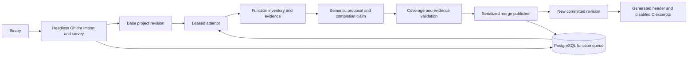

# Rev: how the reverse-engineering engine works, and how to improve it

_Code review of `/home/mitch/Documents/rev`, 2026-10-24. The path supplied as `/home/mitch/rev` was absent; this document describes the checkout at `/home/mitch/Documents/rev`._

## Executive summary

Rev is an experimental system for analyzing a binary with Ghidra, distributing function-level work, validating proposed documentation, and publishing compatible findings into a versioned project. Its central idea is **function sifting**: assign a function as a starting point, allow investigation to move through dependencies, keep useful partial findings, and return unfinished work to a durable queue.

There are two different maturity levels in the repository:

1. **The current `rev run` pipeline** imports a binary into headless Ghidra, surveys functions, queues work in PostgreSQL, runs parallel TypeScript worker loops, builds mostly heuristic semantic proposals, validates claims, serializes publication, and generates a header plus disabled decompiler excerpts. An optional `--opencode` route asks an existing OpenCode server for a structured analysis response. The output is documentation and analysis, **not a reconstructed or verified implementation**.
2. **The proposed architecture** adds a private Ghidra project and OpenCode session per attempt, domain-specific MCP tools, durable checkpoints, agent pivots, resource-limited Podman pods, and a single authoritative merge publisher. Pieces of this exist as modules, but the full path is not connected to `rev run`.

The most valuable next step is an end-to-end worker milestone: one assigned function, one private project, one selected agent skill, the Ghidra and campaign MCP servers, a persisted change bundle, independent validation, and a published revision. Make that work before increasing parallelism.

## The model: campaigns, functions, attempts, and revisions

Rev treats one immutable binary as a **campaign**. A campaign has a binary hash, a Ghidra project, a set of discovered functions, a queue, and a current committed revision. Each queue dispatch creates an **attempt** for one primary function and pins the revision the attempt started from. A proposed change is a **bundle** of semantic operations, such as renaming a function or parameter, changing a type, or adding documentation. A **claim** says a function is fully understood, with evidence and inventory coverage. Only accepted changes and valid claims should advance the campaign.

This split matters because a worker can learn something useful without completing its assigned function. It can also discover the meaning of another function while following a call chain. The architecture permits that cross-function work; the current CLI pipeline has a narrower form of it, including a cycle fallback that may analyze a blocking callee before the leased caller.

### Repository components

| Component | Current responsibility |
| --- | --- |
| `packages/core` | Stable ID types, inventories, change and claim models, coverage contract, MCP schemas. |
| `packages/ghidra-adapter` | Headless Ghidra bridge, inventory mapping, MCP-facing interfaces and campaign MCP server. |
| `packages/db` | PostgreSQL campaign state, queue, leases, claims, revisions. |
| `packages/scheduler` | Campaign orchestration, queue dispatch, worker loops, snapshots, admission helpers. |
| `packages/merge-engine` | Proposal building, evidence checks, semantic three-way merge, claim validation, publication. |
| `packages/supervisor` | OpenCode HTTP client, agent prompt and budget helper, MCP configuration generator, Podman runner. |
| `packages/cli` | `run`, `init`, `status`, `campaign-mcp`, and `mcp-config` entry points. |

## What `rev run` actually does

### 1. Import, analyze, and inventory

The CLI calls `ReverseEngineeringOrchestrator.reverseEngineerBinary`. It resolves and hashes the binary, creates a Ghidra project, and invokes `analyzeHeadless` to import and analyze it. The Java bridge then tries to export a program survey: discovered functions, their decompilation and inventories, entry point, and initialization/finalization arrays. If survey export fails, the orchestrator falls back to a simpler function list. See `packages/scheduler/src/orchestrator.ts` and `packages/ghidra-adapter/src/driver.ts`.

The intake logic separates runtime glue from user functions and seeds the queue in a deterministic randomized order. The fallback list has less inventory information. Inventory completeness is important: the claim validator refuses to treat a function as fully documented when required globals or referenced types have not been enumerated.

### 2. Create campaign state and the base snapshot

Rev stores campaign and function state in PostgreSQL. It copies the closed Ghidra project to a revision snapshot, computes a file manifest, and publishes the first revision with compare-and-swap semantics. Snapshot copying prefers a reflink and requires `REV_ALLOW_FULL_COPY=1` before falling back to a full copy. This avoids silently making expensive copies on filesystems without reflink support.

### 3. Dispatch function attempts

The queue uses a short database transaction and `FOR UPDATE SKIP LOCKED` to avoid assigning the same queue row to concurrent workers. It first prefers a function whose known user callees are already documented. If none is ready, it takes the oldest eligible queued function and marks the dispatch as a cycle case. The attempt records a primary function, base revision, lease expiry, and lease epoch. Workers renew leases and requeue unfinished work to the tail.

The current orchestrator creates a configurable number of async worker loops, eight by default. These are in-process loops; the normal `rev run` path does not use the separate Podman runner to launch an OpenCode/Ghidra pod per attempt. It may clone the current snapshot to a worker directory for a fresh Ghidra inspection. Initial survey inventories can be reused while the campaign remains on the first revision.

### 4. Produce an analysis proposal

Without `--opencode`, a deterministic heuristic analyzes the decompiled body and proposes names, behavior notes, return semantics, and evidence. With `--opencode`, the orchestrator creates a session on an already running OpenCode server, sends an assignment prompt containing the decompiled function, reads the response text, and deletes the session. The response parser expects JSON-like semantic evidence. A failed or insufficient OpenCode result does not fall back to the heuristic in that mode.

This optional route is narrower than the proposed autonomous agent: the orchestrator does not provision an attempt-specific OpenCode configuration, select `SKILL.md` files, connect the generated MCP configuration, supervise a tool-using session through events, or consume a checkpointed Ghidra edit bundle. The repo README explicitly describes the OpenCode supervisor as not wired into the normal pipeline.

### 5. Validate and publish

Rev converts accepted analysis into semantic operations and, when it considers the function claimable, a completion claim. The validator checks that the adapter marked the inventory complete, the body fingerprint still matches, every required parameter/local/global/callee/type appears in the coverage map, names and types meet structural rules, and the documented purpose is persisted. Measured naming and return evidence add checks beyond a simple placeholder blacklist.

The merge engine compares each proposed property with its base and the current main value. Compatible edits can be applied; conflicting dependency groups are held back. Publication is serialized in the orchestrator, and accepted bundles can be batched before one new snapshot is committed. A database compare-and-swap checks the parent revision when publishing. Completion state and queue state are updated with the revision transaction.

The validation proves coverage and persistence of the recorded annotation. It does **not** prove that the inferred semantics are true. A plausible but wrong name or explanation can still require human or later evidence-based review.

### 6. Stop and generate artifacts

The campaign stops when all user functions are documented, the configured attempt limit is reached, or a no-progress threshold is hit. It reports `completed`, `budget_exhausted`, or `stalled`. It writes a C header for accepted documented functions and a C source file containing decompiler excerpts wrapped in `#if 0`. Those excerpts are reference material, not a buildable reverse-engineered implementation.

## The intended autonomous worker design

`ARCHITECTURE.md` proposes a stronger loop. A scheduler leases the oldest eligible function and pins the latest main revision. A trusted runner clones a **closed** Ghidra project into a private attempt workspace. One container runs Ghidra and its adapter; another runs OpenCode and its supervisor. The agent receives an assignment prompt, can inspect and edit through a narrow Ghidra MCP interface, and records pivots, claims, and finish status through a separate campaign MCP interface. A checkpoint seals the resulting project state and evidence bundle. A validator checks the claim against a fresh inventory, and a single publisher merges safe changes into main.

The separation of MCP interfaces is sound:

- **Ghidra MCP** should expose inspection, typed edits, validation, and checkpoints against the private branch.
- **Campaign MCP** should persist investigation pivots, claims, notes, and attempt finalization. Its mutations must be tied to an attempt and durable state.
- **Supervisor** should own wall-clock, token, tool-call, heartbeat, and cancellation controls. The model should not decide whether its own budget was enforced.
- **Publisher** should decide what becomes authoritative. A model's `finish_attempt` or `claim_documented` call is a proposal, not final acceptance.

The current `packages/supervisor/src/runner.ts`, `mcp-config.ts`, `opencode-client.ts`, and `packages/ghidra-adapter/src/campaign-mcp.ts` are useful building blocks. They do not yet form a production worker lifecycle. The container files also need work before they can be treated as pinned reproducible images: the analysis image leaves Ghidra installation as a placeholder, while the agent image runs an install script without a fixed release and ignores installation failure.

## Where the implementation is strongest

1. **Durable task identity and revision pinning.** Queue rows, attempt IDs, leases, and base revisions are explicit rather than hidden in prompts.
2. **Honest completion checks.** The code rejects incomplete inventories and requires evidence for claims. It does not declare a function done because an agent wrote a convincing summary.
3. **Semantic merge unit.** Changes are represented by entity and property, which permits disjoint findings to survive overlapping work better than copying an entire worker project over main.
4. **Serialized publication.** One publisher prevents concurrent writes to the authoritative Ghidra project and revision pointer.
5. **Clear experimental status.** The README and disabled C excerpts avoid presenting partial decompilation as verified source reconstruction.

## Main gaps and risks

| Gap | Why it matters | Better behavior |
| --- | --- | --- |
| Full agent runtime is not connected | `--opencode` is a prompt/response call, not a tool-using isolated attempt. | Wire one complete attempt before scaling workers. |
| No task-specific skill delivery | An agent cannot reliably receive a chosen `SKILL.md` for a particular task. | Materialize only selected skills in a fresh attempt workspace, name them in the prompt, and verify skill-load events. |
| MCP config is generated separately | Config generation alone does not prove the session connected to Ghidra and campaign servers. | Generate config before server startup and check MCP status and one real tool call. |
| Container images are not reproducible yet | The analysis image lacks an installed Ghidra distribution; the OpenCode install is unpinned and may fail silently. | Pin image digests and tool versions, build images in CI, and run startup smoke tests. |
| Inventory gaps block completion | The strict contract is only useful when the adapter can enumerate all required entities. | Complete and conformance-test the inventory and edit adapter, including save/reopen checks. |
| Semantic correctness remains uncertain | Structural checks can pass with a plausible wrong explanation. | Attach evidence to each assertion, use independent review on difficult claims, and expose confidence and unresolved assumptions. |
| Dependency-version checks need current values | The validator accepts optional known callee/type versions; callers that omit them cannot detect every changed dependency there. | Pass candidate-main dependency versions into every final claim validation and test invalidation. |
| Output records are accumulated during this run | A restart may have durable database state but no in-memory records for already accepted functions. | Generate reports from committed revisions and completion records, with resume/rebuild tests. |
| In-process orchestration has limited recovery | A crash between work, claim, snapshot, and state changes needs explicit reconciliation. | Add idempotent attempt finalization, a durable outbox, orphan cleanup, and crash-injection tests. |
| Workload cost is unmeasured | Parallel workers can saturate Ghidra, storage, model limits, or merge throughput. | Admit workers from measured capacity and track accepted progress per resource spent. |

These are code-review observations, not claims that a particular failure was reproduced in a live campaign.

## A practical improvement plan

### Phase 1: prove the Ghidra contract

Choose one pinned Ghidra version and one headless MCP backend. On a small fixture, verify that a worker can enumerate every required parameter, local, referenced global, callee, and type; rename and retype them; save; reopen in a fresh Ghidra process; and recover the same identities and annotations. Exercise indirect calls, thunks, composites, recursive types, and decompiler-generated locals. Where a backend cannot meet the contract, add a narrow Java bridge operation or report a capability failure. Do not weaken the completion rule to fit a limited backend.

Stable IDs deserve particular attention. For example, the current local-variable mapping includes a decompiler fingerprint derived from the current name. Names can change during the workflow, so an identity and replay test should verify that the same local remains addressable after a rename and reanalysis. Capture before/after values and expected fingerprints for every edit, including automatic analysis side effects.

### Phase 2: complete one real agent attempt

Define an immutable attempt manifest containing task ID, function ID, base revision hash, model/runtime/toolchain versions, selected skill hashes, MCP server definitions, budgets, and output schema. Give the attempt its own workspace and config directory. Copy only selected `SKILL.md` files into the agent's skill search path. Start the configured MCP servers and the headless OpenCode server, confirm readiness, create a session, and submit a prompt that names the assigned skill and objective.

Observe the session through events. Record that the agent loaded the skill and called the expected MCP tools. On finish or timeout, save a checkpoint, collect the operation journal and final state diff, and seal the bundle. Make unexpected permission prompts, missing tools, malformed output, and MCP disconnects explicit attempt outcomes. Avoid treating a successful HTTP response as successful reverse engineering.

### Phase 3: validate and publish safely

Validate against a freshly reopened candidate Ghidra project. Compare the final touched-entity state with the operation journal, so untracked Ghidra changes cannot slip through. Recompute inventory coverage after edits and analysis settle. Pass the actual current callee-contract and type-layout versions to the final validator. Publish the snapshot and database revision with a recoverable protocol: write immutable artifacts first, commit the revision pointer and associated queue/completion state atomically, then garbage-collect unreferenced artifacts later.

On a merge conflict, retain the rejected proposal and its evidence. A conflict investigator should receive both versions and the current main inventory; it should produce a new proposal rather than mutating main directly. Make bundles and claims idempotent so retries cannot duplicate publication.

### Phase 4: make recovery and parallelism boring

Add tests that kill a worker during analysis, after checkpoint, during merge, and immediately after revision commit. Reconcile database attempts with actual containers and project directories on restart. Make the lease epoch fence all state-changing attempt operations. A late worker may submit evidence for review, but cannot requeue or complete someone else's newer assignment.

Then run two attempts on the same base revision. Verify disjoint edits merge, conflicting edits remain separate, a claim for another worker's primary function suppresses new dispatch, and stale workers do not resurrect completed work. Only after that should admission scale with memory, Ghidra startup cost, model request/token limits, snapshot traffic, and publisher throughput.

### Phase 5: improve analysis quality

Use several small task-specific skills rather than one large reverse-engineering prompt: for example, inventory verification, type recovery, caller/callee contract analysis, and evidence review. Choose skills per attempt and store their hashes. Structure evidence so each inferred name, type, return behavior, side effect, and invariant points to disassembly, p-code, call sites, strings, or dynamic observations where available.

Keep mechanical validity and semantic confidence separate. The system can prove that all known entities were addressed and persisted; it cannot prove that a name is the original source name or that every runtime behavior was discovered. Report unresolved indirect dispatch, opaque external contracts, analysis limitations, and the exact revision for which a completion was validated. Revalidate affected completions when a body, prototype, type layout, or callee contract changes.

## Definition of done for the next milestone

A small fixture campaign should demonstrate all of the following in one repeatable integration run:

- A scheduler leases a specific function and pins a revision.
- A fresh agent workspace contains exactly the assigned skill files and MCP configuration.
- The agent loads the selected skill and calls a real Ghidra MCP inspection tool.
- An edit survives save, process exit, and fresh reopen.
- A pivot and completion claim are durably recorded through campaign MCP.
- The supervisor enforces timeout and captures usage and outcome.
- The validator checks a fresh complete inventory and measured evidence.
- The publisher commits a new revision, and a restart regenerates the same report from committed state.
- A second, overlapping worker cannot overwrite or resurrect that completion.

## Source map

The implementation details above come from these repository files:

- [`README.md`](/home/mitch/Documents/rev/README.md) — current product status and output limits.
- [`ARCHITECTURE.md`](/home/mitch/Documents/rev/ARCHITECTURE.md) — proposed full worker architecture and operating contract.
- [`packages/scheduler/src/orchestrator.ts`](/home/mitch/Documents/rev/packages/scheduler/src/orchestrator.ts) — current `rev run` control flow.
- [`packages/db/src/queue.ts`](/home/mitch/Documents/rev/packages/db/src/queue.ts) — dispatch, leases, and requeue logic.
- [`packages/ghidra-adapter/src/driver.ts`](/home/mitch/Documents/rev/packages/ghidra-adapter/src/driver.ts) and [`scripts/GhidraBridge.java`](/home/mitch/Documents/rev/packages/ghidra-adapter/scripts/GhidraBridge.java) — headless Ghidra integration.
- [`packages/merge-engine/src/publisher.ts`](/home/mitch/Documents/rev/packages/merge-engine/src/publisher.ts), [`validator.ts`](/home/mitch/Documents/rev/packages/merge-engine/src/validator.ts), and [`bundle.ts`](/home/mitch/Documents/rev/packages/merge-engine/src/bundle.ts) — publication, claims, and merge logic.
- [`packages/supervisor/src/`](/home/mitch/Documents/rev/packages/supervisor/src/) and [`packages/ghidra-adapter/src/campaign-mcp.ts`](/home/mitch/Documents/rev/packages/ghidra-adapter/src/campaign-mcp.ts) — agent/MCP building blocks.
- [`tests/`](/home/mitch/Documents/rev/tests/) — interface, queue, merge, pipeline, and Ghidra fixture tests.

This is a source review. I did not run a full binary campaign or containerized agent attempt to verify runtime behavior.
