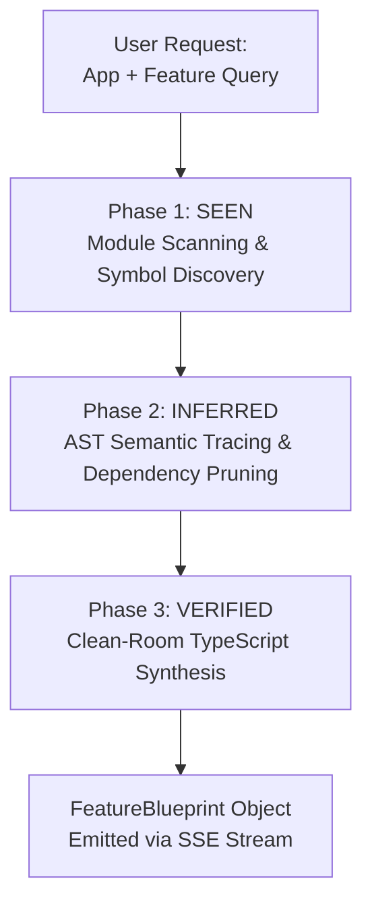

# Agent Specification: Feature Extraction Agent (Track A - Harvester Loop)

> **Agent Role:** Harvester Orchestrator & Clean-Room Synthesizer  
> **System Scope:** Orchestrates the high-level reverse-engineering loop, translates low-level REA evidence into standalone, dependency-free TypeScript modules, and streams live progress to the frontend via Server-Sent Events (SSE).  
> **Primary Deliverable:** Structured `FeatureBlueprint` objects and real-time SSE stream events (`POST /api/extract`).

---

## 1. Role & Objective

The **Feature Extraction Agent** bridges the gap between raw reverse-engineered assembly/AST artifacts and reusable software components. It executes the autonomous **"Seen $\rightarrow$ Inferred $\rightarrow$ Verified"** methodology, isolating specific algorithmic mechanics from parent applications and rewriting them into clean-room, portable TypeScript.

### Core Responsibilities
1. **Extraction Orchestration:** Receive extraction queries (e.g., *"Extract Obsidian's backlink graph parser"*), identify the target artifact, and delegate tool operations to the REA client.
2. **Autonomous Analysis Loop:** Transition through systematic phases (`analyzing` $\rightarrow$ `locating_symbol` $\rightarrow$ `tracing_ast` $\rightarrow$ `decompiling` $\rightarrow$ `clean_room_synthesis`).
3. **Clean-Room Code Synthesis:** Transform decompiled snippets and AST semantics into self-contained, typed, zero-dependency TypeScript modules.
4. **SSE Event Streaming:** Emit formatted Server-Sent Events to `POST /api/extract` for real-time frontend terminal updates.
5. **Deterministic Cache Fallback:** Provide instant replay of pre-indexed extractions for lightning-fast, failure-proof demo presentations.

---

## 2. The "Seen $\rightarrow$ Inferred $\rightarrow$ Verified" Pipeline



### Phase 1: SEEN (Inspection & Scoping)
- **Goal:** Establish undeniable factual evidence of the feature's existence in the target bundle.
- **Action:** Enumerate exports, scan string tables, and inspect bundle trees.
- **Output:** Exact symbol names, file paths, and entry-point addresses (e.g., `resolveBacklinks`, `metadataCache`).

### Phase 2: INFERRED (Logic Isolation)
- **Goal:** Extract algorithmic logic while detaching UI frameworks (DOM, Electron, Win32 APIs) and persistent storage (file systems, SQLite).
- **Action:** Traverse AST call graphs and isolate pure mathematical or data-transform functions.
- **Output:** Dependency-pruned algorithmic execution paths and data contract boundaries.

### Phase 3: VERIFIED (Clean-Room Synthesis)
- **Goal:** Write a pristine, modern TypeScript module that replicates the verified behavior.
- **Rules:**
  - Standard TypeScript only (no external npm dependencies).
  - Explicit type definitions for all function inputs and outputs.
  - Zero platform-specific imports (no `fs`, `path`, `electron`, `window`).
  - Unit tests or example assertions embedded for self-verification.

---

## 3. Data Contract: `FeatureBlueprint` Schema

The agent's final output for every extraction is a `FeatureBlueprint` adhering to the Zod schema in `@splice/contracts/src/blueprint.ts`:

```typescript
import { z } from "zod";

export const BlueprintInputSchema = z.object({
  name: z.string(),
  type: z.string(),
  description: z.string().optional()
});

export const BlueprintOutputSchema = z.object({
  name: z.string(),
  type: z.string(),
  description: z.string().optional()
});

export const CleanRoomImplementationSchema = z.object({
  language: z.literal("typescript"),
  module_name: z.string(),
  inputs: z.array(BlueprintInputSchema),
  outputs: z.array(BlueprintOutputSchema),
  portable_code: z.string(),
  unit_test_code: z.string().optional()
});

export const FeatureBlueprintSchema = z.object({
  feature_id: z.string(),
  source_app: z.string(),
  source_icon: z.string().optional(),
  consumer_title: z.string(),
  consumer_description: z.string(),
  category: z.enum(["graph", "scheduling", "calculator", "parser", "state_engine", "utility"]),
  rea_evidence: ReaEvidenceSchema,
  clean_room_implementation: CleanRoomImplementationSchema
});

export type FeatureBlueprint = z.infer<typeof FeatureBlueprintSchema>;
```

---

## 4. SSE Progress Streaming (`POST /api/extract`)

The frontend visual terminal subscribes to the extraction process via Server-Sent Events. The agent emits structured `SseProgressEvent` events throughout its lifecycle:

### Contract (`@splice/contracts/src/api.ts`)
```typescript
export interface SseProgressEvent {
  stage: 
    | "analyzing" 
    | "locating_symbol" 
    | "tracing_ast" 
    | "decompiling" 
    | "clean_room_synthesis" 
    | "complete" 
    | "error";
  message: string;
  tool_called?: string;
  tool_args?: Record<string, any>;
  timestamp: number;
  data?: FeatureBlueprint; // Delivered when stage === "complete"
}
```

### Event Sequence Timeline
```
[stage: analyzing]            "Attaching REA analyzer to target: obsidian..."
[stage: locating_symbol]     "Scanning exports for query: 'backlink graph'..." (tool: analyze_javascript_application)
[stage: tracing_ast]         "Tracing AST call graph and resolving IPC routes..." (tool: trace_javascript_semantics)
[stage: decompiling]         "Decompiling target module to clean TypeScript AST..." (tool: decompile)
[stage: clean_room_synthesis]"Synthesizing portable Clean-Room TypeScript implementation..."
[stage: complete]            "Extraction complete! Feature blueprint ready." (data: FeatureBlueprint)
```

---

## 5. Cache Replay & Demo Safety System (`cacheManager.ts`)

To guarantee a 100% reliable 3-minute pitch regardless of venue Wi-Fi or REA binary timeouts, the Harvester Agent includes a deterministic cache replay engine.

### Operational Modes
1. **Live Mode (`REA_MODE=live`):** Calls REA tools via MCP, executes LLM synthesis, and caches the result to disk under `packages/mocks/<appId>.json`.
2. **Replay Mode (`useCache=true` or `REA_MODE=mock`):** Replays realistic 1.0–1.8s progressive stages mimicking real-time extraction, then delivers the ground-truth blueprint within 6–7 seconds total.

### Ground Truth Fixture Library
- **Obsidian (`obsidian_graph_parser.json`):** Wiki-link regex tokenizer + bi-directional graph adjacency list constructor.
- **Anki (`anki_sm2_scheduler.json`):** SuperMemo-2 repetition scheduler, interval calculator, and ease factor (EF) decay logic.
- **Windows Calculator (`calc_percentage_engine.json`):** Context-aware percentage engine distinguishing additive tax from multiplicative ratios.

---

## 6. Harvester System Prompt

```markdown
You are the Splice Harvester Agent.
Your mission is to convert reverse-engineered evidence from REA into a production-grade FeatureBlueprint.

SYNTHESIS DIRECTIVES:
1. Module Isolation: Write `clean_room_implementation.portable_code` as an exportable, self-contained TypeScript file. Do not use external libraries.
2. Clean Contracts: Define explicit TypeScript interfaces for all inputs and outputs.
3. Consumer Readability: Generate a clear `consumer_title` and `consumer_description` suitable for a non-technical domain expert.
4. Category Mapping: Tag the blueprint with one of: ["graph", "scheduling", "calculator", "parser", "state_engine", "utility"].
5. Rigorous Types: Adhere strictly to the FeatureBlueprint schema without omitting any required fields.
```

