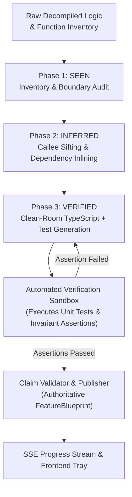
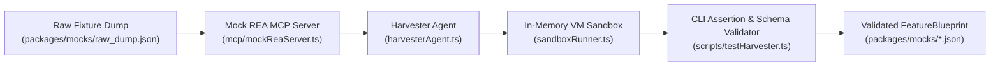

# Agent Specification: Feature Extraction Agent (Track A - Harvester Loop)

> **Agent Role:** Harvester Orchestrator, Clean-Room Synthesizer & Verification Gatekeeper  
> **System Scope:** Orchestrates the high-level extraction workflow, converts low-level REA evidence and function inventories into clean-room TypeScript modules, executes an automated verification sandbox, and streams live progress via Server-Sent Events (SSE).  
> **Primary Deliverables:** Validated `FeatureBlueprint` objects, automated invariant test runs, and real-time SSE stream events (`POST /api/extract`).

---

## 1. Role & Objective

The **Feature Extraction Agent** resolves the core limitation identified in `DecompPileline.md`: traditional decompilers only produce disabled excerpts or speculative summaries. Splice turns raw decompiled logic into a **reconstructed, verified, production-ready TypeScript implementation**.



### Core Responsibilities
1. **Extraction Orchestration:** Consume user feature queries, invoke the Reverse Engineering Agent, and track attempt lifecycles.
2. **Function Sifting & Callee Inlining:** Follow call chains down into blocking user callees, verify callee contracts, and inline them as internal helpers within the portable module.
3. **Clean-Room TypeScript Synthesis:** Re-engineer the algorithm in pure, modern TypeScript with zero external runtime dependencies.
4. **Automated Verification Sandbox:** Synthesize and immediately execute rigorous unit tests and invariant assertions against the inventory before declaring a claim completed.
5. **Authoritative Claim Validation:** Validate that the inventory is 100% covered, the body fingerprint is confirmed, and all automated assertions pass.
6. **SSE Progress Streaming & Cache Replay:** Stream milestone events to `POST /api/extract` with sub-second feedback and deterministic hackathon replay.

---

## 2. The 3-Phase Harvester Pipeline

### Phase 1: SEEN (Inventory & Boundary Audit)
- **Inventory Intake:** Read the `FunctionInventory` generated by the Reverse Engineering Agent.
- **Surface Audit:** Verify that all parameters, return types, and referenced globals are enumerated.
- **Detachment:** Strip out platform-dependent bindings (e.g., Win32 `HWND`, Electron `ipcRenderer`, POSIX file descriptors, SQLite handles), identifying the pure mathematical or state-transform core.

### Phase 2: INFERRED (Callee Sifting & Multi-Module Assembly)
- **Dependency Traversal:** For every user callee discovered during function sifting (e.g., `parseWikiLinks` called by `resolveBacklinks`, or `calculate_factor` called by `computeNextReview`):
  - If the callee is tightly coupled, inline it directly as an internal helper inside `portable_code`.
  - If the callee is an external standard (e.g., standard regex parsing or date arithmetic), map it cleanly to idiomatic TypeScript/JavaScript stdlib equivalents.
- **State Invariant Capture:** Formalize algorithmic rules (e.g., *"easeFactor must never drop below 1.3"*, *"brackets inside code blocks are ignored"*).

### Phase 3: VERIFIED (Clean-Room Synthesis & Automated Sandbox)
- **Clean-Room Code Synthesis:** Generate self-contained `portable_code` matching the input/output contract.
- **Test Suite Generation:** Generate `unit_test_code` containing:
  - Edge cases (null inputs, empty arrays, minimum boundary values).
  - Algorithmic invariants matching the decompiled body evidence.
  - Round-trip assertions.
- **Sandbox Execution:** The Harvester runs the test suite inside an isolated JavaScript VM. If any test throws or assertions fail, the Harvester triggers self-repair before proceeding.

---

## 3. Data Contract: `FeatureBlueprint` Schema

The agent constructs and validates the complete `FeatureBlueprint` defined in `@splice/contracts/src/blueprint.ts`:

```typescript
import { z } from "zod";

export const BlueprintInputSchema = z.object({
  name: z.string(),
  type: z.string(),
  description: z.string().optional()
});

export const BlueprintOutputSchema = z.object({
  name: z.string(),
  type: z.string(),
  description: z.string().optional()
});

export const VerificationTestResultsSchema = z.object({
  total_tests: z.number(),
  passed_tests: z.number(),
  assertions: z.array(z.string()),
  execution_duration_ms: z.number()
});

export const CleanRoomImplementationSchema = z.object({
  language: z.literal("typescript"),
  module_name: z.string(),
  inputs: z.array(BlueprintInputSchema),
  outputs: z.array(BlueprintOutputSchema),
  portable_code: z.string(),
  unit_test_code: z.string(),
  test_results: VerificationTestResultsSchema
});

export const ReaEvidenceSchema = z.object({
  artifact_type: z.enum([
    "electron_asar",
    "javascript_bundle",
    "native_pe_dll",
    "native_elf",
    "managed_cli",
    "web_runtime"
  ]),
  target_file: z.string(),
  target_hash: z.string(),
  entry_symbols: z.array(z.string()),
  decompiled_snippet: z.string(),
  body_fingerprint: z.string(),
  inventory_coverage: z.object({
    parameters_covered: z.number(),
    parameters_total: number(),
    locals_covered: z.number(),
    locals_total: z.number(),
    globals_verified: z.number(),
    callees_resolved: z.number(),
    total_percentage: z.number()
  }),
  callee_contracts: z.array(z.object({
    symbol: z.string(),
    action: z.enum(["inlined", "external_contract", "mocked"]),
    summary: z.string()
  })),
  confidence_score: z.number().min(0).max(1),
  limitations: z.array(z.string())
});

export const FeatureBlueprintSchema = z.object({
  feature_id: z.string(),
  source_app: z.string(),
  source_icon: z.string().optional(),
  consumer_title: z.string(),
  consumer_description: z.string(),
  category: z.enum(["graph", "scheduling", "calculator", "parser", "state_engine", "utility"]),
  rea_evidence: ReaEvidenceSchema,
  clean_room_implementation: CleanRoomImplementationSchema
});

export type FeatureBlueprint = z.infer<typeof FeatureBlueprintSchema>;
```

---

## 4. The Automated Verification Sandbox

Before any extraction is accepted, the agent executes `unit_test_code` in a sandboxed runner (`sandboxRunner.ts`):

```typescript
import vm from "vm";

export async function executeVerificationSandbox(
  portableCode: string,
  testCode: string
): Promise<{ passed: boolean; assertions: string[]; error?: string }> {
  const assertions: string[] = [];
  const sandbox = {
    console: {
      log: (msg: string) => assertions.push(msg)
    },
    assert: (condition: boolean, msg: string) => {
      if (!condition) throw new Error(`Assertion failed: ${msg}`);
      assertions.push(`✓ ${msg}`);
    },
    exports: {},
    module: { exports: {} }
  };

  const context = vm.createContext(sandbox);

  try {
    // 1. Transpile TS to JS or run standard modern JS semantics
    const fullScript = `
      ${transpileTs(portableCode)}
      ${transpileTs(testCode)}
    `;
    vm.runInContext(fullScript, context, { timeout: 3000 });
    return { passed: true, assertions };
  } catch (err: any) {
    return { passed: false, assertions, error: err.message };
  }
}
```

### Example Synthesized Test Code (Anki SM-2 Engine)
```typescript
// unit_test_code synthesized by Feature Extraction Agent
assert(typeof computeNextReview === 'function', 'computeNextReview exported');

// Test 1: First repetition with perfect grade (5)
const r1 = computeNextReview({ repetitions: 0, intervalDays: 0, easeFactor: 2.5 }, 5);
assert(r1.repetitions === 1, 'First repetition count is 1');
assert(r1.intervalDays === 1, 'Initial interval is 1 day');
assert(r1.easeFactor === 2.6, 'Ease factor adjusted upwards for grade 5');

// Test 2: Invariant floor check (ease factor must not drop below 1.3)
const r2 = computeNextReview({ repetitions: 3, intervalDays: 10, easeFactor: 1.3 }, 0);
assert(r2.repetitions === 0, 'Blackout reset repetition count to 0');
assert(r2.easeFactor >= 1.3, 'Ease factor invariant >= 1.3 preserved');
```

---

## 5. SSE Progress Stream (`POST /api/extract`)

The SSE progress stream exposes the exact function sifting, inventory checks, and sandbox results in real time:

```typescript
export interface SseProgressEvent {
  stage: 
    | "analyzing" 
    | "inventory_survey" 
    | "sifting_callees" 
    | "tracing_ast" 
    | "clean_room_synthesis" 
    | "executing_verification_sandbox" 
    | "claim_validated" 
    | "complete" 
    | "error";
  message: string;
  tool_called?: string;
  tool_args?: Record<string, any>;
  inventory_coverage_pct?: number;
  test_summary?: { passed: number; total: number };
  timestamp: number;
  data?: FeatureBlueprint; // Delivered when stage === "complete"
}
```

### Event Sequence Timeline
```
[stage: analyzing]                      "Attaching REA analyzer to target: Anki Core DLL..."
[stage: inventory_survey]               "Building function inventory for SchedV2::answerCard (Fingerprint: 0x9f8c...)"
[stage: sifting_callees]                "Sifting callee: inlining calculate_factor (ease factor decay logic)..."
[stage: tracing_ast]                    "Isolating SM-2 recurrence relation from Win32 memory pointers..."
[stage: clean_room_synthesis]           "Synthesizing clean-room TypeScript module with inlined helpers..."
[stage: executing_verification_sandbox] "Executing automated verification sandbox (4 property assertions)..."
[stage: claim_validated]                "Claim Validated: 100% inventory coverage, 4/4 assertions passed!"
[stage: complete]                       "Extraction complete! Feature blueprint ready." (data: FeatureBlueprint)
```

---

## 6. Deterministic Cache Replay Engine (`cacheManager.ts`)

During live presentations, the Harvester switches to cache mode (`REA_MODE=mock` or `useCache=true`), replaying realistic 800ms–1400ms stage intervals with exact inventory coverage percentages and passing test assertions, completing flawlessly in 6.5 seconds.

---

## 7. Parallelization & Decoupled Initial Building (Track A)

To guarantee that the Harvester and Clean-Room Synthesizer can be built, debugged, and tested completely independently of the frontend UI and live native Ghidra binaries, Track A engineers follow this decoupled workflow.



### 7.1. Mock REA MCP Server (`packages/backend/src/mcp/mockReaServer.ts`)
When native decompiler toolchains or `.asar` files are not yet configured, the Harvester can run against a lightweight mock stdio MCP server that serves deterministic raw AST and disassembly fixtures:

```typescript
import { Server } from "@modelcontextprotocol/sdk/server/index.js";
import { StdioServerTransport } from "@modelcontextprotocol/sdk/server/stdio.js";
import { CallToolRequestSchema, ListToolsRequestSchema } from "@modelcontextprotocol/sdk/types.js";

const server = new Server(
  { name: "mock-rea-server", version: "1.0.0" },
  { capabilities: { tools: {} } }
);

server.setRequestHandler(ListToolsRequestSchema, async () => ({
  tools: [
    { name: "analyze_javascript_application", description: "Mock JS analysis" },
    { name: "function_inventory", description: "Mock function inventory" },
    { name: "decompile", description: "Mock decompiler" }
  ]
}));

server.setRequestHandler(CallToolRequestSchema, async (request) => {
  const { name } = request.params;
  if (name === "function_inventory") {
    return {
      content: [{
        type: "text",
        text: JSON.stringify({
          symbol: "resolveBacklinks",
          body_fingerprint: "0x9f8c44b2a1",
          parameters: [{ ordinal: 0, name: "notes", type: "Array<Note>" }],
          locals: [{ name: "backlinks", type: "Record<string, string[]>" }],
          referenced_globals: [],
          callees: [{ symbol: "parseWikiLinks", category: "user_logic", is_blocking: true }],
          is_complete: true
        })
      }]
    };
  }
  return {
    content: [{
      type: "text",
      text: "function resolveBacklinks(notes) { let backlinks = {}; ... return backlinks; }"
    }]
  };
});

const transport = new StdioServerTransport();
await server.connect(transport);
```

### 7.2. Standalone Harvester CLI Test Harness (`packages/backend/src/scripts/testHarvester.ts`)
Allows running and debugging the complete extraction, callee inlining, clean-room synthesis, and test sandbox verification from the command line:

```typescript
import { HarvesterAgent } from "../harvester/harvesterAgent.js";
import { FeatureBlueprintSchema } from "@splice/contracts";

async function main() {
  console.log("=== [Track A] Testing Harvester Agent in Isolation ===");

  const harvester = new HarvesterAgent({
    model: "claude-3-7-sonnet-20250219", // or gpt-4o
    useMockMcp: process.env.USE_MOCK_REA === "true"
  });

  const query = {
    appId: "obsidian-sample",
    featureQuery: "Wiki backlink graph resolution engine",
    targetFile: "app.asar/dist/app.js"
  };

  console.log(`Extracting: "${query.featureQuery}" from ${query.appId}...`);
  const blueprint = await harvester.extractFeature(query);

  console.log("\n[1] Verifying Synthesized Clean-Room TypeScript...");
  console.log("Module Name:", blueprint.clean_room_implementation.module_name);
  console.log("Code Snippet:\n", blueprint.clean_room_implementation.portable_code.slice(0, 200) + "...\n");

  console.log("[2] Verifying Automated Sandbox Test Execution...");
  console.log(`Tests Passed: ${blueprint.clean_room_implementation.test_results.passed_tests} / ${blueprint.clean_room_implementation.test_results.total_tests}`);
  blueprint.clean_room_implementation.test_results.assertions.forEach(a => console.log(`  ${a}`));

  if (blueprint.clean_room_implementation.test_results.passed_tests !== blueprint.clean_room_implementation.test_results.total_tests) {
    throw new Error("❌ Sandbox unit tests failed!");
  }

  console.log("\n[3] Validating Blueprint against Zod Schema...");
  FeatureBlueprintSchema.parse(blueprint);
  console.log("✓ FeatureBlueprint passed strict Zod schema validation!");

  console.log("\n=== Track A Harvester Test PASSED ===");
}

main().catch(err => {
  console.error("❌ Harvester test failed:", err);
  process.exit(1);
});
```

### 7.3. Step-by-Step CLI Commands for Track A Developers
```bash
# 1. Test the in-memory verification sandbox runner in isolation
npm run test:sandbox

# 2. Run the full Harvester loop with the mock REA MCP server
USE_MOCK_REA=true npm run test:harvester

# 3. Run the Harvester against a live target binary
npm run test:harvester -- --target targets/obsidian-sample
```

### 7.4. Track A Acceptance Gate (Ready for Integration)
- [ ] `test:sandbox` passes all property-assertion unit tests.
- [ ] `test:harvester` produces a valid `FeatureBlueprint` adhering 100% to `FeatureBlueprintSchema`.
- [ ] Clean-room code is pure TypeScript with zero external package imports.
- [ ] Output can be saved directly as a fixture under `packages/mocks/`.

