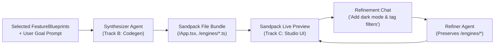

# Agent Specification: Implementation & Frontend Agent (Tracks B & C)

> **Agent Role:** Application Synthesizer & Studio UI/UX Specialist  
> **System Scope:** Fuses extracted `FeatureBlueprint` modules into cohesive React applications, runs them live inside an embedded `@codesandbox/sandpack-react` container, and delivers the split-screen consumer studio interface.  
> **Primary Deliverables:** Synthesis & Refinement engines (`POST /api/synthesize`, `POST /api/refine`), interactive 3D X-Ray cards, streaming terminal, and live Sandpack studio UI.

---

## 1. Role & Objective

The **Implementation & Frontend Agent** drives the consumer experience of Splice. It operates on two tightly coordinated layers:
1. **Track B (The Fusion Engine):** Generates executable React + Tailwind adapter code that wires multiple disparate clean-room engines into a unified application.
2. **Track C (The Studio UI):** Provides a split-screen workspace where users select ingredient apps, watch real-time extraction logs, inspect decompiled X-Ray evidence on 3D cards, and interact with the live running software.

---

## 2. Architecture & Data Flow



---

## 3. Track B: The Synthesis Engine (`synthesizerAgent.ts`)

The Synthesis Engine receives 1–3 `FeatureBlueprint` specifications and a prompt detailing the user's domain goal (e.g., *"Build an interactive medical study dashboard with backlinked notes and spaced repetition intervals"*).

### 3.1. Synthesis Rules & Invariants
- **Engine Immutability:** Each blueprint's `clean_room_implementation.portable_code` MUST be placed untouched into `/engines/<module_name>.ts`. The AI must never rewrite or refactor these reverse-engineered algorithms.
- **Reactive Glue Layer:** In `/App.tsx`, build a cohesive, stateful UI that imports the engine functions, maps user events to engine inputs, and renders engine outputs.
- **Seed Data:** Always populate the initial React state with realistic sample records so the app renders a populated, functional state immediately upon loading.
- **Styling Standards:** Use Tailwind CSS utility classes styled for modern dark/light mode interfaces (clean cards, smooth borders, badge indicators).

### 3.2. Output Schema (`SynthesisResponse`)
```typescript
export interface SynthesisResponse {
  app_title: string;
  app_description: string;
  files: Record<string, string>; // e.g., { "/App.tsx": "...", "/engines/wikiGraphEngine.ts": "..." }
  dependencies: Record<string, string>; // e.g., { "lucide-react": "latest", "canvas-confetti": "latest" }
}
```

### 3.3. Iterative Refinement Loop (`POST /api/refine`)
Allows conversational changes without regenerating the entire project:
- Receives: `{ current_files, blueprints, refine_prompt }`.
- Keeps all files under `/engines/*` completely untouched.
- Modifies `/App.tsx` and child components to implement the user's specific styling or feature update.
- Returns the updated `files` mapping back to the Sandpack runner.

---

## 4. Track C: Studio Layout & Component Architecture

### 4.1. Split-Screen Layout Structure (`packages/frontend/src/App.tsx`)

```
┌────────────────────────────────────────────────────────────────────────────────────────┐
│  [SPLICE] Reverse-Engineered App Studio                    [REA Status: Connected ●]   │
├──────────────────────────────────────────┬─────────────────────────────────────────────┤
│ LEFT COLUMN (45%): HARVESTER & BLENDER   │ RIGHT COLUMN (55%): LIVE SANDPACK STUDIO    │
│                                          │                                             │
│ 1. App Pantry (Select Ingredients):      │ [Tab: Live Preview] [Tab: View Code]        │
│    [x] Obsidian   [x] Anki   [ ] Calc    │ ┌─────────────────────────────────────────┐ │
│                                          │ │  (Sandpack Live Embedded React App)     │ │
│ 2. Feature Prompt & Harvest:             │ │                                         │ │
│    [ "Extract Graph + SM-2 Scheduler" ]  │ │  • Medical Study War Room               │ │
│    [ > Harvest Features (SSE Stream) ]   │ │  • Interactive Wiki Backlinks           │ │
│                                          │ │  • Anki SM-2 Review Buttons             │ │
│ 3. Streaming REA Terminal:               │ └─────────────────────────────────────────┘ │
│    ┌───────────────────────────────────┐ │                                             │
│    │ [15:42:01] analyze_javascript_... │ │ ─────────────────────────────────────────── │
│    │ [15:42:03] decompile 0x140023B80  │ │ Follow-up Refinement:                       │
│    └───────────────────────────────────┘ │ [ "Add dark mode toggle and card tags" ]    │
│                                          │ [ > Refine App ]                            │
│ 4. Feature Card Tray (Flippable Cards):  │                                             │
│    ┌─────────────────┐ ┌───────────────┐ │                                             │
│    │ Obsidian Graph  │ │ Anki Scheduler│ │                                             │
│    │ [X-Ray Flip 🔄] │ │ [X-Ray Flip 🔄]│ │                                             │
│    └─────────────────┘ └───────────────┘ │                                             │
│                                          │                                             │
│ 5. [ ⚡ Fuse & Specialize Application ]   │                                             │
└──────────────────────────────────────────┴─────────────────────────────────────────────┘
```

### 4.2. Key Frontend Components

1. **App Pantry (`components/pantry/AppPantry.tsx`):**
   - Quick ingredient badges for pre-indexed targets (Obsidian, Anki, Windows Calculator).
   - Multi-select toggle state feeding selected app IDs to the harvester.

2. **Real-time SSE Terminal (`components/terminal/SseTerminal.tsx`):**
   - Visual terminal that listens to `POST /api/extract` via `useExtraction`.
   - Displays real-time status pulses, animated tool badges (`analyze_javascript_application`, `decompile`), and execution timestamps.

3. **3D Flippable "X-Ray" Feature Card (`components/cards/FeatureCard.tsx`):**
   - Built with CSS 3D transforms (`[perspective:1000px]`, `[transform-style:preserve-3d]`, `[backface-visibility:hidden]`).
   - **Front Face:** Source app badge, consumer title/description, typed input/output badges, and "Include in Recipe" selection checkbox.
   - **Back Face (X-Ray Mode):** Decompiled C/C++ or AST snippet extracted by REA, artifact type (`native_pe_dll`, `electron_asar`), resolved entry symbols, and confidence score.

4. **Live Sandpack Studio (`components/studio/SandpackPreview.tsx`):**
   - Uses `@codesandbox/sandpack-react` configured with the `react-ts` template.
   - Injects Tailwind CSS script CDN in `/public/index.html` for instant styling.
   - Includes default dependencies (`lucide-react`, `canvas-confetti`).

5. **Refinement Chat (`components/chat/RefineChat.tsx`):**
   - Chat input triggering `POST /api/refine` to iteratively modify the running app without full reload.

---

## 5. Client State Hooks

### `useExtraction.ts` (SSE Stream Consumer)
```typescript
export function useExtraction() {
  const [logs, setLogs] = useState<SseProgressEvent[]>([]);
  const [blueprints, setBlueprints] = useState<FeatureBlueprint[]>([]);
  const [isExtracting, setIsExtracting] = useState(false);

  const startExtraction = async (appId: string, featureQuery: string, useCache = false) => {
    setIsExtracting(true);
    const response = await fetch("/api/extract", {
      method: "POST",
      headers: { "Content-Type": "application/json" },
      body: JSON.stringify({ appId, featureQuery, useCache })
    });

    const reader = response.body?.getReader();
    const decoder = new TextDecoder();

    while (reader) {
      const { done, value } = await reader.read();
      if (done) break;
      const text = decoder.decode(value);
      // Parse SSE lines "data: {...}\n\n"
      for (const line of text.split("\n")) {
        if (line.startsWith("data: ")) {
          const event: SseProgressEvent = JSON.parse(line.slice(6));
          setLogs(prev => [...prev, event]);
          if (event.stage === "complete" && event.data) {
            setBlueprints(prev => [...prev, event.data!]);
          }
        }
      }
    }
    setIsExtracting(false);
  };

  return { logs, blueprints, isExtracting, startExtraction };
}
```

### `useSynthesis.ts` (Sandpack Bundle Manager)
```typescript
export function useSynthesis() {
  const [files, setFiles] = useState<Record<string, string>>({});
  const [isSynthesizing, setIsSynthesizing] = useState(false);

  const synthesize = async (blueprints: FeatureBlueprint[], prompt: string) => {
    setIsSynthesizing(true);
    const res = await fetch("/api/synthesize", {
      method: "POST",
      headers: { "Content-Type": "application/json" },
      body: JSON.stringify({ blueprints, specialization_prompt: prompt })
    });
    const data: SynthesisResponse = await res.json();
    setFiles(data.files);
    setIsSynthesizing(false);
  };

  const refine = async (blueprints: FeatureBlueprint[], refinePrompt: string) => {
    setIsSynthesizing(true);
    const res = await fetch("/api/refine", {
      method: "POST",
      headers: { "Content-Type": "application/json" },
      body: JSON.stringify({ current_files: files, blueprints, refine_prompt: refinePrompt })
    });
    const data: SynthesisResponse = await res.json();
    setFiles(data.files);
    setIsSynthesizing(false);
  };

  return { files, isSynthesizing, synthesize, refine };
}
```

---

## 6. Synthesis LLM Prompt Template

```markdown
You are the Splice Synthesis Engine.
You receive multiple reverse-engineered TypeScript engines (FeatureBlueprints) and a user's target application specification.

Your task is to synthesize these extracted mechanics into a complete, beautiful, working React + Tailwind web application running inside Sandpack.

RULES:
1. Place each blueprint's portable_code into its own file under `/engines/<moduleName>.ts`. NEVER modify the algorithmic code inside these engines. Treat them as immutable ground truth.
2. In `/App.tsx`, build a cohesive, interactive UI with sample seed data pre-populated.
3. Wire user interactions directly to the imported engine functions.
4. Use Tailwind CSS for modern aesthetics (slate dark theme, clean cards, subtle borders, rounded badges, clean typography).
5. Output MUST be strictly valid JSON matching this schema:
{
  "app_title": "string",
  "app_description": "string",
  "files": {
    "/App.tsx": "code string",
    "/engines/engine1.ts": "code string",
    "/engines/engine2.ts": "code string"
  },
  "dependencies": {
    "lucide-react": "latest",
    "canvas-confetti": "latest"
  }
}
```

