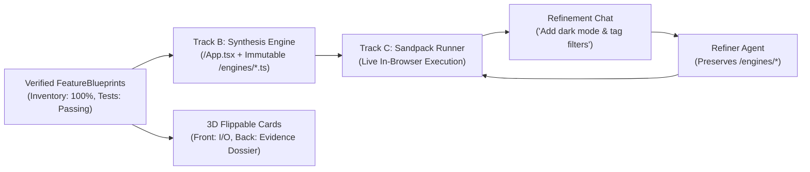
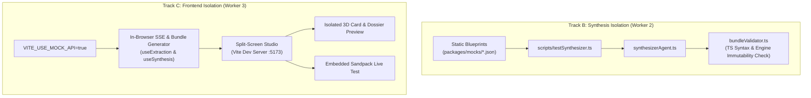

# Agent Specification: Implementation & Frontend Agent (Tracks B & C)

> **Agent Role:** Application Synthesizer & Studio UI/UX Specialist  
> **System Scope:** Fuses verified clean-room `FeatureBlueprint` modules into cohesive React applications, embeds them inside an active `@codesandbox/sandpack-react` runner, and provides a consumer studio featuring 3D X-Ray cards with deep evidence dossiers.  
> **Primary Deliverables:** Synthesis & Refinement engines (`POST /api/synthesize`, `POST /api/refine`), interactive 3D X-Ray cards with verification metrics, deep evidence inspection drawer, streaming terminal, and live Sandpack studio UI.

---

## 1. Role & Objective

The **Implementation & Frontend Agent** brings reverse-engineered algorithms into production reality:
1. **Track B (The Fusion Engine):** Generates executable React + Tailwind adapter code that combines disparate, verified clean-room engines into a unified application.
2. **Track C (The Studio UI):** Provides a split-screen studio where users select ingredients, observe real-time extraction and sandbox verification in an SSE terminal, inspect verified inventories on 3D X-Ray cards, and interact with the live running software.



---

## 2. Track B: The Fusion & Synthesis Engine (`synthesizerAgent.ts`)

The Synthesis Engine receives 1–3 verified `FeatureBlueprint` specifications and a prompt detailing the user's domain goal (e.g., *"Build an interactive medical study dashboard with backlinked notes and spaced repetition intervals"*).

### 2.1. Strict Invariants
- **Engine Immutability:** Each blueprint's `clean_room_implementation.portable_code` (including all inlined callee helpers) MUST be placed untouched into `/engines/<module_name>.ts`. The AI must never rewrite or refactor these reverse-engineered algorithms.
- **Reactive State Glue:** `/App.tsx` imports the engine functions, maps user events to engine inputs, and renders engine outputs.
- **Seed Data:** Initial React state is populated with realistic domain records so the app renders immediately upon loading.
- **Styling:** Standard Tailwind CSS utility classes styled for clean dark/light mode interfaces.

### 2.2. Sandpack File Structure
```
/App.tsx                     # Generated reactive UI and adapter state
/engines/wikiGraphEngine.ts  # Verified clean-room Obsidian backlink engine
/engines/sm2Scheduler.ts     # Verified clean-room Anki SM-2 repetition engine
/styles.css                  # Custom Tailwind overrides
/public/index.html           # Tailwind CDN & base HTML template
```

### 2.3. Output Contract (`SynthesisResponse`)
```typescript
export interface SynthesisResponse {
  app_title: string;
  app_description: string;
  files: Record<string, string>;
  dependencies: Record<string, string>;
}
```

### 2.4. Follow-Up Refinement Loop (`POST /api/refine`)
Allows conversational changes without regenerating the entire project:
- Receives: `{ current_files, blueprints, refine_prompt }`.
- Keeps all files under `/engines/*` completely untouched.
- Modifies `/App.tsx` and child components to implement the user's specific styling or feature update.
- Returns the updated `files` mapping back to the Sandpack runner.

---

## 3. Track C: Studio Layout & Component Architecture

### 3.1. Split-Screen Layout (`packages/frontend/src/App.tsx`)

```
┌────────────────────────────────────────────────────────────────────────────────────────┐
│  [SPLICE] Reverse-Engineered App Studio                    [REA Status: Connected ●]   │
├──────────────────────────────────────────┬─────────────────────────────────────────────┤
│ LEFT COLUMN (45%): HARVESTER & BLENDER   │ RIGHT COLUMN (55%): LIVE SANDPACK STUDIO    │
│                                          │                                             │
│ 1. App Pantry (Select Ingredients):      │ [Tab: Live Preview] [Tab: View Code]        │
│    [x] Obsidian   [x] Anki   [ ] Calc    │ ┌─────────────────────────────────────────┐ │
│                                          │ │  (Sandpack Live Embedded React App)     │ │
│ 2. Feature Prompt & Harvest:             │ │                                         │ │
│    [ "Extract Graph + SM-2 Scheduler" ]  │ │  • Medical Study War Room               │ │
│    [ > Harvest Features (SSE Stream) ]   │ │  • Interactive Wiki Backlinks           │ │
│                                          │ │  • Anki SM-2 Review Buttons             │ │
│ 3. Streaming REA Terminal:               │ └─────────────────────────────────────────┘ │
│    ┌───────────────────────────────────┐ │                                             │
│    │ [15:42:01] Sifting callee...      │ │ ─────────────────────────────────────────── │
│    │ [15:42:03] Sandbox: 4/4 Passed    │ │ Follow-up Refinement:                       │
│    └───────────────────────────────────┘ │ [ "Add dark mode toggle and card tags" ]    │
│                                          │ [ > Refine App ]                            │
│ 4. Feature Card Tray (Flippable Cards):  │                                             │
│    ┌─────────────────┐ ┌───────────────┐ │                                             │
│    │ Obsidian Graph  │ │ Anki Scheduler│ │                                             │
│    │ [X-Ray Flip 🔄] │ │ [X-Ray Flip 🔄]│ │                                             │
│    └─────────────────┘ └───────────────┘ │                                             │
│                                          │                                             │
│ 5. [ ⚡ Fuse & Specialize Application ]   │                                             │
└──────────────────────────────────────────┴─────────────────────────────────────────────┘
```

---

## 4. The 3D Flippable "X-Ray" Card with Evidence Dossier

Judges inspect the authenticity of reverse-engineered features via the 3D flippable card and its deep evidence drawer:

### Card Front
- Source application badge & consumer title/description.
- Typed input/output parameter pills.
- "Include in Recipe" selection toggle.

### Card Back (X-Ray Mode)
- **Provenance Badges:**
  - `Inventory: 100% Covered`
  - `Body Fingerprint: Verified [0x9f8c...]`
  - `Sandbox: 4/4 Assertions Passed`
- Decompiled snippet in syntax-highlighted block.
- **"Inspect Deep Dossier" button** opening the evidence drawer.

### 4.1. Implementation (`FeatureCard.tsx`)

```tsx
import React, { useState } from "react";
import { FeatureBlueprint } from "@splice/contracts";
import { Cpu, CheckCircle2, ShieldCheck, FileCode, Layers, ExternalLink } from "lucide-react";
import { EvidenceDossierModal } from "./EvidenceDossierModal";

export const FeatureCard: React.FC<{
  blueprint: FeatureBlueprint;
  selected: boolean;
  onToggle: () => void;
}> = ({ blueprint, selected, onToggle }) => {
  const [flipped, setFlipped] = useState(false);
  const [showDossier, setShowDossier] = useState(false);

  return (
    <>
      <div className="relative w-full h-80 [perspective:1000px] select-none">
        <div
          className={`w-full h-full duration-500 [transform-style:preserve-3d] transition-transform ${
            flipped ? "[transform:rotateY(180deg)]" : ""
          }`}
        >
          {/* FRONT OF CARD */}
          <div className="absolute inset-0 bg-slate-900 border border-slate-800 rounded-xl p-4 flex flex-col justify-between [backface-visibility:hidden] shadow-xl">
            <div>
              <div className="flex items-center justify-between mb-2">
                <span className="text-xs font-semibold px-2 py-0.5 rounded bg-indigo-950 text-indigo-300 border border-indigo-800">
                  {blueprint.source_app}
                </span>
                <button
                  onClick={(e) => { e.stopPropagation(); setFlipped(true); }}
                  className="text-xs text-amber-400 hover:text-amber-300 flex items-center gap-1 bg-amber-950/40 px-2 py-0.5 rounded border border-amber-800/50"
                >
                  <Cpu className="w-3 h-3" /> X-Ray Evidence
                </button>
              </div>
              <h3 className="font-bold text-slate-100 text-sm mb-1">{blueprint.consumer_title}</h3>
              <p className="text-xs text-slate-400 line-clamp-2">{blueprint.consumer_description}</p>

              <div className="mt-3 space-y-1">
                <div className="text-[11px] text-slate-400 font-medium">Inputs:</div>
                <div className="flex flex-wrap gap-1">
                  {blueprint.clean_room_implementation.inputs.map((inp, i) => (
                    <span key={i} className="text-[10px] bg-slate-800 text-slate-300 px-1.5 py-0.5 rounded border border-slate-700">
                      {inp.name}: {inp.type}
                    </span>
                  ))}
                </div>
              </div>
            </div>

            <button
              onClick={onToggle}
              className={`w-full py-1.5 px-3 rounded text-xs font-medium flex items-center justify-center gap-1.5 transition-colors ${
                selected
                  ? "bg-emerald-600 text-white hover:bg-emerald-500"
                  : "bg-slate-800 text-slate-300 hover:bg-slate-700"
              }`}
            >
              <CheckCircle2 className="w-3.5 h-3.5" />
              {selected ? "Selected for Fusion" : "Include in Recipe"}
            </button>
          </div>

          {/* BACK OF CARD: X-RAY REA EVIDENCE & VERIFICATION BADGES */}
          <div className="absolute inset-0 bg-slate-950 border border-amber-600/50 rounded-xl p-4 flex flex-col justify-between [transform:rotateY(180deg)] [backface-visibility:hidden] shadow-2xl">
            <div>
              <div className="flex items-center justify-between mb-2">
                <span className="text-xs font-mono font-bold text-amber-400 flex items-center gap-1">
                  <Cpu className="w-3.5 h-3.5" /> REA Provenance
                </span>
                <button
                  onClick={(e) => { e.stopPropagation(); setFlipped(false); }}
                  className="text-xs text-slate-400 hover:text-slate-200"
                >
                  Back ✕
                </button>
              </div>

              {/* RIGOROUS VERIFICATION BADGES */}
              <div className="grid grid-cols-2 gap-1.5 mb-2">
                <div className="bg-slate-900 border border-slate-800 px-2 py-1 rounded text-[10px] text-emerald-400 flex items-center gap-1">
                  <ShieldCheck className="w-3 h-3 text-emerald-400" />
                  Inventory: {blueprint.rea_evidence.inventory_coverage.total_percentage}% Covered
                </div>
                <div className="bg-slate-900 border border-slate-800 px-2 py-1 rounded text-[10px] text-emerald-400 flex items-center gap-1">
                  <FileCode className="w-3 h-3 text-emerald-400" />
                  Sandbox: {blueprint.clean_room_implementation.test_results.passed_tests}/{blueprint.clean_room_implementation.test_results.total_tests} Passed
                </div>
              </div>

              <div className="bg-black/80 rounded p-2 border border-slate-800 overflow-x-auto max-h-28 text-[10px] font-mono text-emerald-400 leading-tight">
                <pre>{blueprint.rea_evidence.decompiled_snippet}</pre>
              </div>
            </div>

            <div className="flex items-center justify-between pt-2 border-t border-slate-800">
              <span className="text-[10px] text-slate-500 font-mono">
                Fingerprint: {blueprint.rea_evidence.body_fingerprint.slice(0, 10)}...
              </span>
              <button
                onClick={(e) => { e.stopPropagation(); setShowDossier(true); }}
                className="text-[11px] text-amber-400 hover:text-amber-300 font-medium flex items-center gap-1 underline"
              >
                Inspect Deep Dossier <ExternalLink className="w-3 h-3" />
              </button>
            </div>
          </div>
        </div>
      </div>

      {showDossier && (
        <EvidenceDossierModal
          blueprint={blueprint}
          onClose={() => setShowDossier(false)}
        />
      )}
    </>
  );
};
```

---

## 5. The Deep Evidence Dossier Modal (`EvidenceDossierModal.tsx`)

Displays the full audit trail when judges or engineers click **"Inspect Deep Dossier"**:
1. **Inventory Coverage Matrix:** Table detailing parameters, local variable fingerprints, and referenced globals.
2. **Function Sifting & Callee Contracts:** Tree of inlined helper routines and callee contracts.
3. **Automated Verification Sandbox Log:** Real-time log showing each test assertion executed and verified by the test sandbox.
4. **Decompiled vs Clean-Room Diff:** Side-by-side view comparing raw decompiled C/AST against synthesized portable TypeScript.

---

## 6. Sandpack Runner (`SandpackPreview.tsx`)

Runs the fused micro-app in an active sandbox with responsive Tailwind styling and hot reloading:

```tsx
import React from "react";
import { Sandpack } from "@codesandbox/sandpack-react";

export const SandpackPreview: React.FC<{
  files: Record<string, string>;
  dependencies?: Record<string, string>;
}> = ({ files, dependencies = {} }) => {
  return (
    <div className="h-full w-full rounded-xl overflow-hidden border border-slate-800 shadow-2xl">
      <Sandpack
        template="react-ts"
        theme="dark"
        files={{
          ...files,
          "/public/index.html": `<!DOCTYPE html>
<html>
<head>
  <meta charset="utf-8" />
  <script src="https://cdn.tailwindcss.com"></script>
</head>
<body class="bg-slate-900 text-slate-100 min-h-screen">
  <div id="root"></div>
</body>
</html>`
        }}
        customSetup={{
          dependencies: {
            "lucide-react": "^0.344.0",
            "canvas-confetti": "^1.9.2",
            ...dependencies
          }
        }}
        options={{
          showNavigator: false,
          showTabs: true,
          showLineNumbers: true,
          editorHeight: "100%",
          resizablePanels: true
        }}
      />
    </div>
  );
};
```

---

## 7. Parallelization & Decoupled Initial Building (Tracks B & C)

To enable the AI Synthesis Engineer (Worker 2) and the Studio Frontend Engineer (Worker 3) to build and test at full speed without waiting for Track A's live harvester or a running backend, both tracks employ decoupled mock harnesses.



---

### 7.1. Track B: Isolated Synthesis Building & Headless Validation

#### Step 1: Input Fixtures (`packages/mocks/`)
Worker 2 relies strictly on verified static blueprint fixtures:
- `packages/mocks/obsidian_graph_parser.json`
- `packages/mocks/anki_sm2_scheduler.json`
- `packages/mocks/calc_percentage_engine.json`

#### Step 2: Headless Bundle Validator (`packages/backend/src/synthesis/bundleValidator.ts`)
Validates that generated Sandpack bundles will compile and run with 0 errors before Sandpack is even mounted:

```typescript
import ts from "typescript";
import { FeatureBlueprint, SynthesisResponse } from "@splice/contracts";

export function validateSandpackBundle(
  blueprints: FeatureBlueprint[],
  response: SynthesisResponse
): { valid: boolean; errors: string[] } {
  const errors: string[] = [];

  // 1. Mandatory File Presence Check
  if (!response.files["/App.tsx"]) errors.push("Missing /App.tsx");
  if (!response.files["/public/index.html"]) errors.push("Missing /public/index.html");

  // 2. Engine Immutability Check
  for (const bp of blueprints) {
    const expectedPath = `/engines/${bp.clean_room_implementation.module_name}.ts`;
    const actualCode = response.files[expectedPath];
    if (!actualCode) {
      errors.push(`Missing immutable engine file: ${expectedPath}`);
    } else if (actualCode.trim() !== bp.clean_room_implementation.portable_code.trim()) {
      errors.push(`CRITICAL: Synthesizer modified immutable engine code in ${expectedPath}!`);
    }
  }

  // 3. TypeScript Compilation & Syntax Check
  for (const [filePath, code] of Object.entries(response.files)) {
    if (filePath.endsWith(".ts") || filePath.endsWith(".tsx")) {
      const sourceFile = ts.createSourceFile(
        filePath,
        code,
        ts.ScriptTarget.ES2022,
        true,
        filePath.endsWith(".tsx") ? ts.ScriptKind.TSX : ts.ScriptKind.TS
      );
      // Scan for structural parse errors
      const parseDiagnostics = (sourceFile as any).parseDiagnostics || [];
      if (parseDiagnostics.length > 0) {
        errors.push(`TypeScript parse error in ${filePath}: ${parseDiagnostics[0].messageText}`);
      }
    }
  }

  return { valid: errors.length === 0, errors };
}
```

#### Step 3: Standalone CLI Synthesis Test Harness (`packages/backend/src/scripts/testSynthesizer.ts`)
```typescript
import fs from "fs/promises";
import path from "path";
import { synthesizeApplication } from "../synthesis/synthesizerAgent.js";
import { validateSandpackBundle } from "../synthesis/bundleValidator.js";
import { FeatureBlueprint } from "@splice/contracts";

async function runSynthesisTest() {
  console.log("=== [Track B] Testing Synthesis Engine in Isolation ===");

  // 1. Load mock blueprints
  const obsidianJson: FeatureBlueprint = JSON.parse(
    await fs.readFile(path.resolve("../../packages/mocks/obsidian_graph_parser.json"), "utf-8")
  );
  const ankiJson: FeatureBlueprint = JSON.parse(
    await fs.readFile(path.resolve("../../packages/mocks/anki_sm2_scheduler.json"), "utf-8")
  );

  const prompt = "Build a medical flashcard review suite that parses [[Wiki]] note links and tracks review dates.";
  console.log(`Fusing 2 blueprints with prompt: "${prompt}"...`);

  // 2. Synthesize bundle
  const response = await synthesizeApplication([obsidianJson, ankiJson], prompt);
  console.log("✓ Synthesis completed. App Title:", response.app_title);
  console.log("Generated files:", Object.keys(response.files));

  // 3. Validate headless bundle
  const validation = validateSandpackBundle([obsidianJson, ankiJson], response);
  if (!validation.valid) {
    console.error("❌ Bundle validation failed with errors:\n", validation.errors.join("\n"));
    process.exit(1);
  }

  console.log("✓ Headless bundle validated: 0 syntax errors, engine immutability preserved!");
  console.log("=== Track B Synthesis Test PASSED ===");
}

runSynthesisTest();
```

---

### 7.2. Track C: Studio Frontend Offline Mock Mode

To allow Worker 3 to build and polish the split-screen UI, 3D card animations, and Sandpack preview with **zero backend server running**, the frontend includes an in-browser mock mode.

#### Step 1: Frontend `.env.development`
```env
VITE_USE_MOCK_API=true
```

#### Step 2: Simulated In-Browser SSE Generator (`packages/frontend/src/hooks/useExtraction.ts`)
```typescript
import { useState } from "react";
import { FeatureBlueprint, SseProgressEvent } from "@splice/contracts";
import obsidianMock from "@splice/mocks/obsidian_graph_parser.json";
import ankiMock from "@splice/mocks/anki_sm2_scheduler.json";

export function useExtraction() {
  const [logs, setLogs] = useState<SseProgressEvent[]>([]);
  const [blueprints, setBlueprints] = useState<FeatureBlueprint[]>([]);
  const [isExtracting, setIsExtracting] = useState(false);

  const startExtraction = async (appId: string, featureQuery: string) => {
    setIsExtracting(true);
    setLogs([]);

    // Check for offline mock mode
    if (import.meta.env.VITE_USE_MOCK_API === "true") {
      const mockBlueprint = appId.includes("anki") ? ankiMock : obsidianMock;
      const stages: Array<{ stage: any; msg: string; tool?: string; ms: number }> = [
        { stage: "analyzing", msg: `Attaching REA analyzer to ${appId}...`, ms: 600 },
        { stage: "inventory_survey", msg: `Surveying exports and building inventory...`, ms: 800 },
        { stage: "sifting_callees", msg: `Sifting callee call chains and inlining helpers...`, ms: 900 },
        { stage: "executing_verification_sandbox", msg: `Executing verification sandbox (4 assertions)...`, ms: 700 },
        { stage: "claim_validated", msg: `Claim Validated: 100% inventory covered, tests passed!`, ms: 500 },
        { stage: "complete", msg: `Extraction complete! Blueprint ready.`, ms: 400 }
      ];

      for (const step of stages) {
        await new Promise(r => setTimeout(r, step.ms));
        const evt: SseProgressEvent = {
          stage: step.stage,
          message: step.msg,
          tool_called: step.tool,
          timestamp: Date.now(),
          data: step.stage === "complete" ? (mockBlueprint as any) : undefined
        };
        setLogs(prev => [...prev, evt]);
        if (evt.stage === "complete" && evt.data) {
          setBlueprints(prev => [...prev, evt.data!]);
        }
      }
      setIsExtracting(false);
      return;
    }

    // LIVE HTTP SSE (when backend is available)
    // ...
  };

  return { logs, blueprints, isExtracting, startExtraction };
}
```

#### Step 3: Standalone Component Isolation Mounts
The frontend includes isolated preview routes in development:
- `http://localhost:5173/?test=card`: Tests 3D card perspective flipping, badge rendering, and the "Inspect Deep Dossier" modal.
- `http://localhost:5173/?test=terminal`: Simulates continuous SSE progress logs with pulse animations.
- `http://localhost:5173/?test=sandpack`: Mounts Sandpack with a pre-baked static file bundle to verify dark theme styling and Tailwind compilation.

---

### 7.3. Step-by-Step CLI Commands for Parallel Teams

```bash
# ==========================================
# TRACK B: AI SYNTHESIS DEVELOPER (Worker 2)
# ==========================================
cd packages/backend
# Run the synthesis test harness against mock blueprints
npm run test:synthesis

# Run the follow-up refinement test harness
npm run test:refine

# ==========================================
# TRACK C: FRONTEND DEVELOPER (Worker 3)
# ==========================================
cd packages/frontend
# Start Vite in offline mock mode (requires 0 backend processes)
VITE_USE_MOCK_API=true npm run dev
# Open http://localhost:5173 in browser
```

---

### 7.4. Independent Acceptance Gates (Definition of Done)

#### Track B (Synthesis) Acceptance Gate
- [ ] `npm run test:synthesis` executes cleanly from terminal.
- [ ] `validateSandpackBundle` asserts 0 TypeScript parse/syntax errors.
- [ ] `/engines/*.ts` algorithmic code remains 100% byte-for-byte identical to input blueprints.
- [ ] `/App.tsx` correctly imports all engine symbols and wires them to React state.

#### Track C (Frontend Studio) Acceptance Gate
- [ ] Frontend boots in 1 second via `VITE_USE_MOCK_API=true npm run dev`.
- [ ] Clicking "Harvest Features" plays a smooth, real-time SSE stream in the terminal.
- [ ] Feature Cards flip smoothly in 3D (`rotateY(180deg)`) and open the Deep Evidence Dossier modal.
- [ ] Clicking "⚡ Fuse & Specialize Application" loads the embedded Sandpack runner without crashing.

