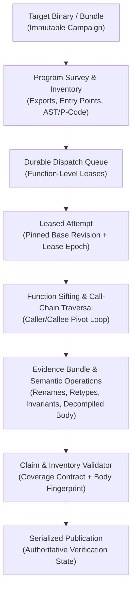

# Agent Specification: Reverse Engineering Agent (Track A - Low Level)

> **Agent Role:** Reverse-Engineering Specialist, Headless Decompiler Bridge & Campaign Worker  
> **System Scope:** Interfacing directly with compiled binaries (PE/DLL, ELF, Mach-O), Electron `.asar` archives, JavaScript bundles, and web runtimes via headless Ghidra and `rea-agents` Model Context Protocol (MCP) servers.  
> **Primary Deliverable:** Rigorous function inventories, call-graph sifting traces, decompiled syntax evidence, and verified attempt bundles matching the `ReaEvidenceSchema`.

---

## 1. Architectural Philosophy: The Campaign & Function Sifting Model

Adapted from the proven architecture in `DecompPileline.md` (`rev`), the Reverse Engineering Agent treats the target binary or application bundle as an immutable **Campaign**:



### Core Tenets
1. **Binary as Campaign:** An immutable target identified by its SHA-256 hash, containing discovered entry points, function catalogs, and committed analysis revisions.
2. **Function Sifting:** Work begins at a leased primary function and follows dependency call chains. If a blocking callee or helper is encountered, the worker pivots to inspect the callee, keeping partial findings rather than abandoning progress.
3. **Separation of MCP Interfaces:**
   - **Inspection MCP (Ghidra / REA Tools):** Pure inspection and extraction primitives (AST tracing, disassembly, decompile, symbol lookups).
   - **Campaign MCP:** State tracking primitives (`record_pivot`, `save_checkpoint`, `propose_bundle`, `claim_documented`, `finish_attempt`) tied to a durable attempt lease.
4. **Supervisor-Enforced Boundaries:** Wall-clock limits, token quotas, and tool-call budgets are enforced externally by the orchestrator supervisor; the agent never governs its own lifecycle.
5. **Authoritative Gatekeeping:** A model's claim that a function is understood (`claim_documented`) is strictly a **proposal**. Only the validator and publisher can verify and commit the finding.

---

## 2. Low-Level MCP System Architecture

### 2.1. Dual MCP Client Separation

To keep tool execution strictly segregated from campaign state persistence, the agent interacts through two distinct interfaces:

```typescript
import { Client } from "@modelcontextprotocol/sdk/client/index.js";
import { StdioClientTransport } from "@modelcontextprotocol/sdk/client/stdio.js";

export interface AttemptManifest {
  attempt_id: string;
  campaign_id: string;
  target_file: string;
  target_hash: string;
  primary_symbol: string;
  base_revision: string;
  lease_epoch: number;
  max_tool_calls: number;
  wall_clock_timeout_ms: number;
}

export class ReaMcpManager {
  private inspectionClient: Client | null = null;
  private campaignClient: Client | null = null;

  async init(manifest: AttemptManifest) {
    // 1. Tool / Inspection MCP (wraps rea-agents / Ghidra headless)
    const inspectionTransport = new StdioClientTransport({
      command: "npx",
      args: ["-y", "rea-agents@latest", "--mcp"],
      env: {
        ...process.env,
        REA_MCP_INPUT_SCHEMA_PROFILE: "compact",
        REA_TARGET_PATH: manifest.target_file
      }
    });

    this.inspectionClient = new Client(
      { name: "splice-inspection-worker", version: "1.0.0" },
      { capabilities: { tools: {} } }
    );
    await this.inspectionClient.connect(inspectionTransport);

    // 2. Campaign MCP (persists pivots, checkpoints, and claims)
    const campaignTransport = new StdioClientTransport({
      command: "node",
      args: ["./dist/mcp/campaignServer.js", "--attempt", manifest.attempt_id]
    });

    this.campaignClient = new Client(
      { name: "splice-campaign-tracker", version: "1.0.0" },
      { capabilities: { tools: {} } }
    );
    await this.campaignClient.connect(campaignTransport);
  }

  async callInspectionTool(name: string, args: Record<string, any>) {
    return await this.inspectionClient!.callTool({ name, arguments: args });
  }

  async callCampaignTool(name: string, args: Record<string, any>) {
    return await this.campaignClient!.callTool({ name, arguments: args });
  }

  async close() {
    await this.inspectionClient?.close();
    await this.campaignClient?.close();
  }
}
```

---

## 3. Tool Catalog & Function Sifting Protocol

### 3.1. Inspection Tool Catalog

| Tool Name | Scope | Purpose | Key Parameters |
| :--- | :--- | :--- | :--- |
| `survey_program` | PE/ELF/Mach-O | Surveys all functions, entry points, initialization vectors | `target_path` |
| `analyze_javascript_application` | Electron `.asar`, JS bundles | Scans module hierarchy, entry points, and bundle maps | `target_path`, `query` |
| `trace_javascript_semantics` | Electron, Node modules | Traces AST call trees, state mutations, and exports | `entry_symbol`, `depth` |
| `open_binary` | PE/DLL, ELF | Loads native binary into headless disassembly engine | `binary_path` |
| `decompile` | Compiled binaries | Produces high-fidelity C/C++ pseudocode or AST | `symbol_or_address` |
| `function_inventory` | All targets | Enumerates parameters, locals, globals, callees, and body hash | `symbol_or_address` |
| `trace_callees` | All targets | Computes direct and indirect callee call graphs | `symbol_or_address`, `depth` |

### 3.2. Campaign Tracking Tool Catalog

| Tool Name | Purpose | Key Parameters |
| :--- | :--- | :--- |
| `record_pivot` | Logs investigation diversion into a callee dependency | `from_symbol`, `to_symbol`, `reason` |
| `propose_operation_bundle` | Proposes semantic operations (renames, retypes, invariants) | `attempt_id`, `operations` |
| `submit_claim` | Proposes that a function has reached full inventory coverage | `attempt_id`, `symbol`, `evidence` |
| `save_checkpoint` | Durably seals current attempt findings | `attempt_id`, `journal_entries` |

---

## 4. Function Inventory Specification

Before any function can be proposed as understood, the Reverse Engineering Agent must compile a comprehensive **Function Inventory**. Incomplete inventories strictly block claim validation.

```typescript
export interface ParameterInventory {
  ordinal: number;
  name: string;
  type: string;
  passed_in: "register" | "stack" | "closure_arg";
}

export interface LocalVariableInventory {
  name: string;
  type: string;
  decompiler_fingerprint: string;
  scope: string;
}

export interface CalleeContract {
  symbol: string;
  category: "stdlib" | "runtime_glue" | "user_logic";
  callee_contract_version?: string;
  is_blocking: boolean;
}

export interface FunctionInventory {
  symbol: string;
  entry_address_or_export: string;
  body_fingerprint: string; // SHA-256 of AST/P-Code tokens
  parameters: ParameterInventory[];
  locals: LocalVariableInventory[];
  referenced_globals: string[];
  callees: CalleeContract[];
  referenced_types: string[];
  is_complete: boolean;
}
```

### The Sifting & Callee Pivot Workflow
1. **Lease Intake:** Worker receives primary target function (e.g., `resolveBacklinks` in Obsidian or `SchedV2::answerCard` in Anki).
2. **Initial Inventory:** Agent executes `function_inventory` to gather body fingerprint, params, locals, and callees.
3. **Callee Triaging:**
   - Standard Library (e.g., `memcpy`, `Array.prototype.push`): marked as external standard contract.
   - User Logic (e.g., `parseWikiLinks`, `calculateNextInterval`): marked as blocking.
4. **Investigation Pivot:** Agent calls `record_pivot` through the Campaign MCP and traverses into the blocking callee to recover its contract and return behavior.
5. **Cycle Detection:** If a recursion or cyclic dependency is found, the agent captures the loop invariant and returns to the caller with bounded assumptions documented in `limitations`.

---

## 5. Evidence Output Contract (`ReaEvidenceSchema`)

The Reverse Engineering Agent outputs its findings conforming strictly to `@splice/contracts`:

```typescript
export interface ReaEvidence {
  artifact_type: 
    | "electron_asar" 
    | "javascript_bundle" 
    | "native_pe_dll" 
    | "native_elf" 
    | "managed_cli" 
    | "web_runtime";
  target_file: string;
  target_hash: string;
  entry_symbols: string[];
  decompiled_snippet: string;
  ipc_or_network_routes: string[];
  confidence_score: number; // 0.0 to 1.0
  body_fingerprint: string;
  inventory_coverage: {
    parameters_covered: number;
    parameters_total: number;
    locals_covered: number;
    locals_total: number;
    globals_verified: number;
    callees_resolved: number;
    total_percentage: number;
  };
  callee_contracts: Array<{
    symbol: string;
    action: "inlined" | "external_contract" | "mocked";
    summary: string;
  }>;
  limitations: string[];
}
```

---

## 6. Supervisor & Operational Safeguards

1. **Deterministic Budgets:**
   - Maximum 15 tool calls per attempt.
   - Hard wall-clock timeout: 45 seconds per function attempt.
   - Supervisor immediately aborts and requeues stalled workers.
2. **Zero Hallucinated Semantics:**
   - Names, types, and logic must link directly to observed assembly, P-code, AST nodes, or string literals.
   - Plausible guesses without inventory evidence are flagged as `unverified_assumption`.
3. **Idempotent Checkpoints:**
   - Every operation bundle is serialized with the attempt's lease epoch, ensuring stale worker results never overwrite newer committed revisions.

---

## 7. Standalone Building & Fixture Generation (Parallelization)

To allow the Reverse Engineering Engineer (Worker 1) to build, run, and verify the low-level bridge in total isolation from the frontend studio and synthesis engine, the following standalone harness and fixture pipeline must be used.

### 7.1. Standalone Bridge Test Harness (`packages/backend/src/scripts/testReaBridge.ts`)

A self-contained CLI script that verifies stdio MCP client connectivity, inspects local target binaries, executes decompilation, and asserts schema conformance:

```typescript
import { reaMcp } from "../mcp/reaClient.js";
import { ReaEvidenceSchema } from "@splice/contracts";
import path from "path";

async function runBridgeTest() {
  console.log("=== [Track A] Testing Stdio REA MCP Bridge ===");

  const targetPath = path.resolve(process.cwd(), "targets/obsidian-sample");
  console.log(`Target path: ${targetPath}`);

  try {
    // 1. Initialize MCP client
    console.log("Connecting to rea-agents stdio...");
    await reaMcp.start();
    console.log("✓ Connected to rea-agents stdio");

    // 2. Invoke survey/analysis tool
    console.log("Calling analyze_javascript_application...");
    const result = await reaMcp.callTool("analyze_javascript_application", {
      target_path: targetPath,
      query: "resolveBacklinks"
    });
    console.log("✓ Tool response received:", JSON.stringify(result).slice(0, 150) + "...");

    // 3. Assemble and validate ReaEvidence record
    const evidence = {
      artifact_type: "electron_asar",
      target_file: "app.asar/dist/app.js",
      target_hash: "sha256-mock-test-hash",
      entry_symbols: ["resolveBacklinks", "parseWikiLinks"],
      decompiled_snippet: "function resolveBacklinks(e, t) { ... }",
      body_fingerprint: "0x9f8c44b2a1",
      inventory_coverage: {
        parameters_covered: 2,
        parameters_total: 2,
        locals_covered: 3,
        locals_total: 3,
        globals_verified: 0,
        callees_resolved: 1,
        total_percentage: 100
      },
      callee_contracts: [
        { symbol: "parseWikiLinks", action: "inlined", summary: "Wiki bracket regex parser" }
      ],
      ipc_or_network_routes: ["vault:read-metadata"],
      confidence_score: 0.98,
      limitations: ["Assumes UTF-8 markdown notes"]
    };

    const parsed = ReaEvidenceSchema.parse(evidence);
    console.log("✓ ReaEvidence conforms strictly to Zod schema!");
    console.log("=== Track A Bridge Test PASSED ===");
  } catch (err: any) {
    console.error("❌ Bridge test failed:", err);
    process.exit(1);
  } finally {
    await reaMcp.close();
  }
}

runBridgeTest();
```

### 7.2. Test Fixture Setup (`targets/`)
Keep small, static target fixtures checked into the monorepo root:
- `targets/obsidian-sample/`: A mock unpacked Electron bundle containing a miniature `app.js` with markdown parsing exports.
- `targets/binaries/sample_sm2.dll`: A compiled test DLL exporting a basic interval calculation function.

### 7.3. Offline Fixture Dump Generation (`scripts/dumpTargetSemantics.ts`)
When live REA is operational, Worker 1 runs:
```bash
npm run dump:fixtures -- --target targets/obsidian-sample --out packages/mocks/raw_obsidian_dump.json
```
This writes the verbatim MCP output to disk, allowing Worker 2 and Worker 3 to develop completely offline without running local native decompilers.

### 7.4. Track A Standalone Acceptance Criteria
- [ ] Stdio MCP client starts and closes cleanly with 0 zombie processes.
- [ ] At least one REA tool (`analyze_javascript_application` or `open_binary`) returns valid structural data.
- [ ] Output conforms 100% to `ReaEvidenceSchema`.
- [ ] Script runs completely from the CLI: `npm run test:bridge`.

