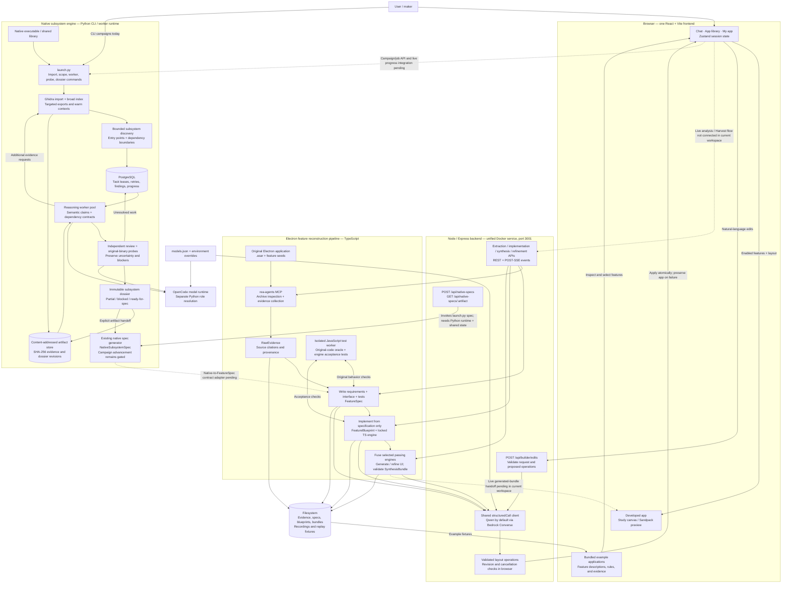
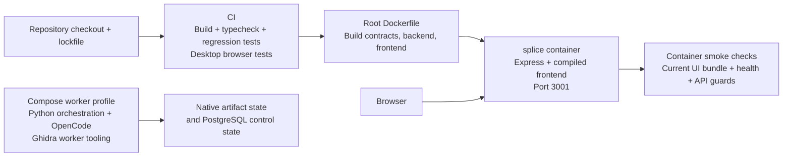

# Splice end-to-end architecture

Code snapshot: 2026-10-24. Solid arrows describe implemented relationships, not
proof of successful live end-to-end acceptance. Dashed arrows identify unfinished
product integration or contract handoffs.

## Reading the boundaries

- **One frontend:** `packages/frontend/src/App.tsx` mounts `IdeWorkbench`. Old
  components are retained source, not separately deployed frontends. Production
  Express serves Vite's compiled assets on port 3001. Development Vite runs on
  port 5173 and proxies API requests to Express.
- **Current UI:** the library uses bundled fixtures. Chat calls the builder API;
  valid operations change presentation while engines remain locked. The current
  IDE state survives view changes in the session, not necessarily page reloads.
- **Electron pipeline:** Step 2 and Step 3 dependencies are wired in code. The
  sandbox checks original behavior and reconstructed implementations separately.
  Purity, type conformance, test results, and bundle validation constrain output.
  Backend wiring and tests do not establish live full-pipeline acceptance.
- **Native engine:** PostgreSQL controls durable work; immutable files hold evidence.
  Scope expansion, targeted analysis, review, and probes can create further work.
  Parallel leases have been demonstrated; full scale, quality, and recovery gates
  remain open. Partial evidence produces a partial dossier.
- **Native specification bridge:** the route and generator exist. A native
  specification is a different contract from `FeatureSpec`; it does not yet feed
  the TS implementation/fusion pipeline. The root Node Dockerfile does not package
  the Python engine or its state; the bridge requires the appropriate runtime and
  shared artifact access. Campaign specification generation remains gated by the
  engine implementation plan.
- **Models:** Splice's spec, engine, UI, and refusal-fallback defaults use Qwen via
  the shared Bedrock client. Explicit Claude overrides retain their separate API
  path. Native workers use OpenCode and Python role routing; do not assume every
  native model call uses the Splice Qwen path.

## Deployment and verification

The Node image and native worker runtime are separate deployment concerns. The
Compose worker service defaults to CLI help, not an automatically running native
campaign or a fully provisioned multi-host worker fleet.

## Source anchors

- Browser: `packages/frontend/src/ide/IdeWorkbench.tsx`, `store/useIdeStore.ts`, `data/ideFixtures.ts`.
- API mounting / static assets: `packages/backend/src/server.ts`.
- Extraction / oracle: `packages/backend/src/routes/step2/index.ts`, `spec/buildSpec.ts`, `sandbox/runTests.ts`.
- Reconstruction / fusion: `packages/backend/src/routes/step3/deps.ts`, `engine/implement.ts`, `synthesis/`.
- Layout editing: `packages/backend/src/builder/edits.ts`, `packages/contracts/src/builder.ts`.
- Native bridge: `packages/backend/src/routes/nativeSpecs.ts`, `packages/contracts/src/nativeSpec.ts`.
- Native analysis and control: `launch.py`, `engine/analysis/`, `engine/queue.py`, `engine/worker.py`, `engine/validation/`, `engine/dossier.py`.
- Native design and execution gate: `DecompPileline.md`, `DECOMP_IMPLEMENTATION_PLAN.md`.
- Deployment: `Dockerfile`, `worker.Dockerfile`, `compose.yaml`, `.github/workflows/ci.yml`.
