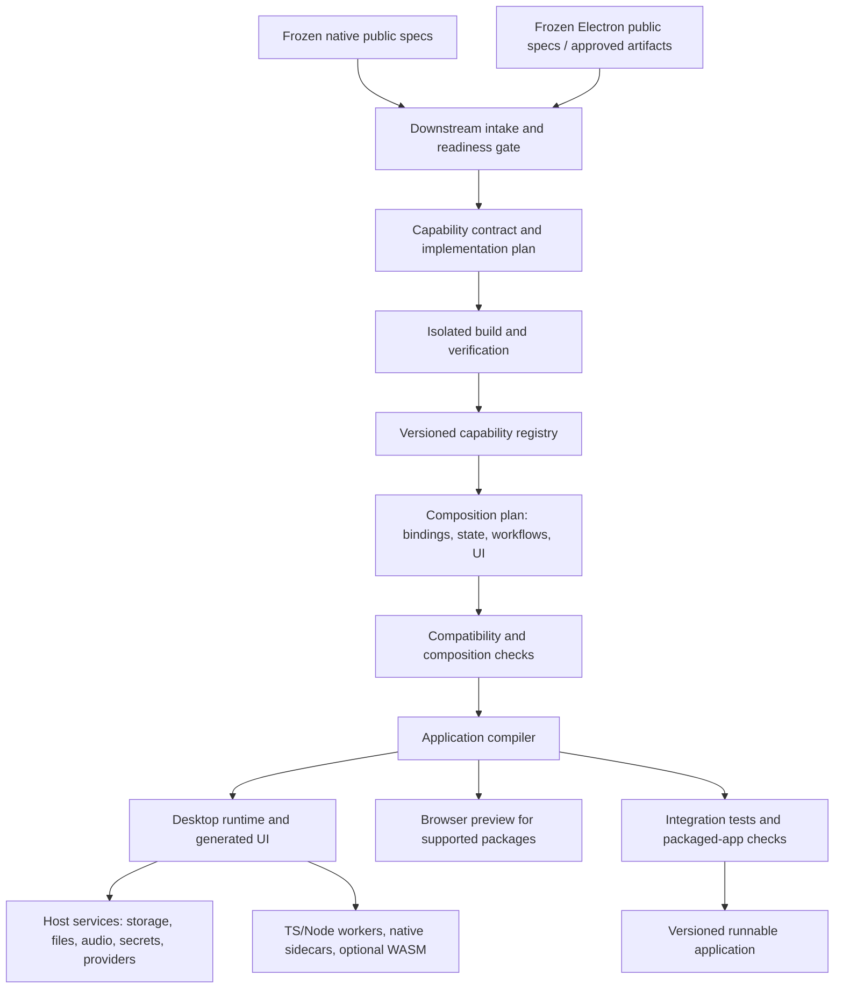

# Splice: completing cross-application recombination

Planning baseline: `8b2f97d`, reviewed 2026-10-27. This is a proposed downstream
implementation plan, not a claim that the described runtime exists.

**Recommendation:** make a verified capability package the reusable unit, and build
a composition compiler plus a desktop runtime around those packages. The existing
pure-TypeScript pipeline becomes one supported implementation path. Native,
stateful Electron, rendering, and remote-service capabilities need additional paths.

The product outcome is a new application with shared documents and connected
workflows. Selecting three features must produce behavior that crosses all three
boundaries, survives restart, and ships as a runnable application.

## 1. Scope and upstream boundary

Native and Electron decompilation, discovery, evidence collection, and specification
generation are frozen for this work. Consume immutable outputs through downstream
adapters. Do not change their schemas or ask those engineers to restructure their
pipelines to begin implementation.

The downstream team owns specification consumption, implementation, packaging,
composition, runtime services, UI generation, verification, and export. If an input
omits consequential behavior, record the missing prerequisite and return a precise
question to its owner. Do not manufacture behavior or promote an incomplete artifact.

Use public behavioral specs and permitted examples for implementation. Preserve
analyst-only evidence and independent evaluation behind their existing boundary.
The review requirements in [the native handoff](NATIVE_CLEANROOM_HANDOFF.md) remain
applicable; `ready_for_review` is not a recorded approval to implement.

Source application technology and implementation technology are separate choices:
a native-origin capability may be rebuilt in TypeScript, C, or another supported
language. An Electron-origin capability may require filesystem state, streaming,
or a remote service. Original application binaries are not the default runtime dependency.

## 2. What exists, and what prevents the full vision

The onboarding and milestone documents contain historical status. In particular,
the current [Step 3 dependencies](../packages/backend/src/routes/step3/deps.ts) are
wired to the LLM, sandbox, and streaming helpers; they are not still null stubs.
The following findings come from current source inspection, not a fresh live run.

| Area | Existing foundation | Remaining gap |
| --- | --- | --- |
| Engine generation | [Implementation and repair loop](../packages/backend/src/engine/implement.ts), purity checks, interface checks, acceptance execution | One import-free TypeScript module; no general multi-file/native build artifact or effectful component lifecycle |
| Native ingestion | [Native adapter](../packages/backend/src/native/nativeAdapter.ts) and API/UI path to implementation | Falls back to `any` interfaces and `assert.ok(true)` tests; can label a review-ready native spec verified without behavioral assertions for every requirement |
| Feature fusion | [Synthesis](../packages/backend/src/synthesis/synthesize.ts) locks engine bytes and generates React | The prompt asks engines to feed each other, but there is no typed composition graph, binding contract, shared-state ownership, or workflow test |
| API generation | [Router/client generator](../packages/backend/src/engine/apiGenerator.ts) exists | No production callers found; signature parsing is textual, complex values fall back to unknown, and output validation is absent |
| Persistence | [Backend generator](../packages/backend/src/synthesis/persistenceGenerator.ts) emits CRUD routes | Storage is an in-memory Map; entities are deduplicated by name; no durable transactions, migrations, or integration with generated UI operations |
| Bundle validation | [Validator](../packages/backend/src/synthesis/validateBundle.ts) checks engine identity, imports, client compilation | Import presence is not proof of execution; server files receive syntax checks, not complete compilation and runtime tests |
| Refinement | [Refine loop](../packages/backend/src/synthesis/refine.ts) preserves locked engines | Reassembles the client bundle without carrying forward or regenerating `backend_paths`, so backend functionality can disappear |
| Desktop export | [Electron exporter](../packages/frontend/src/lib/electronProject.ts) builds a local React renderer | Reads client files only; no capability host, native artifacts, preload service API, or generated backend startup; current policy denies permissions and network connections |
| Studio/library | Saved blocks, native candidates, pipeline test bench, and IDE views exist | [IDE state](../packages/frontend/src/ide/store/useIdeStore.ts) still relies heavily on bundled fixtures; [StudioView](../packages/frontend/src/ide/views/StudioView.tsx) contains feature logic; a general runtime-backed project is missing |
| Other implementation paths | [Electron reconstruction](../scripts/electron/project.mjs) assembles IPC modules; native cleanroom workbench can compile candidates | Useful upstream outputs, but no common package contract connects these artifacts to Studio fusion |

The current [contracts](../packages/contracts/src/synthesis.ts) cap synthesis at four
blueprints, use a fixed browser dependency allowlist, and describe a client file map
with an attached backend map. Simply removing the cap will not make composition general.

**First fixes:** stop vacuous verification, preserve complete runtime artifacts through
refinement/export, and distinguish a compiled UI from a verified composed application.
These are downstream changes; neither extraction pipeline needs modification.

## 3. The architecture to build



### A. A downstream capability contract

Add new contracts alongside `FeatureSpec` and `NativeSubsystemSpec`. Do not force
the frozen inputs into an expanded legacy `FeatureSpec`. The names below are proposals.

| Record | Required contents |
| --- | --- |
| `CapabilityDefinition` | Stable ID; public spec hash/version; selected behavior and exclusions; operations, events and error schemas; state/lifecycle; required capabilities and host effects; explicit assumptions |
| `CapabilityPackage` | Definition hash; implementation and build hashes; entrypoints; runtime kind; OS/architecture support; dependency lock; assets/resources; public verification report and independent verdict reference |
| `CompositionPlan` | Package instances pinned by hash; provided/required port bindings; data mappings; document/state ownership; workflows; UI surfaces; permissions/provider configuration; integration acceptance scenarios |
| `ApplicationBundle` | Plan hash; package lock; renderer, host and worker artifacts; storage migrations; assets; launch/build instructions; verification reports; supported platform matrix |

Represent operations with machine-readable request, result, and error schemas.
Generate TypeScript clients and host wrappers from these schemas. A TypeScript
declaration string is insufficient as a cross-language wire contract.

Preserve numeric widths, signedness, null/missing distinctions, timestamps/units,
ordering, and encoding when they affect behavior. Define tagged transport encodings
for values JSON cannot preserve, including large integers and relevant special
floating-point values. Keep native pointers private; expose scoped handles with
create/dispose semantics only where needed. Transfer audio/assets through bounded
blob references or streams rather than repeatedly embedding them in JSON.

Adapters must fail on ambiguity. Converting public prose to an executable interface
is a downstream design step with traceable decisions, not permission to invent
requirements. Wrap existing verified TS blueprints as packages for compatibility.
Import an already-built candidate only with its verification identity and matching
interface; a compiled `.so` or successful reconstruction report alone is insufficient.

Separate readiness dimensions: upstream review, implementation checks, independent
behavior checks, composition checks, and packaging checks. Record unknown/unrun
states instead of collapsing them into one `passed` badge. A review attestation can
live in the downstream intake envelope without altering the upstream spec schema.

### B. Implementation and build workers

Retain the existing pure TS path for small deterministic capabilities. Add a
multi-file implementation workspace with a pinned build recipe, dependencies,
public tests, artifact outputs, and bounded repair attempts. Start the native path
with the existing C toolchain; add other languages only when a capability needs them.

Reuse the public-workspace, broker, and independent-evaluation pattern documented in
[the onboarding guide](../.agents/README.md). Do not repurpose analyst containers or
mount original binaries/evidence into implementation workspaces. Keep independent
cases outside the repair workspace; a reported counterexample used for repair
becomes development data and needs fresh independent evaluation afterward.

Generalize the build/test interfaces downstream without modifying frozen extraction
drivers. A builder consumes a public contract and produces a package; it does not
restart decompilation or revise the upstream behavior spec.

### C. A host runtime with explicit services

Use Electron as the first complete delivery target because the example requires
local storage, audio capture, and native execution. Keep Sandpack for packages whose
runtime requirements it actually supports. Unsupported preview operations must be
identified explicitly rather than simulated as working functionality.

| Capability | Initial placement | Boundary |
| --- | --- | --- |
| Pure TS computation | Worker or host-managed JS runtime | Validated request/result; optional in-browser execution |
| Rebuilt native computation | Supervised native sidecar process | Versioned RPC, bounded messages, deadlines and restart policy |
| Stateful Electron-derived logic | Node worker behind host services | Namespaced operations, managed persistence and file access |
| Markdown parsing/rendering | Renderer worker plus trusted view components | Parsed document/render model, escaped/sanitized content, resource resolver |
| Transcription | Provider adapter in host/service process | Audio stream in; ordered transcript events and job status out |

Prefer a sidecar before in-process native addons: it gives a clear protocol and
crash boundary without binding the first implementation to Electron's native addon
ABI. WASM is a later packaging target for suitable portable compute; it is not a
prerequisite for the first native integration. Pin compiler/runtime versions and
build native artifacts for every advertised OS/architecture.

Electron main owns lifecycle and a narrow preload API. It should not execute heavy
formulas or expose arbitrary IPC/process/filesystem access to generated UI. Generate
allowed operations from the manifest and validate callers and payloads in the host.
This follows Electron's documented [context isolation](https://www.electronjs.org/docs/latest/tutorial/context-isolation/)
and [process model](https://www.electronjs.org/docs/latest/tutorial/process-model).

Runtime services need workspace-scoped storage, file/blob access, clocks, secrets,
audio capture, network/provider calls, cancellation, and progress events. Explicitly
declare permissions per package. A separate process is not by itself a security
sandbox: enforce resource, filesystem and network boundaries for generated code.
Build workers and hosted previews must also isolate projects from the control plane.

### D. Composition as an executable plan

Insert planning between package selection and UI generation. The planner proposes
bindings, adapters, workflows and views; deterministic checks decide whether the
plan is executable. UI synthesis receives the validated app client and view models.

For each connection, check schema compatibility **and meaning**: units, ID domains,
timezones, ordering, null/error semantics, state revisions, and collection cardinality.
Two properties named `value` or two entities named `Note` are not automatically compatible.
Namespace package instances and resolve dependency versions; two uses of the same
capability may need different state/configuration.

Define workflow ordering, cancellation, timeouts, retries, idempotency and failure
propagation. Allow feedback only through explicit state transitions; reject accidental
event cycles. Late formula or transcription responses must not overwrite newer edits.
Record which operations are safe to retry after a crash and which require recovery.

Classify generated adapters as new composition logic with their own tests and
provenance. Format conversion is not a license to synthesize an unrequested algorithm.
For example, extracting budget values from arbitrary speech is an additional
capability, not an implicit consequence of connecting a transcriber to a spreadsheet.

### E. Shared application state and lifecycle

Use a workspace document model with stable IDs and explicit relationships. Individual
packages retain private state where necessary; the composition owns shared documents
and projections. Introduce durable local storage, initially SQLite plus a blob store,
behind the repository interface. Keep in-memory repositories for tests.

Persist commands/results transactionally where required; use an outbox for work that
crosses process/service boundaries. Support schema migrations, revision checks,
import/export, undo boundaries, backup, and recovery. A remote request cannot be
rolled back by a database transaction, so give jobs explicit retry/cancel semantics.

Store package versions, app revisions and migration compatibility. UI-only refinement
must preserve package hashes, backend artifacts and user data. Changing a capability
or wiring edge triggers affected compatibility and regression checks before the new
revision replaces the last working application.

## 4. Worked example: Calc + Markdown + transcription

Build a **meeting notebook with live calculation blocks**:

1. Capture or import audio; start a transcription job.
2. Stream transcript segments into a meeting document with timestamps and stable IDs.
3. Let the user edit Markdown and create a small associated budget table.
4. Evaluate formulas against the table through the Calc-derived capability.
5. Display cell results inside the note; edits invalidate and refresh affected results.
6. Save, close, reopen, and continue with the same notes, table and transcript.

| Selected capability | Boundary to request/consume | Extra composition responsibility |
| --- | --- | --- |
| Calc formula behavior | Formula text + workbook/context + explicit options → typed values/errors and required state transitions | Workbook identity, revisioning, scheduling recalculation, result bindings |
| Obsidian-style Markdown behavior | Markdown + link/resource context → supported render model or safe output | Editing surface, document ownership, navigation, application-specific embedded blocks |
| Notion-style transcription workflow | Start/stream/cancel/finalize operations + transcript segment model | Audio permissions, provider configuration, job persistence, segment ordering and note insertion |

These are desired downstream interfaces, not assertions about interfaces currently
delivered by the frozen pipelines. Narrow them to what the actual reviewed handoff supports.

**Calc scope matters.** The repository reports a bounded FormulaGrammar success;
that is not a complete evaluator. Broader compiler/token/vector and formula behavior
remain separate work upstream. Begin with an available approved compute subsystem
to prove native transport, and only label a milestone “Calc formulas” when its
contract actually includes evaluation. Track function coverage, references/ranges,
coercion, errors, precision, locale/date handling, circular references and exclusions
against the pinned spec. Do not make full Calc compatibility the prerequisite for
building a generic recombination runtime.

**Markdown rendering is larger than wikilink extraction.** Existing Inkwell examples
do not establish Obsidian rendering parity. Obsidian documents multiple Markdown
flavors and extensions, including embeds, block references and callouts. Select a
declared subset and test it; resource loading and navigation need explicit adapters.
[Obsidian's format reference](https://obsidian.md/help/obsidian-flavored-markdown).

**Transcription needs a service boundary.** Notion documents sending audio to
sub-processors for transcription. Its packaged desktop client therefore does not
supply that remote implementation. Use a separately configured transcription
provider or local model behind a stable port. Do not assume a public Notion
transcription API or claim identical Notion model behavior. A replacement provider
must be labeled as such. [Notion's meeting-notes documentation](https://www.notion.com/help/ai-meeting-notes).

Proposed application data:

```text
Workspace
  Document { id, revision, markdown, blockReferences }
  Workbook { id, revision, sheets, cells, calculationOptions }
  Transcript { id, documentId, jobId, segments, status }
  AudioAsset { id, blobReference, format, duration }
  BlockBinding { documentId, blockId, workbookId, cellReference }
```

Proposed workflow:

```text
audio -> transcription adapter -> ordered transcript segments -> document
user-confirmed values -> workbook edits -> formula evaluation -> cell results
document + resolved cell results -> Markdown rendering -> shared notebook view
```

For the first end-to-end scenario, a user confirms quantity `3` and unit cost `20`
from a transcript, enters `=B2*C2`, and sees `60` in the linked note. Changing the
quantity to `4` updates the result to `80`. Formula blocks and cell bindings are
new Splice composition behavior; do not present their syntax as recovered Obsidian behavior.

Acceptance must also cover a formula error, stale result rejection, denied microphone
permission, provider disconnect, repeated transcript events, worker crash, restart
with saved data, and replacement of one package without silently changing the others.
Use deterministic provider recordings for orchestration tests and a separately
labeled live audio test for actual transcription quality and latency.

## 5. Implementation sequence and acceptance gates

Each milestone should be a reviewable change with downstream fixtures. Upstream
artifacts can be pinned as they arrive; fixtures used in the meantime must be labeled
authored/development, never presented as recovered or independently verified behavior.

| Milestone | Work | Completion gate |
| --- | --- | --- |
| M0: trustworthy intake | Add downstream readiness envelope; reject missing executable contracts, no-op tests and absent identity; separate review/implementation/original-check statuses | A draft, an unapproved review-ready spec, a no-op suite and a tampered package cannot become a verified reusable package |
| M1: common package format | Add the four contracts; wrap existing TS blueprints; import versioned native/Electron handoffs; build schema-derived clients and registry storage | One TS package and one approved native-origin definition load through the same API without editing upstream schemas; incompatible inputs produce actionable blockers |
| M2: native and stateful runtime | Add native build worker, sidecar RPC, Node worker runner, lifecycle management and host-service interfaces | A rebuilt native operation and a JS operation execute through one client; numeric/error fidelity, cancellation and crash containment pass |
| M3: composition and durable state | Compile explicit bindings/workflows; implement workspace storage, migrations and revision handling; replace name-only entity merging | Two packages exchange real data; mismatched bindings are rejected; restart preserves state; late/retried work cannot corrupt it |
| M4: example vertical slice | Consume a suitable formula package and Markdown package; add a real transcription provider adapter; implement the notebook workflow | Formula results visibly update the note, transcript events persist, failure cases pass, and the declared capabilities execute without the source apps installed |
| M5: Studio and faithful preview | Connect library selection to real package registry, planning, build jobs and runtime-backed preview; expose blockers and verification detail | A user builds the slice through Studio after a page reload; progress/cancellation/resume work; no app-specific fixture branch supplies behavior |
| M6: complete export and refinement | Emit renderer, host, packages, native binaries, provider config placeholders, storage/migrations and lockfile; validate complete revisions | Export installs and launches on each advertised platform; offline capabilities work offline; UI refinement preserves services and data; failed revisions leave the last working app intact |
| M7: generalization and release | Version compatibility, package replacement, second unrelated recipe, realistic workloads, platform builds, delivery/update/rollback | A new app combination works without editing compiler/runtime internals; packaged acceptance and performance budgets pass; upgrades preserve user data |

M0–M3 are the critical path. Work on service interfaces, UI and packaging can overlap
once M1 contracts are stable. M4 depends on the exact upstream capabilities becoming
available; it does not justify expanding this task into decompilation/spec work.
Collect implementation timings after M2 before attaching delivery dates to the full vision.

Suggested downstream ownership: one owner for contracts/intake/package builds, one
for runtime/state/composition, and one for Studio/export/end-to-end acceptance. These
are workstreams for planning, not an assumption that the two upstream engineers are free.

## 6. Concrete repository work

Proposed additions:

```text
packages/contracts/src/capability.ts       package/operation/readiness contracts
packages/contracts/src/composition.ts      bindings, workflows and app revisions
packages/backend/src/capabilities/          intake adapters, builds, registry
packages/backend/src/composition/          planning, compatibility, compiler
packages/backend/src/verification/         package and cross-capability gates
packages/runtime/                          runner protocol and host services
packages/desktop-host/                     Electron lifecycle and preload
```

Extend `agents/CONTRACTS.md` with the additive contracts when implementation begins,
following the repository's shared-contract review process. Preserve legacy endpoints
as adapters during migration. Proposed API surface: import/build a capability, fetch
its package/report, create/validate a composition, build an application, inspect/cancel
a job, and export a pinned revision. IDs/hashes should select server-owned verified
artifacts; do not trust uploaded `verification.status` fields as attestations.

Use durable downstream build jobs with checkpoints and resumable events. Browser
disconnects should detach observation from a persistent job; explicit cancellation
should stop it. Reuse storage/queue infrastructure where appropriate without
creating another owner for native analysis campaigns.

Adapt `engine/implement.ts` into the TS build backend; keep its existing tests.
Replace native adapter placeholder behavior at the downstream boundary. Integrate
or replace `apiGenerator.ts` with schema-driven generation. Evolve the persistence
repository interface while moving persistence out of loose attached source maps.
Make `synthesize.ts`, `refine.ts`, `validateBundle.ts`, and `electronProject.ts`
consume the complete application manifest.

Connect the existing App library and pipeline test bench to this path before adding
more builder surfaces. Remove duplicated feature implementations from production
views as packages replace them. Preview and export must load the same pinned
packages and workflows, with explicit differences only for unavailable host services.

## 7. What proves the vision is complete

Verification needs distinct levels:

1. **Capability behavior:** public tests execute real operations; independent checks
   cover the declared boundary; state sequences, errors and numeric edges are tested.
   Mutation checks should demonstrate that meaningful wrong behavior is caught.
2. **Boundary behavior:** actual transport preserves values/errors; permissions,
   handles, cancellation, streaming and resource limits behave as declared.
3. **Composition behavior:** user workflows prove data travels between capabilities,
   with correct mappings, ordering, retries and persistence. Removing an expected
   operation must make the scenario fail; an unused import cannot satisfy the gate.
4. **Application behavior:** generated backend and renderer compile and run together;
   browser/desktop tests exercise the actual packages and stored data.
5. **Distribution behavior:** an exported app runs on a clean machine without the
   Splice development server or original applications, except explicitly declared
   external providers. Platform packaging, upgrades and recovery are tested.
6. **Generality:** a second materially different recipe and a package replacement
   work through the same machinery without per-app compiler branches.

Set workload and latency/memory budgets for each package and workflow before claiming
performance acceptance. Scope the advertised support matrix explicitly. “Full vision”
means a reusable system for composing supported capabilities, not a finite test suite
proving that every feature of every desktop application can be recovered and combined.

For this repository's eventual implementation changes, retain the existing contracts,
build, typecheck, unit, replay and relevant Studio checks, then add native runner,
composition and packaged-desktop suites. Existing green tests alone cannot establish
the new runtime and product guarantees.

## Review method and limits

Reviewed repository guidance, architecture/contracts, native handoff/library docs,
Step 3 generation/validation, native adaptation, API/persistence generation, Studio
state/views, and Electron assembly/export source at the baseline above. Upstream
decompilation/spec code remains outside the proposed changes.

This change contains documentation only. Local Markdown links and patch formatting
were checked. Node dependencies are absent in this checkout; no runtime suite, live
model generation, native build, or composed application execution was performed for
this plan. Findings about current behavior are source-based and should receive
targeted regression tests during the corresponding implementation milestones.
