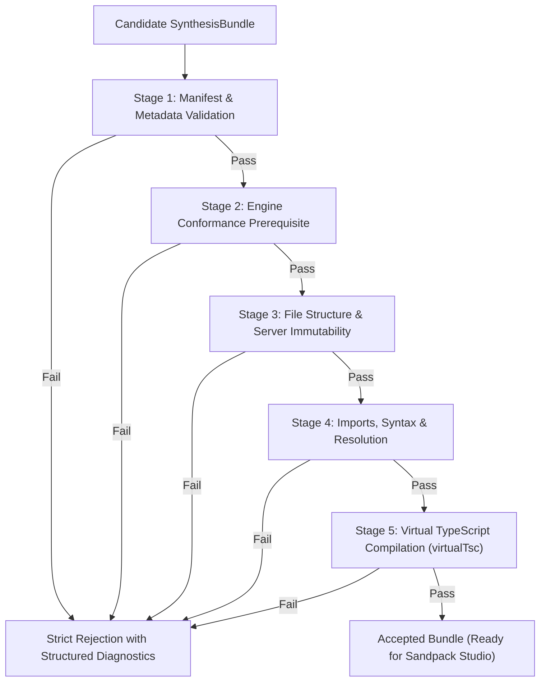

# Splice Step 3: Bundle Validation & Virtual Typechecker Specification
## Acceptance Criteria, Structural Gates, and Scope Boundaries

---

## 1. Overview & Architecture

The **Bundle Validator** (`packages/backend/src/synthesis/validateBundle.ts`) and **Virtual Typechecker** (`packages/backend/src/typecheck/virtualTsc.ts`) form the final structural gate of Splice Step 3. They evaluate whether a synthesized or refined bundle (`SynthesisBundle`) is structurally sound, type-safe, and ready for deployment in the Sandpack Studio environment.



> [!IMPORTANT]
> **Core Engineering Principle:** Typechecking alone is **not** treated as proof of behavioral correctness. A candidate bundle is accepted only when all underlying engines have independently passed comprehensive behavioral acceptance testing and conformance oracle checks.

---

## 2. Complete Bundle Qualification Matrix (Acceptance Criteria)

A bundle is qualified as **Accepted** if and only if it satisfies all checks across all five sequential validation stages:

### Stage 1: Manifest & Metadata Integrity (`stage: "manifest"`)
| Check | Requirement | Failure Consequence |
|---|---|---|
| **Contract Schema** | Validates against `SynthesisBundle` Zod schema (`bundle_id`, `app_title`, `revision >= 0`, `mode`). | Rejection with specific field diagnostic. |
| **Feature ID Alignment** | `bundle.feature_ids` must match `blueprints.map(b => b.feature_id)` exactly. | Rejection: feature mismatch. |
| **Engine Path Alignment** | `bundle.engine_paths` must match `/engines/${module_name}.ts` for all fused blueprints. | Rejection: missing or unexpected engine path. |
| **Dependency Pinning** | `bundle.dependencies` must contain exact pinned versions from `ALLOWED_DEPENDENCIES` (`react@18.3.1`, `react-dom@18.3.1`, `lucide-react@0.344.0`, `canvas-confetti@1.9.3`). Unpinned, floating, or unwhitelisted versions are disallowed. | Rejection: invalid or unpinned dependency. |

### Stage 2: Engine Behavioral Conformance Prerequisite (`stage: "engine_conformance"`)
| Check | Requirement | Failure Consequence |
|---|---|---|
| **Verification Status** | Every blueprint in `blueprints` must have `verification.status === "passed"`. | Rejection: unverified or failed engine cannot be bundled. |
| **Purity Compliance** | `verification.purity_violations` must be empty (no globals, imports, timers, Math.random). | Rejection: engine contains purity violations. |
| **Interface Conformance** | `verification.type_errors` must be empty (strict TypeScript conformance to `types_code`). | Rejection: engine failed interface typecheck. |
| **Executed Acceptance Tests** | `verification.total > 0` and `verification.passed === verification.total`. | Rejection: unexecuted or failing acceptance tests. |

### Stage 3: Bundle File Structure & Server Immutability (`stage: "structure"`)
| Check | Requirement | Failure Consequence |
|---|---|---|
| **Root Component Presence** | `/App.tsx` must exist. | Rejection: `Missing /App.tsx`. |
| **Component Default Export** | `/App.tsx` must contain a default export (`export default function|class|App`). | Rejection: missing default export. |
| **Server-Owned Immutability** | `/public/index.html`, `/index.tsx`, and `/styles.css` must exist and match `ENTRY_FILES` byte-for-byte. Model cannot modify server entry files. | Rejection: server-owned file was modified. |
| **Engine Byte-Identity** | Every `/engines/${b.implementation.module_name}.ts` must match `b.implementation.portable_code` byte-for-byte. | Rejection: engine differs from verified code. |
| **Path Allowlist** | All files must match `ENTRY_FILES`, engine paths, or `GENERATED_PATH` (`/App.tsx`, `/components/*.tsx`, `/lib/*.ts`, `/data/seed.ts`). Arbitrary paths (`/src/...`, scripts, configs) are rejected. | Rejection: `File not allowed: <path>`. |
| **Generated Path Consistency** | Every file in `bundle.generated_paths` must exist in `bundle.files`, and every non-server file in `bundle.files` must be listed in `generated_paths`. | Rejection: path inconsistency. |
| **Engine Uniqueness** | No duplicate engine module names or duplicate feature IDs among blueprints. | Rejection: duplicate engine module or feature. |

### Stage 4: Imports, Syntax & Resolution (`stage: "imports"`)
| Check | Requirement | Failure Consequence |
|---|---|---|
| **Syntax Validity** | All generated files must be valid TypeScript/TSX parse trees (`ts.createSourceFile` reports zero parse diagnostics). | Rejection with line, column, and syntax diagnostic. |
| **Relative Import Resolution** | All relative imports (`./...`, `../...`) must resolve to a valid file in `bundle.files` (`.ts`, `.tsx`, `.d.ts`, `/index.ts`, `/index.tsx`). | Rejection: `cannot resolve import "<spec>"`. |
| **Anti-Cycle / Self-Import** | Files cannot import themselves directly (e.g. `/App.tsx` importing `./App`). | Rejection: `file imports itself "<spec>"`. |
| **Package Whitelist** | All bare imports must belong to `ALLOWED_PKGS` (`react`, `react-dom`, `lucide-react`, `canvas-confetti`, `react/jsx-runtime`, `react-dom/client`). | Rejection: `package "<spec>" is not available`. |
| **100% Engine Utilization** | Every engine in `blueprints` must be imported and used by the generated UI. Fusing an engine without using it is rejected. | Rejection: `Engine <name> is never imported by the UI`. |

### Stage 5: Virtual TypeScript Compilation (`stage: "typecheck"`)
| Check | Requirement | Failure Consequence |
|---|---|---|
| **Virtual Compilation** | In-memory compilation across all bundle files via `virtualTsc` (`ts.createProgram` with React JSX, Bundler module resolution, ES2022 target). | Rejection with file, line, column, TypeScript diagnostic code, and formatted message. |
| **Export Typing** | Verified engine exports must match usage in UI code (catches typos, signature mismatches, missing exports). | Rejection: TS compile error. |
| **Component Props** | Custom React components in `/components/*.tsx` must be called with compatible prop types. | Rejection: TS compile error. |

---

## 3. What Checks Remain OUTSIDE the Validator

To maintain clean separation of concerns, the Bundle Validator acts strictly as a **compile-time structural and type gate**. The following checks explicitly remain outside its scope:

1. **Dynamic Browser DOM Mounting & React Runtime Rendering:**
   - *Why outside:* The validator runs in Node.js on the backend without a headless browser or DOM layout engine.
   - *Where handled:* The Sandpack Studio iframe (`packages/frontend/src/components/SandpackPreview.tsx`) mounts the bundle in a live browser environment.

2. **Runtime Exceptions & React Hook Invariant Violations:**
   - *Why outside:* Issues such as calling hooks conditionally, infinite render loops, uncaught promise rejections, or runtime `null` dereferences cannot be detected statically by the TypeScript compiler.
   - *Where handled:* Handled by the Sandpack runtime error hook and Step 3 Refine & Auto-Fix loop (`POST /api/refine` with `kind: "fix"`), which automatically feeds the runtime stack trace back to the LLM to repair.

3. **UI Visual Quality, Aesthetics & Layout Responsiveness:**
   - *Why outside:* Static code analysis cannot evaluate whether Tailwind utility classes produce an aesthetically pleasing, accessible, or mobile-responsive layout.
   - *Where handled:* Evaluated via Playwright headless browser suites (`npm run test:studio`) and visual human review against the OHI/O Hackathon Rubric.

4. **Algorithmic Correctness of Engines:**
   - *Why outside:* The bundle validator checks that engines are imported and called with correct types; it does not re-run algorithm unit tests.
   - *Where handled:* Algorithmic correctness is proven upfront by the Step 3 Conformance Oracle (`evaluateEngineConformance` in `src/engine/oracle.ts`) and sandbox acceptance tests.

5. **Prompt Intent Fidelity & Semantic Feature Completeness:**
   - *Why outside:* The validator verifies that the bundle compiles and uses the engines; it cannot determine whether the generated UI fulfills every subjective nuance of the user's creative prompt.
   - *Where handled:* Evaluated interactively by the user and refined through conversational edits (`POST /api/refine` with `kind: "edit"`).

---

## 4. Structured Diagnostics Reference

`validateBundleDetailed` returns a `BundleValidationResult` with structured diagnostics:

```ts
export interface BundleDiagnostic {
  stage: "manifest" | "structure" | "engine_conformance" | "imports" | "typecheck";
  file?: string;
  line?: number;
  col?: number;
  message: string;
  severity: "error" | "warning";
}
```

### Diagnostic Stage Codes & Explanations

| Stage Code | Focus Area | Example Diagnostic |
|---|---|---|
| `manifest` | Schema & bundle metadata | `Dependency "react@19.0.0" does not match allowed version "18.3.1"` |
| `engine_conformance` | Prerequisite engine verification | `Engine "sm2Scheduler" failed behavioral conformance verification (status: failed); unverified engines cannot be bundled` |
| `structure` | Server entry files & path rules | `/index.tsx was modified; it is server-owned` |
| `imports` | Syntax, imports allowlist & resolution | `/App.tsx(14,5): Syntax error: Unexpected token` |
| `typecheck` | TypeScript compiler diagnostics | `/App.tsx(22,14): Property 'updateEases' does not exist on type typeof import('/engines/sm2Scheduler')` |
