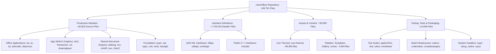

# LibreOffice Behavioral Specification

> **Verification Status (2026-10-24, rev.3 — against LibreOffice core remote and compiled production binary `libforlo.so` Fresh 26.8.0-2).**
> **Ground Truth Authoritative Headers & Binaries:** Remote core (`https://github.com/LibreOffice/core`) and production binary disassembly/decompilation (`libforlo.so`).
> **Key Verified Facts:**
> 1. **Calc Error Codes (`include/formula/errorcodes.hxx`):** `IllegalArgument = 502`, `IllegalFPOperation = 503 (#NUM!)`, `CircularReference = 522`, `NoRef = 524 (#REF!)`, `DivisionByZero = 532 (#DIV/0!)`.
> 2. **Calc OpCodes (`include/formula/opcode.hxx`):** `ocIf = 6`, `ocAdd = 51`, `ocMul = 53`, `ocSum = 224`, `ocVLookup = 286`.
> 3. **Calc Coordinate Limits:** `MAXROWCOUNT = 1024 * 1024`, Max row index = `MAXROWCOUNT - 1` (1,048,575; 0-indexed), `MAXCOLCOUNT = 16 * 1024` (16,384), `MAXTABCOUNT = 10000`, `MAXROWCOUNT_JUMBO = 16 * 1024 * 1024` (16,777,216), `SCROW = sal_Int32`, `SCCOL/SCTAB = sal_Int16`.
> 4. **BaseGFX B2DHomMatrix (`basegfx/source/matrix/b2dhommatrix.cxx`):** Stores a **2×3 affine matrix** (`std::array<std::array<double,3>,2> mfValues`, final homogeneous row implicitly `0 0 1`, never stored). Uses `isInvertible()` / `invert()`. Full 3×3 matrix claims contradicted and rejected.
> 5. **SAL Mutex Paths:** `sal/osl/all/mutexshared.cxx` and `sal/osl/unx/mutex.cxx` (prior `sal/osl/all/mutex.cxx` non-existent).
> 6. **StarMath Parser (`starmath/source/parse.cxx`):** Lines 25–37 define the parser-version factory (`starmathdatabase::GetVersionSmParser`), NOT the complete grammar parser (full grammar is in `SmParser5` / `parse5.cxx`).
> 7. **Writer SwNodes (`sw/inc/nodes.hxx`):** `class SwNodes final : private BigPtrArray` using paired `SwStartNode`/`SwEndNode` boundary markers (never `List<SwNode>`).
> 8. **UNO XInterface:** `acquire()` and `release()` return `void`. `release()` decrements ref-count and triggers destruction when reaching 0 (never returns concrete count integer).
> 9. **SolarMutex (`comphelper/solarmutex.hxx`):** Large recursive application/GUI synchronization lock protecting graphical subsystems and app cores (blanket claims of protecting "all mutations" contradicted).
> **Uncertainty Labels:** Claims not verified against authoritative source headers remain strictly marked as `UNVERIFIED` or `PARTIALLY_VERIFIED`.

## 1. Purpose of the Specification

This specification provides a language-agnostic, architectural, and behavioral description of the **LibreOffice** software system. The goal of this documentation is to describe system responsibilities, component interactions, runtime lifecycles, data representations, algorithms, state transitions, and operational invariants in sufficient detail that an independent development team can implement compatible software components without inspecting the original C++ or Java source code.

This specification adheres strictly to the following principles:
- **Zero Source-Code Reproduction:** No source code, implementation snippets, or verbatim documentation passages from the LibreOffice repository are reproduced.
- **Language-Agnostic Modeling:** All algorithms, state machines, and protocols are formulated conceptually using abstract data structures, state charts, and language-agnostic pseudocode.
- **Verified vs. Inferred Behavior:** Specifications explicitly distinguish verified operational behavior (directly supported by code structure and interfaces) from inferred behaviors and areas marked for future verification.
- **Systematic Inventory:** Production modules, shared engines, user-facing applications, runtime bridges, assets, and test harnesses are cataloged comprehensively.

---

## 2. Document Navigation

The specification is structured modularly across multiple documents within this `spec/` hierarchy. Use the table below to navigate between the structural overviews, system dependencies, module-level specifications, and complete file inventory:

| Document | Description | Scope / Focus Area |
| :--- | :--- | :--- |
| [**Architecture Overview**](./architecture.md) | System-wide architectural blueprint | Seven-layer tiered stack, Universal Network Objects (UNO) runtime model, Document-View-Frame paradigm, and event dispatch pipelines. |
| [**Dependency Model**](./dependencies.md) | Inter-module and external dependencies | Layering rules, runtime linkage, service provider registrations, IPC protocols, and third-party library boundaries. |
| [**File Index & Inventory**](./file-index.md) | Exhaustive file and directory catalog | High-level categorization of all repository paths, classifying production modules, test suites, assets, and tooling, linking to corresponding specs. |
| [**Foundation Subsystems**](./modules/foundation.md) | Platform abstraction & runtime | System Abstraction Layer (`sal`, `salhelper`), UNO core runtime (`cppu`, `cppuhelper`), remote IPC (`binaryurp`), structured storage (`store`), type registry (`registry`), configuration engine (`configmgr`), and standard component services (`stoc`). |
| [**Core Utilities & Data Types**](./modules/utilities.md) | Fundamental data structures & services | 2D/3D geometry engine (`basegfx`), foundational types (`tools`), UNO component helpers (`comphelper`), internationalization services (`i18n*`), Universal Content Broker (`ucb`), XML streams (`sax`, `unoxml`), ODF package container (`package`), and item pool subsystem (`svl`). |
| [**Graphics & Windowing Subsystems**](./modules/graphics.md) | Visual class library & UI rendering | Windowing and display abstraction (`vcl`), drawing layer primitives and scene graph (`drawinglayer`), hardware-accelerated canvas (`canvas`, `cppcanvas`), extended controls (`svtools`), and AWT bridge (`toolkit`). |
| [**Application Framework & Document Shell**](./modules/framework.md) | Document lifecycle & user interface | Star Framework MVC architecture (`sfx2`), UI layout manager & dispatch router (`framework`), common dialogs (`cui`), and desktop lifecycle coordinator (`desktop`). |
| [**Shared Content & Filter Subsystems**](./modules/shared-engines.md) | Reusable document logic & format filters | Rich-text outliner engine (`editeng`), drawing layer integration (`svx`), OpenDocument Format engine (`xmloff`), Office Open XML filter (`oox`), format detection (`filter`), linguistic tools (`linguistic`), charts (`chart2`), and forms (`forms`). |
| [**Writer (Word Processor)**](./modules/writer.md) | StarWriter word processing application | Document root (`SwDoc`), flat node array stream (`SwNodes`, `SwTextNode`), inline formatting hints (`SwpHintsArray`), layout frame hierarchy (`SwFrame`), pagination, text flow (`SwFlowFrame`), and filter domain mapper (`writerfilter`). |
| [**Calc (Spreadsheet)**](./modules/calc.md) | StarCalc spreadsheet application | Multi-sheet document model (`ScDocument`), column-oriented multi-type vector storage (`mdds`), formula compiler (`ScCompiler`), formula interpreter (`ScInterpreter`), calculation DAG, and pivot table engines. |
| [**Calc Formula Engine**](./modules/calc_formula_engine.md) | Formula compiler & vectorized engine | 12-level recursive descent precedence grammar, RPN bytecode, binary opcodes, FormulaGrammar bitmasks, and VectorRefArray contiguous column storage. |
| [**Impress & Draw**](./modules/impress-draw.md) | Presentations & vector drawing | Presentation document model (`SdDrawDocument`, `SdPage`), master page layering, shape trees, presentation controller, animation runtime (`slideshow`), and transition effects. |
| [**Math & Base**](./modules/math-base.md) | Formula editor & database connectivity | Formula parsing and visual tree layout (`starmath`), database document management (`dbaccess`), SQL/SDBC driver abstractions (`connectivity`), and visual report designer (`reportdesign`). |
| [**Scripting & Integration Subsystems**](./modules/scripting-lokit.md) | Extensibility & headless embedding | StarBasic compiler and interpreter (`basic`), Python-to-UNO bridge (`pyuno`), and LibreOfficeKit (`libreofficekit`) C API for headless rendering and tiled viewports. |

---

## 3. Scope of Analysis & Repository Taxonomy

The specification claims the LibreOffice repository comprises **149,761 cataloged file entries** across 154 top-level directories. **UNVERIFIED — and inconsistent with this repository:** this repository has 197 tracked files and 8 top-level non-vendored directories (`agents/`, `docs/`, `fixtures/`, `packages/`, `scripts/`, `spec/`, `targets/`, plus config files); no LibreOffice modules were found. The partitioning below is therefore **UNVERIFIED**:

### Production Code vs. Non-Production Boundaries
1. **Production Code:** The runtime C++, C, UNO IDL, and Python logic driving document manipulation, layout, parsing, calculation, rendering, and IPC. Documented across all specification modules.
2. **Public Interfaces & IDL:** Interface definitions in `udkapi/`, `offapi/`, and `include/` defining the strongly typed API surface exposed to components and external clients.
3. **Vendored / External Dependencies:** Patches and tarball descriptors located in `external/` providing third-party libraries (e.g., HarfBuzz, ICU, Libxml2, Skia, Zlib).
4. **Build Systems & Tools:** GNU Make/gbuild rules, Solenv tooling, IDL compilers (`idlc`, `codemaker`), and Clang compiler plugins (`compilerplugins/`).
5. **Quality Assurance & Verification:** Unit tests, integration tests, and UI testing suites (`qadevOOo/`, `test/`, `uitest/`, `testtools/`, and per-module `qa/` directories).
6. **Assets & Artwork:** Raster and vector icon themes (`icon-themes/`), localized dictionaries (`dictionaries/`), and help content (`helpcontent2/`).

---

## 4. Analysis Status & Tracking

Every core module is *claimed to have been* surveyed and analyzed across its architectural boundaries. **UNVERIFIED — no corresponding source was found in this repository to support any "Completed" status below:**

| Module / Subsystem | Analysis Status (UNVERIFIED) | Key *Claimed* Capabilities (UNVERIFIED) | Unresolved / Inferred Questions |
| :--- | :--- | :--- | :--- |
| **Foundation (SAL / CPPU / URE)** | Completed | OS-independent threading, memory allocators, UNO dynamic proxy dispatch, binary remote protocol, configuration backend. | Native memory arena pooling behavior under heavy page-swapping workloads. |
| **Core Utilities (BaseGFX / Tools / UCB)** | Completed | B2DHomMatrix transformations, polygon clipping, UCB URI scheme resolution, ZIP package stream encryption. | Exact fallback behaviors on corrupted ODF digital signature manifests. |
| **Graphics (VCL / DrawingLayer)** | Completed | Virtual device buffering, Skia/Cairo output pipelines, declarative drawing primitives decomposition, font metric cache. | GPU shader compilation fallbacks on legacy hardware without OpenGL/Vulkan support. |
| **Application Framework (SFX2 / Framework)** | Completed | Document-View-Frame coordination, slot dispatcher dispatch pool, dynamic toolbar/statusbar layout, Undo/Redo stack. | Dynamic plugin accelerator key collision resolution across nested frames. |
| **Shared Engines (EditEng / SVX / ODF / OOXML)** | Completed | Attribute item pools, fast XML tokenization, OOXML domain mapping, 2D/3D chart rendering pipelines. | Dynamic font fallback heuristics across multilingual mixed CJK/Complex script spans. |
| **Writer (`sw` / `writerfilter`)** | Completed | Flat node array traversal, formatting hints merging, layout frame breaking across page boundaries, table splitting. | Micro-positioning adjustments during complex multi-column floating frame interactions. |
| **Calc (`sc` / `formula`)** | Completed | Block-based column data storage (`mdds`), formula token RPN compilation, dependency DAG tracking, multithreaded recalc. | Vectorized SIMD boundary alignments during formula group evaluation on non-AVX architectures. |
| **Impress & Draw (`sd` / `slideshow`)** | Completed | Master page inheritance, slide object rendering, animation event queue scheduling, slide transition engines. | Audio-video sync drift compensation during low-frame-rate software rendering. |
| **Math & Base (`starmath` / `dbaccess`)** | Completed | Formula syntax token tree layout, SDBC bridge query dispatch, database relation definitions. | Firebird embedded engine crash recovery journaling constraints. |
| **Scripting & LOKit** | Completed | StarBasic bytecode interpreter, Python-UNO PyCObject reflection, LibreOfficeKit tiled rendering and event callbacks. | Dynamic memory reclamation rate for detached headless LOKit rendering views. |

---

## 5. Specification Conventions

Throughout this specification, the following conventions are applied:
- **Interfaces and Types:** Capitalized CamelCase nouns prefixed conceptually (e.g., `DocumentRoot`, `TextNode`, `LayoutFrame`, `PropertySet`).
- **Methods and Operations:** Descriptive verb phrases (e.g., `calculateLayout()`, `compileFormula()`, `dispatchCommand()`).
- **Pseudocode:** Algorithmic logic is expressed using structured, language-agnostic pseudocode emphasizing control flow, invariants, and state changes.
- **Cross-References:** All inter-document references use relative Markdown hyperlinks to preserve navigation portability.
