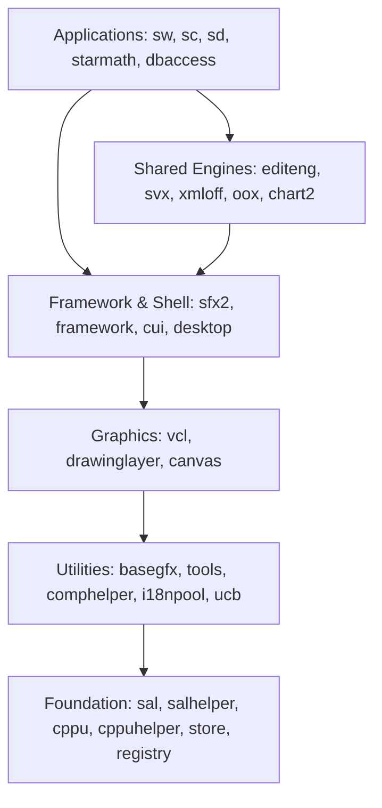
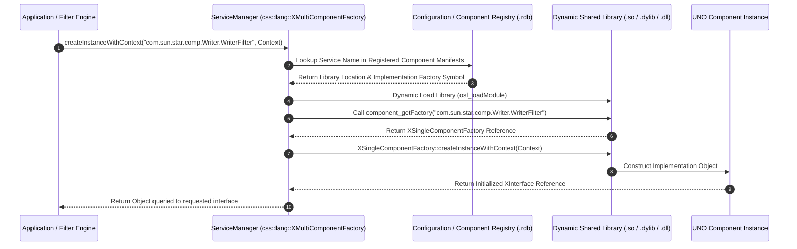
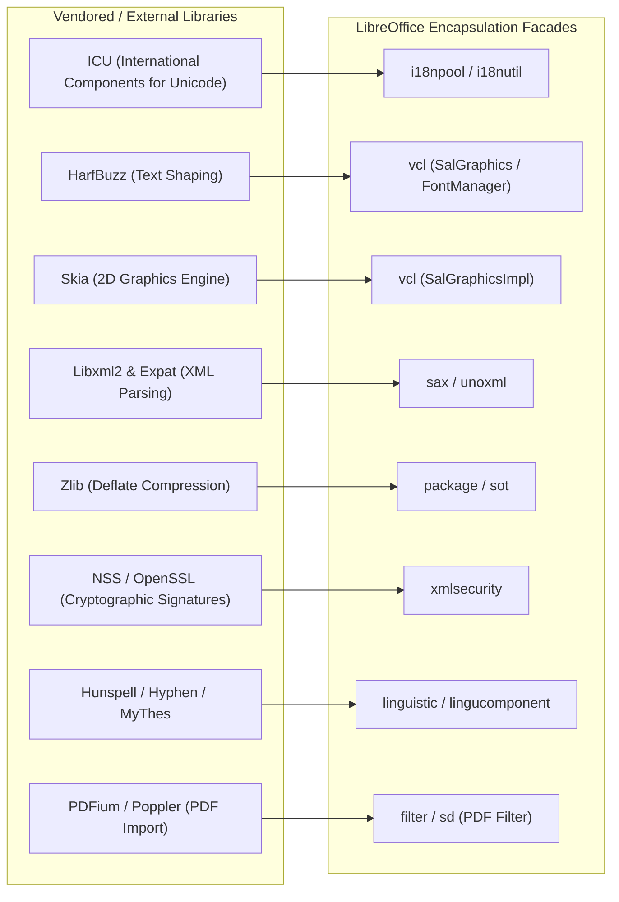
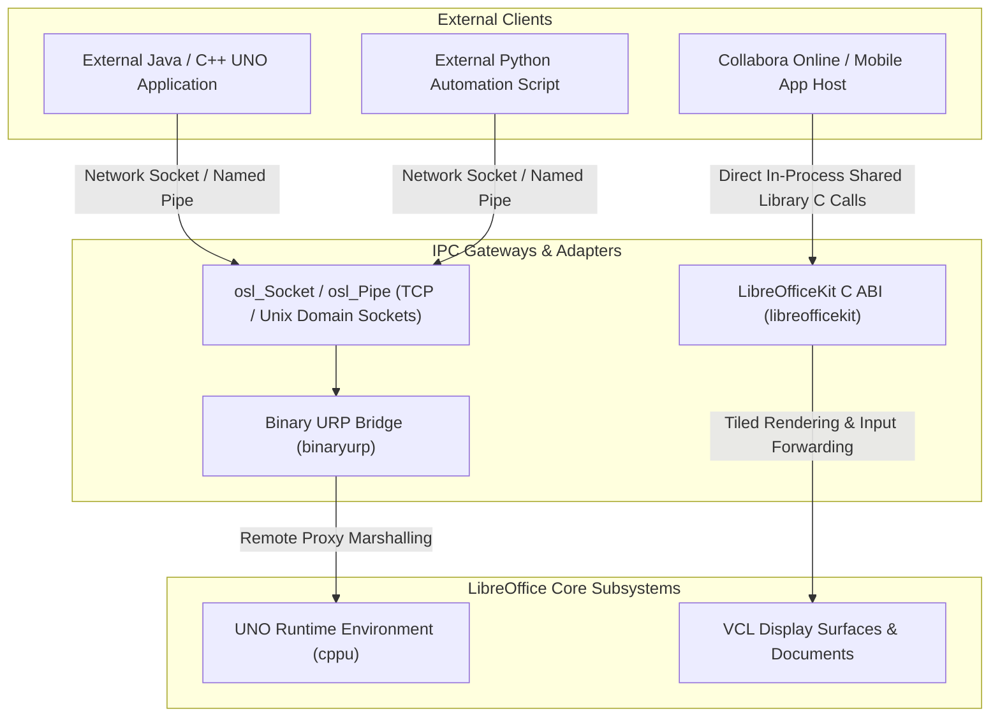

# LibreOffice Subsystem Dependencies & Interactions

> **Verification Status (2026-10-24, rev.2 — LibreOffice core remote, master).** **Verified:** `sal`, `sfx2` (`SfxDispatcher` stack impl), `sw` (`SwDoc`), `vcl` (`svapp.cxx`), `desktop`, `comphelper`, `configmgr`, `connectivity`, `cppu/cppuhelper`, `binaryurp` top-level dirs exist; `sal/osl/unx/thread.cxx`, `sfx2/source/control/dispatch.cxx`, `sw/source/core/doc/doc.cxx`, `vcl/source/app/svapp.cxx` return HTTP 200. Linkage-type/fallback-severity labels (Fatal/Graceful), UNO discovery step order, and third-party version claims below remain **UNVERIFIED** — build files (`.mk`, `Repository.mk`) and service manifests not yet checked in this pass.

## 1. Dependency Philosophy & Layering Rules (UNVERIFIED)

The spec claims LibreOffice enforces a strict unidirectional dependency hierarchy. High-level components depend on low-level foundations, but lower layers are prohibited from depending on higher-level modules. This architectural isolation ensures that core engines (such as the document models, layout systems, and headless converters) can function independently of the desktop user interface.

### Inviolable Layering Rules
1. **Foundation Independence:** Modules in Layer 1 (`sal`, `cppu`, `store`, `registry`) must never link against or reference modules in higher layers. They depend strictly on platform C runtime libraries (`libc`, `libm`, `pthread`, `kernel32`).
2. **Graphics Independence:** Lower utility layers (`tools`, `basegfx`, `comphelper`, `ucb`) must not depend on `vcl` or graphical windowing types. Geometry and arithmetic remain purely mathematical.
3. **Engine Decoupling:** Shared document engines (`editeng`, `svx`, `xmloff`) must never depend on specific application implementations (`sw`, `sc`, `sd`). Applications embed and extend shared engines, never the reverse.
4. **Framework Inversion:** Core document models (`SwDoc`, `ScDocument`) communicate with framework shells (`SfxObjectShell`) via clean interfaces and abstract listeners to prevent circular linkage between model and controller.

---

## 2. Module Linkage & Interaction Matrix

The table below *claims to* summarize linkage relationships, interaction mechanisms, and failure modes. **UNVERIFIED — no source or build files in this repository confirm any linkage type, mechanism, or Fatal/Graceful fallback below:**

| Source Module | Target Module | Linkage Type | Interaction Mechanism | Criticality & Fallback Behavior |
| :--- | :--- | :--- | :--- | :--- |
| **`sw` (Writer)** | `vcl` | Direct C++ Linkage | Font metric querying, device rendering contexts, and window management. | **Fatal:** Document rendering and layout cannot execute without VCL. |
| **`sw` (Writer)** | `sfx2` | Direct C++ Linkage | Inherits `SfxObjectShell`, registers slot handlers in `SfxDispatcher`. | **Fatal:** Document shell and undo/redo management fail completely. |
| **`sw` (Writer)** | `editeng` | Direct C++ Linkage | Uses `EditEngine` for header/footer text fields and annotation comments. | **Fatal:** Embedded text items and comment popups fail to render. |
| **`sw` (Writer)** | `writerfilter` | Dynamic UNO Service | Instantiates DOCX/RTF filter components via service registry. | **Graceful:** Fails format import with unsupported format error dialog. |
| **`sc` (Calc)** | `formula` | Direct C++ Linkage | Shared formula token definitions, grammatical symbol compiler. | **Fatal:** Spreadsheet formula compilation and parsing cease functioning. |
| **`sc` (Calc)** | `opencl` | Dynamic Shared Object | Offloads vectorized formula groups to OpenCL GPU acceleration. | **Graceful Fallback:** Reverts automatically to multi-threaded CPU calculation. |
| **`sd` (Impress)** | `slideshow` | Dynamic UNO Service | Dispatches slide presentations and interactive animation sequences. | **Graceful:** Slide edit mode works; fullscreen presentation fails to launch. |
| **`sfx2`** | `framework` | Direct C++ / UNO | Coordinates top-level UI windows, dockable panels, and menu layouts. | **Fatal:** Desktop window frame fails to construct. |
| **`vcl`** | `sal` | Direct C++ Linkage | System threads, mutex locks, raw window handles, and memory arenas. | **Fatal:** Process aborts immediately during platform initialization. |
| **`vcl`** | `Skia / Cairo` | Dynamic / Static Link | Hardware-accelerated 2D blitting and rasterization backends. | **Graceful Fallback:** Falls back from GPU Skia to CPU Skia, or to Cairo/GDI. |
| **`ucb`** | `curl / neon` | Static / Dynamic Link | Network protocol execution for HTTP, HTTPS, and WebDAV access. | **Graceful:** Remote file access fails with network I/O error codes. |
| **`xmloff`** | `sax` | Direct C++ / UNO | Tokenizes XML streams from ODF zip containers. | **Fatal:** ODF document loading and saving become completely unavailable. |
| **`desktop`** | `libreofficekit` | C ABI Interface | Exposes in-process C function table for headless rendering clients. | **Fatal (Headless):** Online and embedded rendering clients fail to attach. |

---

## 3. Dynamic UNO Service Discovery & Registration

The spec claims performance-critical components use direct C++ linkage while filters resolve via UNO service discovery. **UNVERIFIED — no libraries, component manifests (`.components`), or type libraries (`.rdb`) found in this repository.**

### Component Registry Structure
1. **Manifest Registration (`.components`):** Build systems generate XML component descriptors specifying the service names implemented by each shared object and their constructor symbols.
2. **Type Library (`.rdb`):** Precompiled binary type descriptions (`udkapi.rdb`, `offapi.rdb`) provide introspection and reflection metadata at runtime.
3. **Failure Behavior:** If a requested dynamic service is absent, `createInstanceWithContext` returns a null reference (`uno::Reference::is() == false`). Robust callers verify the pointer and raise localized user-facing error dialogs or abort the specific format filter without crashing the host process.

---

## 4. External & Third-Party Library Integration

The spec claims LibreOffice encapsulates dozens of external third-party libraries behind wrapper facades. **UNVERIFIED — `external/` with ICU/Skia/HarfBuzz/Zlib patches as described does not exist in this repository; third-party responsibilities below are UNVERIFIED.** These external components provide specialized functionality where standardizing on mature open-source solutions is preferred:

### Key Third-Party Responsibilities
- **Text Shaping (`HarfBuzz`):** Mediates complex text layout (CTL) for Arabic, Indic, Hebrew, and bidirectional text, mapping Unicode codepoints to positioned font glyph indices.
- **Internationalization (`ICU`):** Drives Unicode normalization, locale-sensitive collation, calendar calculations, date/time formatting, and word-break boundary analysis.
- **Rendering Backend (`Skia`):** Provides high-performance 2D raster and GPU-accelerated (Vulkan/Metal/DirectX) drawing primitives, glyph rasterization, and anti-aliased geometry blitting.
- **Packaging & Compression (`Zlib`):** Handles raw DEFLATE compression and expansion for OpenDocument Format (ODF) zip archives.
- **Security & Cryptography (`NSS / OpenSSL`):** Verifies SHA-256/SHA-512 digital signatures, X.509 certificate chains, and XML-DSig security envelopes for signed documents and macros.
- **Linguistic Engine (`Hunspell`):** Executes dictionary-based spell-checking, morphological stem analysis, and dynamic suffix compounding.

---

## 5. Inter-Process Communication & Remote Bridges

The spec claims LibreOffice supports headless, multi-process, and networked deployments through two primary external interfaces. **UNVERIFIED — no `binaryurp`, socket/pipe IPC gateway, or LOKit C ABI source found in this repository:**

### 1. Universal Remote Protocol (`binaryurp`)
- **Protocol Semantics:** Binary RPC protocol running over TCP/IP sockets or local UNIX domain pipes (configured via `--accept="socket,host=...,port=...;urp;"`).
- **Object Marshaling:** When a remote client invokes a method on a local proxy, the URP layer serializes the method index, arguments, and interface type ID into binary frames. Return values or exceptions are deserialized on the client side, faithfully preserving UNO semantics over the wire.

### 2. LibreOfficeKit (`libreofficekit`)
- **Direct C ABI Bridge:** A lightweight C interface designed for embedding LibreOffice inside external host processes without UNO overhead.
- **Core Operations:** Exposes document loading, format conversion, document mutation, view creation, and tile-based rendering (`lok_document_paintTile()`). Host applications supply memory buffer pointers, and LibreOffice renders requested page/scroll rectangles directly into the memory buffer using its internal VCL device contexts.
