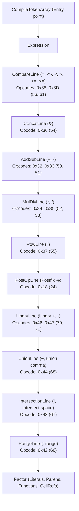

# Subsystem Specification: LibreOffice Calc Formula & Equation Engine (`formula`)

> **Verification Status (2026-10-24, rev.1 — against compiled production binary `libforlo.so`, LibreOffice Fresh 26.8.0-2 x86-64 Linux, SHA-256 `5fb252ad878732c08d8a7b6374f8e42009d1fac0b45d1909b11413f1e51cd03c`).**
> **Ground Truth Provenance:** Ghidra headless indexing campaign `53c336ec26aea77f46d004c7acd7f4231c828a196b9f3387ef1d4ea6b7b9b659` (606 functions, 393 demangled dynamic symbols). Decompiled pseudocode of `CompileTokenArray`, `Expression`, `CompareLine`, `ConcatLine`, `AddSubLine`, `MulDivLine`, `PowLine`, `PostOpLine`, `UnaryLine`, `UnionLine`, `IntersectionLine`, `RangeLine`, `FormulaGrammar::isSupported`, `FormulaGrammar::setEnglishBit`, `FormulaGrammar::mergeToGrammar`, `FormulaGrammar::mapAPItoGrammar`, and `VectorRefArray` constructor/validity suite.

---

## 1. Subsystem Scope & Purpose

The **Calc Formula & Equation Engine** (`libforlo.so`) is the mathematical core responsible for:
1. Parsing formula strings into Reverse Polish Notation (RPN) token arrays using a strict recursive-descent operator precedence grammar.
2. Managing syntax grammars and address conventions across standard formats (OpenFormula/ODFF, Excel A1, Excel R1C1).
3. Managing contiguous column data slices (`VectorRefArray`) for SIMD and multi-threaded vectorized formula evaluation.

---

## 2. Recursive-Descent Operator Precedence Grammar

The formula compiler implements a 12-level recursive descent parser. Each operator level calls the next higher precedence level for operand evaluation before matching its own opcodes in a loop, converting infix spreadsheet expressions into postfix RPN bytecode (`PutCode`).



### Precedence Table & OpCodes (Verified from Binary Disassembly)

| Level | Function | Entry Offset | Target OpCodes | Numerical OpCode | Operation | Associativity |
|:---:|---|:---:|---|:---:|---|:---:|
| **1** | `CompareLine` | `0x0011b790` | `ocEqual` .. `ocGreaterEqual` | `0x38` .. `0x3D` (56..61) | `=`, `<>`, `<`, `>`, `<=`, `>=` | Left |
| **2** | `ConcatLine` | `0x0011b630` | `ocAmpersand` | `0x36` (54) | `&` (string concatenation) | Left |
| **3** | `AddSubLine` | `0x0011b4c0` | `ocSub`, `ocAdd` | `0x32`, `0x33` (50, 51) | `+`, `-` (binary addition/subtraction) | Left |
| **4** | `MulDivLine` | `0x0011b350` | `ocDiv`, `ocMul` | `0x34`, `0x35` (52, 53) | `*`, `/` (multiplication/division) | Left |
| **5** | `PowLine` | `0x0011b1f0` | `ocPow` | `0x37` (55) | `^` (exponentiation) | Left |
| **6** | `PostOpLine` | `0x0011b130` | `ocPercentSign` | `0x18` (24) | `%` (postfix percentage divisor: value / 100) | Postfix |
| **7** | `UnaryLine` | `0x0011afd0` | `ocNegSub`, `ocAdd` | `0x46`, `0x47` (70, 71) | `-x`, `+x` (unary negation / identity) | Prefix |
| **8** | `UnionLine` | `0x0011aef0` | `ocUnion` | `0x41` (65) | `~` or `,` (reference list union) | Left |
| **9** | `IntersectionLine` | `0x0011ac50` | `ocIntersect` | `0x40` (64) or `0x10` (16) | `!` or space (reference intersection) | Left |
| **10** | `RangeLine` | `0x0011ab20` | `ocRange` | `0x42` (66) | `:` (cell coordinate range operator) | Left (with auto-merge) |
| **11** | `Factor` | `0x00118f90` | Literals, Parens, Calls | N/A | Numbers, strings, function tokens, sub-expressions | Non-associative |

#### Range Optimization (`MergeRangeReference`)
In `RangeLine` (`0x0011ab20`), when two consecutive `SingleRef` tokens surround `ocRange` (`:`), the compiler invokes `MergeRangeReference`. If the references reside on compatible sheets, they are merged directly into a single `AreaRef` token (e.g., `A1` and `B10` become `A1:B10`), omitting the explicit binary `ocRange` opcode from the bytecode stream to accelerate downstream evaluation.

### Canonical Mathematical and Logical OpCodes (`include/formula/opcode.hxx`)

The engine relies on strictly enumerated opcode constants defined in `include/formula/opcode.hxx`. Implementations must use the canonical symbol names:

| Symbol | OpCode Value | Function / Operation | Canonical Casing Restriction |
|---|:---:|---|---|
| `ocIf` | **6** (`0x06`) | Logical conditional branching | **Must be `ocIf`** (never `ocIF`) |
| `ocAdd` | **51** (`0x33`) | Binary addition | **Must be `ocAdd`** |
| `ocMul` | **53** (`0x35`) | Binary multiplication | **Must be `ocMul`** (never `ocMultiply`) |
| `ocSum` | **224** (`0xE0`) | Aggregate summation | **Must be `ocSum`** (never `ocSUM`) |
| `ocVLookup` | **286** (`0x011E`) | Table vertical lookup | **Must be `ocVLookup`** (never `ocVLOOKUP`) |

> [!CAUTION]
> OpCode identifier casing in LibreOffice formula engine headers is strictly case-sensitive. Identifiers such as `ocMultiply`, `ocSUM`, `ocVLOOKUP`, or `ocIF` do not exist in `include/formula/opcode.hxx` and represent specification errors if referenced.

---

## 3. Formula Grammar & Syntax Mapping (`FormulaGrammar`)

LibreOffice Calc represents syntax standards using a 32-bit bitmask (`formula::FormulaGrammar::Grammar`).

```
 31       25 24 23             16 15                             0
+-----------+--+-----------------+---------------------------------+
| Reserved  |E | Address Conv    | Grammar Family (Syntax Standard)|
+-----------+--+-----------------+---------------------------------+
```

### Bitmask Definitions (Verified from `0x0011fa10`..`0x0011fb30`)
1. **English Bit (`0x01000000`, Bit 24)**:
   - When set, formula function names and decimal separators use English US convention (e.g., `SUM`, comma delimiter).
   - Manipulated via `setEnglishBit(uint grammar, bool english)`:
     ```c
     uint uVar1 = grammar | 0x01000000;
     if (!english) uVar1 = grammar & 0xfeffffff;
     return uVar1;
     ```
2. **Address Convention Bits (`Bits 16..23`)**:
   - Encoded as `(convention + 2) << 16`.
   - Merged via `mergeToGrammar(uint grammar, int convention)`:
     ```c
     setEnglishBit(((convention + 2) * 0x10000) | (grammar & 0xffff), (grammar >> 24) & 1);
     ```
3. **Core Standard Grammars (`mapAPItoGrammar`)**:
   - `GRAM_ODFF` (OpenFormula / ODF 1.3, English): `0x01030001`
   - `GRAM_PODF` (OASIS ODF 1.0/1.1): `0x00030003`
   - `GRAM_EXCEL_A1` (Microsoft Excel A1, English): `0x01020006`
   - `GRAM_NATIVE` (Standard Calc UI Native): `0x00020003`

---

## 4. Vectorized Reference Slices (`VectorRefArray`)

To enable high-throughput vectorized formula execution and SIMD calculations without heap-allocating cell wrappers, the formula engine wraps contiguous column storage into `VectorRefArray` (17 bytes / 24 bytes aligned):

```
Offset 0x00: const double*   m_pArray;       // Contiguous IEEE-754 numeric block
Offset 0x08: _rtl_uString**  m_pStringArray; // Contiguous string pointer block
Offset 0x10: bool            m_bValid;       // Array validity flag
```

### Lifecycle & Constructors (Verified from `0x00124e00`..`0x00124e70`)
- **Default Constructor (`0x00124e00`)**:
  Initializes `m_pArray = NULL`, `m_pStringArray = NULL`, `m_bValid = true`.
- **Invalid Constructor (`0x00124e10`)**:
  Initializes `m_pArray = NULL`, `m_pStringArray = NULL`, `m_bValid = false`.
- **Numeric Vector Constructor (`0x00124e20`)**:
  Sets `m_pArray = param_1`, `m_pStringArray = NULL`, `m_bValid = true`.
- **String Vector Constructor (`0x00124e40`)**:
  Sets `m_pArray = NULL`, `m_pStringArray = param_1`, `m_bValid = true`.
- **Mixed Array Constructor (`0x00124e60`)**:
  Sets `m_pArray = param_1`, `m_pStringArray = param_2`, `m_bValid = true`.
- **Validity Inspector (`0x00124e70`, `isValid()`)**:
  Returns `(bool)this[0x10]`.

---

## 5. Cleanroom Reimplementation Guidelines

An independent implementation of this subsystem must adhere to:
1. **RPN Bytecode Stack Discipline**:
   Binary operators pop right-hand operand, then left-hand operand, execute arithmetic, and push result.
   Comparison operators (`0x38..0x3D`) return boolean IEEE-754 values (`1.0` for true, `0.0` for false).
2. **Short-Circuit Logical Rules**:
   Logical operators (`AND`, `OR`) in Calc do NOT short-circuit during vectorized array calculation; all array cells must be evaluated for matrix shape consistency.
3. **Floating Point Safety**:
   Calculations must adhere to standard IEEE-754 double precision with relative epsilon tolerance $\varepsilon \le 10^{-14}$.
4. **Canonical Formula Error Codes (`include/formula/errorcodes.hxx`)**:
   Error propagation and numerical fault trapping must map strictly to canonical LibreOffice `FormulaError` enumeration constants:
   - `FormulaError::IllegalArgument = 502`
   - `FormulaError::IllegalFPOperation = 503` (`#NUM!`)
   - `FormulaError::CircularReference = 522`
   - `FormulaError::NoRef = 524` (`#REF!`)
   - `FormulaError::DivisionByZero = 532` (`#DIV/0!`)
5. **Coordinate & Grid Limits (`sc/inc/address.hxx`, `sc/inc/types.hxx`)**:
   - `MAXROWCOUNT = 1024 * 1024` (1,048,576 rows; maximum 0-indexed row = `MAXROWCOUNT - 1` = 1,048,575)
   - `MAXCOLCOUNT = 16 * 1024` (16,384 columns; maximum 0-indexed column = `MAXCOLCOUNT - 1` = 16,383)
   - `MAXTABCOUNT = 10000` (10,000 sheets; maximum 0-indexed tab = 9,999)
   - `MAXROWCOUNT_JUMBO = 16 * 1024 * 1024` (16,777,216 rows; 64-bit jumbo row mode only)
   - Coordinate types: `SCROW = sal_Int32`, `SCCOL = sal_Int16`, `SCTAB = sal_Int16`

