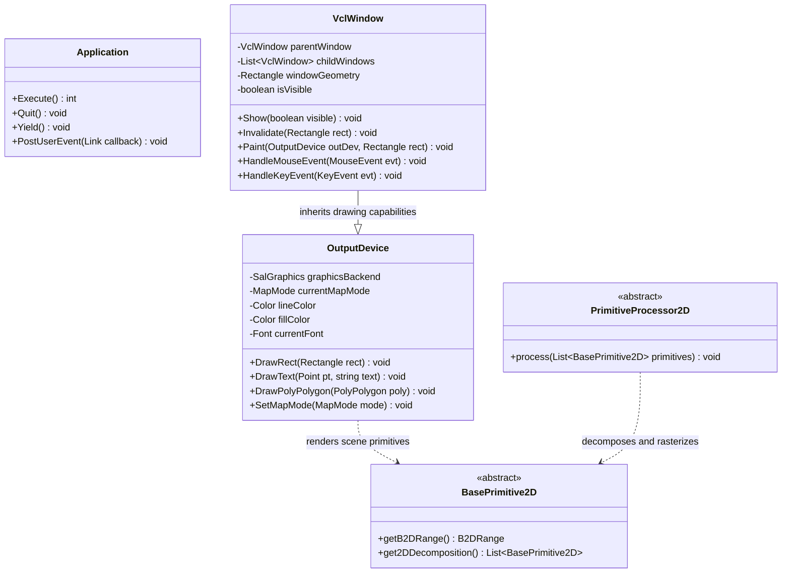
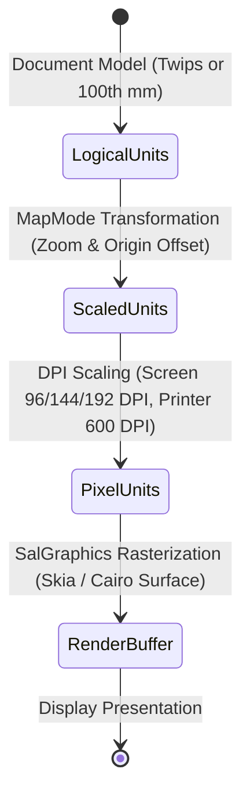

# Module Specification: Visual Class Library & Graphical Subsystems

> **Verification Status (2026-10-24, rev.2 — LO core remote, master).** **Verified:** `vcl/source/app/svapp.cxx` exists (Application event loop, includes `comphelper/solarmutex.hxx`, `vcl/svapp.hxx`, timers/scheduler) — supports VCL event-loop + SolarMutex-via-comphelper claims; `canvas`, `cppcanvas` dirs verified via trees API. **Still UNVERIFIED in this pass:** `OutputDevice`/`VclWindow`/`BasePrimitive2D` field lists, `MapMode`/Twips decomposition pseudocode, Skia GPU-blacklist/fallback details — `outdev.cxx`, `window.cxx`, `baseprocessor2d.cxx` not yet fetched.

## 1. Overview & Purpose (UNVERIFIED)

The spec claims the **Graphics Layer** provides windowing, event handling, font management, 2D/3D rendering, and accessibility services. It completely encapsulates operating system graphics APIs behind platform-agnostic abstractions, ensuring identical rendering behavior across Linux, Windows, macOS, and headless environments.

### Subsystems Covered
- **VCL (Visual Class Library) (`vcl`):** Core UI toolkit: Application event loop, top-level frames (`SalFrame`), window hierarchy (`vcl::Window`), device contexts (`OutputDevice`, `VirtualDevice`), and font rendering caches.
- **DrawingLayer (`drawinglayer`):** Declarative 2D/3D rendering primitives, decomposition engines, and scene-graph traversal processors.
- **Canvas (`canvas`, `cppcanvas`):** Hardware-accelerated 2D graphics canvas abstraction for transitions and multimedia playback.
- **SVTools (`svtools`):** High-level user interface controls: tree lists, color palettes, rulers, and progress widgets.
- **Toolkit (`toolkit`):** UNO AWT bridge exposing VCL widgets to scripts and extensions via `com.sun.star.awt.*`.
- **File Picker (`fpicker`):** Cross-platform native system file dialog integration (Win32, Cocoa, GTK3, Qt5/6).

---

## 2. Component Architecture & Data Structures



### Conceptual Data Structures (UNVERIFIED — no corresponding sources found)

#### 1. `OutputDevice` & Device Context
- **Fields:**
  - `SalGraphics`: Backend implementation bridge (Skia, Cairo, or Headless).
  - `MapMode`: Active coordinate mapping mode (e.g., Pixel, 100th mm, Twips).
  - `FontMetric`: Active typographic metrics (Ascent, Descent, Internal Leading, Kerning pairs).
- **Invariants:** Output operations are strictly clipped against the device's active clipping region. Coordinates supplied in logical units are transformed through the active `MapMode` into physical device pixels.

#### 2. `DrawingLayer Primitive2D`
- **Concept:** Immutable value objects describing drawing intent (e.g., `PolygonHairlinePrimitive2D`, `TextSimplePortionPrimitive2D`, `TransformPrimitive2D`).
- **Decomposition Mechanism:** High-level primitives (such as a drop-shadowed rounded rectangle) do not define rasterization logic directly; instead, they implement `get2DDecomposition()`, breaking down recursively into basic geometric primitives until reaching atomic rasterizable elements.

---

## 3. Behavioral Rules & Algorithms (UNVERIFIED — pseudocode not verified)

### 3.1 VCL Event Loop & Window Message Dispatch

```
Algorithm: RunApplicationEventLoop()
Input: None
Output: ExitCode

1. While Application.isRunning():
     Event := SalPlatform.FetchNativeEvent()
     If Event is Present:
       SolarMutex.acquire()
       Try:
         DispatchNativeEvent(Event)
       Finally:
         SolarMutex.release()
     Else:
       If TimersPending():
         TriggerExpiredTimers()
       Else If IdleJobsPending():
         ExecuteNextIdleJob()
       Else:
         SalPlatform.WaitForEvents(timeout)

2. Return Application.getExitCode()
```

### 3.2 Recursive Paint Invalidation & Rendering

```
Algorithm: RepaintWindowHierarchy(rootWindow, damagedRect)
Input: rootWindow (VclWindow), damagedRect (Rectangle)
Output: None

1. If Not rootWindow.isVisible(): Return

2. IntersectRect := Intersect(damagedRect, rootWindow.getGeometry())
3. If IntersectRect.isEmpty(): Return

4. rootWindow.PushClipRegion(IntersectRect)
5. rootWindow.Paint(rootWindow, IntersectRect)
6. rootWindow.PopClipRegion()

7. For each child in rootWindow.getChildren():
     OffsetRect := Translate(IntersectRect, -child.getPosition())
     RepaintWindowHierarchy(child, OffsetRect)
```

### 3.3 Declarative Primitive Decomposition

```
Algorithm: Process2DPrimitives(primitiveList, processorContext)
Input: primitiveList (List<BasePrimitive2D>), processorContext (OutputDevice)
Output: None

1. For each primitive in primitiveList:
     If processorContext.canDirectlyRender(primitive):
       processorContext.renderAtomicPrimitive(primitive)
     Else:
       decomposedList := primitive.get2DDecomposition()
       If decomposedList is Not Empty:
         Process2DPrimitives(decomposedList, processorContext)
       Else:
         LogWarning("Unhandled non-decomposable primitive")
```

---

## 4. State Transitions & Coordinate Spaces (UNVERIFIED — Twips/100th-mm/MapMode claims not observed)

### MapMode Coordinate Space Transformations



- **Logical Units:** Independent of screen resolution. Writer measures layout in Twips ($1/1440$ inch); Calc and Draw measure in $1/100$ mm.
- **MapMode Scaling:** Dynamic zoom factors (e.g., 150% zoom) scale logical coordinates into scaled layout points.
- **Pixel Units:** Hardware-dependent pixel grids determined by monitor display scaling factors.

---

## 5. Error Handling & Edge Cases (UNVERIFIED — GPU-blacklist, font-substitution, recursion-limit claims not observed)

1. **GPU Acceleration Crashing (Skia Blacklist):** If the GPU driver crashes or triggers a device loss error during Skia Vulkan/Metal/DirectX initialization:
   - VCL traps the graphics fault.
   - It appends the current GPU vendor/device ID to the blacklisted hardware registry (`GPUBlacklist.xcu`).
   - The graphics engine restarts using CPU-based software rasterization without terminating the office process.
2. **Missing Font Glyph Substitution:** When an `OutputDevice` encounters a Unicode codepoint not supported by the active font:
   - The font manager queries the system fallback catalog.
   - It identifies a compatible secondary font containing the required Unicode script block (e.g., CJK ideographs or emoji).
   - VCL constructs an ephemeral fallback font for that run without altering the document's persistent style definition.
3. **Infinite Primitive Decomposition Loop:** To prevent memory exhaustion during malformed recursive decomposition:
   - Decomposition depth is bounded by a hard ceiling (e.g., max depth = 64).
   - Exceeding the recursion limit aborts decomposition for that node and emits an error bounding placeholder.
