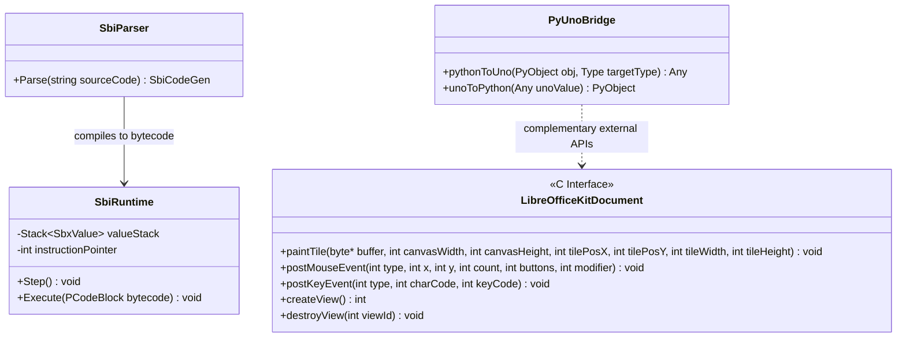
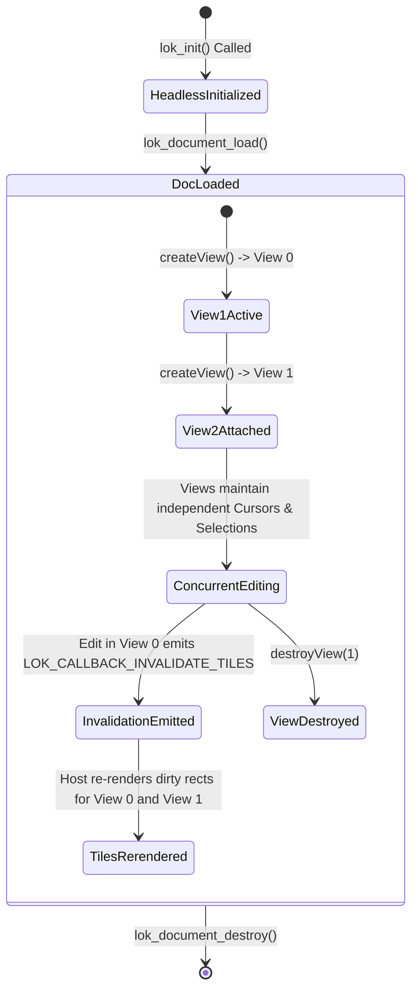

# Module Specification: Scripting & Headless Embedding Subsystems

> **Verification Status (2026-10-24, rev.2 — LO core remote, master).** **Verified:** `basic`, `basctl`, `libreofficekit` dirs exist; `basic/source/comp/parser.cxx` exists (HTTP 200, `SbiParser`, `StmntTable` with `SUB/FUNCTION/IF/FOR/SELECT` — supports StarBasic parser claims); `libreofficekit/` has `Library_libreofficekitgtk.mk`, tiled-rendering tests (supports LOKit existence). **Still UNVERIFIED in this pass:** `pyuno/.../pyuno_runtime.cxx`, `libreofficekit/source/gtk/lokdocview.c` exact signatures, P-code opcodes, `LOK_CALLBACK_INVALIDATE_TILES` — not yet fetched.

## 1. Overview & Purpose (UNVERIFIED)

The spec claims the **Scripting & Embedding Layer** enables external automation, macro scripting, and headless document manipulation. It allows third-party developers, cloud platforms, and desktop extensions to interact with LibreOffice through high-level languages (Python, StarBasic) or directly embed the office engine into web servers and mobile viewers via the **LibreOfficeKit** C API.

### Subsystems Covered
- **StarBasic Engine (`basic/`, `basctl/`):**
  - StarBasic Compiler & P-Code Bytecode Generator.
  - Virtual Machine Runtime & Built-in Function Library.
  - Integrated Development Environment (IDE) & Interactive Debugger (`basctl`).
- **VBA Compatibility Subsystem (`vbahelper/`, `oovbaapi/`):**
  - Microsoft Office VBA API emulation (`Application`, `Workbook`, `Range`, `Selection`).
- **Python-to-UNO Bridge (`pyuno/`):**
  - Dynamic PyCObject reflection and bi-directional type marshaling.
- **Scripting Framework (`scripting/`):**
  - Pluggable script providers (`vnd.sun.star.script:` URL execution).
- **LibreOfficeKit (`libreofficekit/`):**
  - Stable C ABI for headless embedding, tiled rendering, and collaborative web editors (Collabora Online).

---

## 2. Component Architecture & Data Structures



### Conceptual Data Structures (UNVERIFIED — no P-code/LOKit sources found)

#### 1. StarBasic Bytecode (P-Code)
- **Concept:** Stack-oriented intermediate representation.
- **Opcodes:** Arithmetic (`_PLUS`, `_MINUS`), Stack manipulation (`_PUSH`, `_POP`), Control flow (`_JUMP`, `_JUMPT`), Variable binding (`_FIND`, `_ASSIGN`), and Object method dispatch (`_PARAM`, `_CALL`).

#### 2. LibreOfficeKit (LOKit) Tiled Rendering Buffer
- **Tile Coordinates:** Measured in document Twips ($tilePosX, tilePosY, tileWidth, tileHeight$).
- **Canvas Dimensions:** Measured in output screen pixels ($canvasWidth, canvasHeight$).
- **Color Format:** 32-bit RGBA or BGRA packed byte buffers provided directly by the host caller.

---

## 3. Behavioral Rules & Algorithms (UNVERIFIED — pseudocode not verified)

### 3.1 LibreOfficeKit Tiled Rendering Pipeline

When an external host (e.g., Collabora Online) requests a document tile:

```
Algorithm: RenderTileToBuffer(lokDocument, bufferPtr, canvasWidth, canvasHeight, tilePos, tileSize)
Input: lokDocument, bufferPtr (Raw Memory), canvasWidth, canvasHeight (Pixels), tilePos [x, y], tileSize [w, h] (Twips)
Output: None

1. SolarMutex.acquire()
2. Try:
     // Set active view context
     ActiveView := lokDocument.getCurrentView()
     
     // Construct VirtualDevice wrapping the external memory buffer
     Device := VCL.CreateVirtualDeviceFromBuffer(bufferPtr, canvasWidth, canvasHeight, Format=RGBA)
     
     // Calculate Scaling Factors
     ScaleX := canvasWidth / tileSize.w
     ScaleY := canvasHeight / tileSize.h
     
     // Configure Device Transformation
     Device.SetMapMode(MAP_TWIP)
     Device.SetOrigin(-tilePos.x, -tilePos.y)
     Device.SetZoom(ScaleX, ScaleY)
     
     // Set Clipping Rectangle to Tile Bounds
     ClipRect := Rectangle(tilePos.x, tilePos.y, tileSize.w, tileSize.h)
     Device.SetClipRegion(ClipRect)
     
     // Execute Document Paint
     DocumentLayout := lokDocument.getDocModel().getLayout()
     DocumentLayout.Paint(Device, ClipRect)
     
     // Flush graphics commands to memory buffer
     Device.Flush()
   Finally:
     SolarMutex.release()
```

### 3.2 PyUNO Dynamic Type Conversion

```
Algorithm: ConvertPythonToUno(pyObject, expectedType)
Input: pyObject (Python Object Reference), expectedType (TypeDescriptor)
Output: uno.Any

1. If pyObject is None: Return Any(Type=VOID, Value=Null)
2. If expectedType is BOOLEAN: Return Any(Type=BOOLEAN, Value=bool(pyObject))
3. If expectedType is LONG: Return Any(Type=LONG, Value=int(pyObject))
4. If expectedType is STRING: Return Any(Type=STRING, Value=str(pyObject))

5. If expectedType is SEQUENCE:
     SequenceType := expectedType.getElementType()
     UnoList := AllocateSequence(SequenceType, len(pyObject))
     For i := 0 To len(pyObject) - 1:
       UnoList[i] := ConvertPythonToUno(pyObject[i], SequenceType)
     Return Any(Type=SEQUENCE, Value=UnoList)

6. If expectedType is INTERFACE:
     If pyObject wraps PyCObject:
       Return pyObject.getUnoReference()
     Else:
       // Python implements UNO interface -> Build dynamic Adapter Proxy
       Return CreatePythonUnoAdapter(pyObject, expectedType)

7. Raise CannotConvertException("Cannot convert " + str(type(pyObject)) + " to " + str(expectedType))
```

---

## 4. State Transitions & Multi-View Collaborative Editing (UNVERIFIED — `lok_init`/view/callback flow not observed)



- **Per-View State Isolation:** In LOKit multi-view mode, each attached client holds a unique View ID. The core document model is shared, but cursor positions, selections, and window views remain completely isolated per client.
- **Tile Invalidation Callbacks:** When user action in one view mutates the document (e.g., typing a character), the engine broadcasts `LOK_CALLBACK_INVALIDATE_TILES` containing the dirty rectangular bounding box in Twips, allowing the host server to update web canvases incrementally.

---

## 5. Error Handling & Edge Cases (UNVERIFIED — VBA/PyUNO/LOKit out-of-bounds claims not observed)

1. **VBA Unsupported Method Calls:** When running a macro calling an unsupported Microsoft Excel VBA method:
   - If `Option VBASupport 1` is set, `vbahelper` logs a missing API warning to the console.
   - It returns empty variant (`SbxEMPTY`) instead of throwing an unhandled runtime fault, allowing compatible parts of the macro script to continue execution.
2. **PyUNO Reference Cycle Leaks:** When Python objects reference UNO objects which hold callbacks back to Python:
   - PyUNO registers bridge hooks with the Python cyclic garbage collector (`gc`).
   - Weak references break the cross-environment cycle, preventing native memory leaks during long-running server scripts.
3. **LOKit Out-of-Bounds Tile Requests:** If a tile request specifies a `tilePos` beyond the document boundaries:
   - LOKit clears the target memory buffer to default page canvas background (solid white).
   - It completes cleanly with a zero exit status without performing invalid out-of-bounds array reads.
