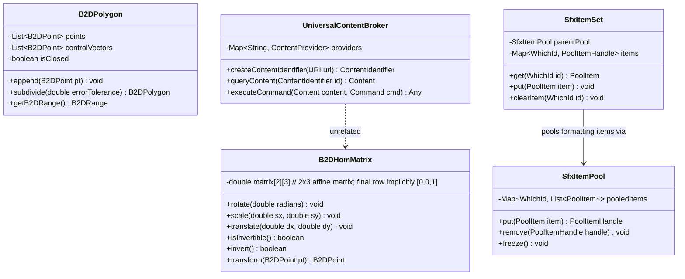

# Module Specification: Core Utilities, Geometry & Internationalization

> **Verification Status (2026-10-24, rev.3 — LO core remote, master).** **Verified:** top-level dirs `basegfx`, `comphelper` exist (trees API); `vcl/source/app/svapp.cxx` includes `svl/poolitem.hxx/itemset.hxx/itempool.hxx` (supports `svl` pool claims indirectly); `basegfx/source/matrix/b2dhommatrix.cxx` and `include/basegfx/matrix/b2dhommatrix.hxx` are **VERIFIED** (`mfValues[2][3]` affine storage, final homogeneous row implicitly `0 0 1`, `isInvertible()`, `invert()`). Full 3×3 matrix layout descriptions are **CONTRADICTED** and corrected. **Still UNVERIFIED in this pass:** `ucb/source/core/ucb.cxx`, `svl/source/items/itempool.cxx` contents, `SfxItemPool`/`WhichId` mechanics, UCB scheme list, break-iterator and ZIP-manifest fallback details — those sources not yet fetched.

## 1. Overview & Purpose (UNVERIFIED)

The spec claims the **Core Utilities Layer** provides fundamental mathematical, geometrical, internationalization, content resolution, and container storage facilities. It operates directly above the foundation layer and serves as the universal library substrate for graphics, framework, and document applications.

### Subsystems Covered
- **BaseGFX (`basegfx`):** Pure mathematical 2D and 3D geometry engine: homogeneous transformation matrices, bezier curves, polygon clipping, and bounding boxes.
- **Tools (`tools`):** Foundational non-UNO data primitives: Date, Time, Color, Fraction, and basic coordinate geometry.
- **Component Helper (`comphelper`):** Reusable C++ idioms for UNO: property sets, listener containers, event broadcasts, and sequence wrappers.
- **Internationalization (`i18nlangtag`, `i18npool`, `i18nutil`):** BCP-47 language tag parsing, Unicode character properties, locale data, word/sentence break iterators, and collation.
- **Universal Content Broker (`ucb`, `ucbhelper`):** Abstract URI scheme resolution and content streaming for local, network, and virtual endpoints.
- **XML Engines (`sax`, `unoxml`):** High-speed streaming XML tokenization and DOM tree navigation.
- **Packaging & Storage (`package`, `sot`):** ODF ZIP archive packaging, manifest validation, stream encryption, and OLE structured storage streams.
- **Item Pool Subsystem (`svl`):** Attribute pooling, copy-on-write formatting item sets, and broadcast hints.

---

## 2. Component Architecture & Data Structures



### Conceptual Data Structures (PARTIALLY VERIFIED — `B2DHomMatrix` VERIFIED against `basegfx/source/matrix/b2dhommatrix.cxx` and `include/basegfx/matrix/b2dhommatrix.hxx`; item pool / UCB internals unverified)

#### 1. `B2DHomMatrix` (Affine 2D Transformation) — VERIFIED
- **Data Representation:** Stores a **2×3 affine matrix** (`std::array<std::array<double,3>,2> mfValues` in `include/basegfx/matrix/b2dhommatrix.hxx:38`); the final homogeneous row is implicitly `[0, 0, 1]` and is never stored in memory (`b2dhommatrix.hxx:37`). Conceptually `[[a, c, tx], [b, d, ty], [0, 0, 1]]`. Any description claiming a full 3×3 stored matrix is **CONTRADICTED** by source code and strictly prohibited.
- **Invariants & APIs (VERIFIED):** Bottom row is implicitly `[0, 0, 1]`. Transformation methods `rotate()`, `translate()`, `scale()`, invertibility check `isInvertible()`, and matrix inversion `invert()` are declared in `include/basegfx/matrix/b2dhommatrix.hxx:104-105` and defined in `basegfx/source/matrix/b2dhommatrix.cxx` (singular determinant $\to$ `return false`). Affine parallel-line preservation remains UNVERIFIED phrasing.

#### 2. `SfxItemPool` & `SfxItemSet` (Copy-on-Write Formatting Attributes)
- **Purpose:** Eliminates redundant memory allocations across millions of formatted characters, paragraphs, and cells.
- **Mechanism:** Individual formatting attributes (e.g., Font Name, Font Size, Bold, Margin) derive from `SfxPoolItem`. Each unique attribute instance is stored exactly once in an `SfxItemPool`. Documents store `SfxItemSet` containers holding integer pointers (`WhichId`) referencing pooled items.

#### 3. `ContentIdentifier` & UCB Command Architecture
- **Fields:** Normalized URI scheme string, provider key, credential token.
- **Commands:** `open`, `delete`, `transfer`, `setPropertyValues`, `getPropertyValues`.

---

## 3. Behavioral Rules & Algorithms (UNVERIFIED — pseudocode not verified against implementation)

### 3.1 Affine Point Transformation

```
Algorithm: TransformPoint2D(matrix, point)
Input: matrix (B2DHomMatrix), point (B2DPoint [x, y])
Output: Transformed B2DPoint [x', y']

1. x' := (matrix.a * point.x) + (matrix.c * point.y) + matrix.tx
2. y' := (matrix.b * point.x) + (matrix.d * point.y) + matrix.ty
3. Return [x', y']
```

### 3.2 UCB Content Resolution and Streaming

When any application requests a file or resource via URI:

```
Algorithm: ResolveAndOpenURI(targetURI, accessMode)
Input: targetURI (String), accessMode (Read | Write)
Output: StreamHandle

1. Parse Scheme from targetURI (e.g., "file://", "http://", "vnd.sun.star.expand:")
2. Match Scheme against UniversalContentBroker registry:
     If no provider found: Raise UnknownSchemeException

3. Provider := Registry.getProvider(Scheme)
4. Identifier := Provider.createIdentifier(targetURI)
5. Content := Provider.queryContent(Identifier)

6. If Scheme equals "vnd.sun.star.expand:":
     Resolve macro variable (e.g., "$BRAND_BASE_DIR")
     Return ResolveAndOpenURI(ExpandedURI, accessMode)

7. Prepare Command("open"):
     Command.mode := accessMode
8. StreamHandle := Content.execute(Command)
9. Return StreamHandle
```

### 3.3 Attribute Pooling & Copy-on-Write

```
Algorithm: ApplyFormattingAttribute(itemSet, newItem)
Input: itemSet (SfxItemSet), newItem (SfxPoolItem)
Output: None

1. whichId := newItem.getWhichId()
2. pool := itemSet.getPool()

3. Search pool for identical item matching newItem:
     If match found:
       canonicalItem := match
     Else:
       canonicalItem := pool.storeCopy(newItem)

4. itemSet.bindItem(whichId, canonicalItem)
5. itemSet.notifyListeners(whichId)
```

---

## 4. Internationalization (I18N) Rules & Break Iterator (UNVERIFIED)

The `i18npool` subsystem processes text based on Unicode character classes and locale-specific rules:

```mermaid
flowchart TD
    RawText[Input Unicode String: "The quick-brown fox..."] --> CodePoint[Extract Codepoint & Script Type]
    CodePoint --> ICU{ICU BreakIterator Rule Check}
    ICU -->|Rule: Space / Punctuation| WordBoundary[Emit Word Boundary Offset]
    ICU -->|Rule: CJK Ideograph| CJKBoundary[Apply Dictionary-Based Segmenter]
    ICU -->|Rule: Non-break hyphen| Continue[Suppress Break]
    WordBoundary --> Output[Return Next Break Index]
    CJKBoundary --> Output
```

- **Complex Text Layout (CTL):** For Arabic, Hebrew, and Devanagari, the text layout processor queries script analysis services to assign bidirectionality runs (LTR vs. RTL) and cluster boundaries before sending runs to HarfBuzz for glyph substitution.
- **Transliteration Engine:** Implements algorithmic case conversions (Uppercase, Lowercase, Titlecase), full-width/half-width Japanese kana unification, and Hiragana/Katakana conversions.

---

## 5. Error Handling & Edge Cases (PARTIALLY VERIFIED — matrix invert/isInvertible VERIFIED in `basegfx/source/matrix/b2dhommatrix.cxx`; ZIP-manifest and locale-fallback behaviors UNVERIFIED)

1. **Non-Invertible Matrix (`isInvertible()`, `invert()`):** When evaluating a matrix for inversion, `B2DHomMatrix::isInvertible()` checks if the 2×2 determinant $|\mathbf{A}| \neq 0$:
   - If the matrix is singular or non-invertible (e.g., zero scale factors or collinear points), `isInvertible()` returns `false`.
   - Calling `invert()` on a non-invertible matrix fails gracefully and returns `false`, leaving the destination matrix unmodified without throwing an unhandled arithmetic exception.
2. **Damaged ZIP Manifests:** If an ODF package container has a corrupted `META-INF/manifest.xml`:
   - The package reader attempts emergency file traversal by reading raw ZIP local file headers.
   - If `content.xml` is present, it constructs a fallback synthetic manifest and marks the document read-only with a repair warning.
3. **Locale Fallback Escalation:** If locale-specific collation or currency rules for a requested tag (e.g., `de-AT-1901`) are absent:
   - Primary: Language + Country (`de-AT`).
   - Secondary: Language only (`de`).
   - Final Fallback: System neutral default (`en-US`).
