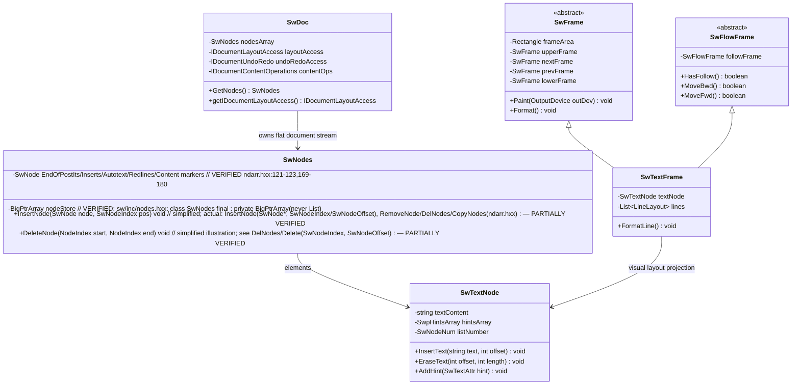
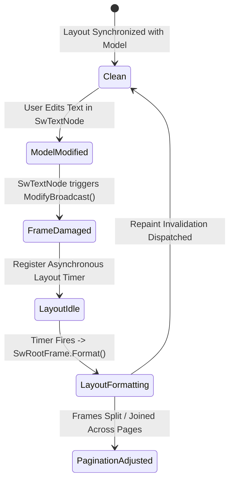

# Module Specification: Writer (Word Processor)

> **Verification Status (2026-10-24, rev.3 — LO core remote, master).** **Verified:** `sw/source/core/doc/doc.cxx` exists and defines `SwDoc::acquire/release` (atomic refcount), `GetUndoManager`/`GetIDocumentUndoRedo`, `IDocumentDrawModelAccess/SettingAccess` managers. `SwNodes` data structure is **VERIFIED** in `sw/inc/nodes.hxx` and `sw/inc/ndarr.hxx` (`class SwNodes final : private BigPtrArray` using paired `SwStartNode`/`SwEndNode` boundary markers; never `List<SwNode>`). **Still UNVERIFIED in this pass:** `sw/source/core/layout/flowfrm.cxx`, `writerfilter/source/dmapper/DomainMapper.cxx` contents, `SwpHintsArray` exact hints merging order, widow/orphan rules, follow-frame and hint-merging pseudocode step order — layout/filter sources not yet fetched.

## 1. Overview & Purpose (UNVERIFIED)

The spec claims **LibreOffice Writer** (`sw`) is a full-featured word processing and desktop publishing application. It manages complex text flow, multi-column page layouts, nested tables, foot/endnotes, live cross-references, mail merge, and track-changes editing.

### Subsystems Covered
- **Writer Document Core (`sw/source/core/`):**
  - Document Model (`SwDoc`, `IDocument*` interfaces).
  - Flat Node Array (`SwNodes`, `SwNode`, `SwTextNode`, `SwStartNode`, `SwEndNode`).
  - Character Formatting & Attribute Hints (`SwpHintsArray`, `SwTextAttr`).
  - Cursor & Selection Navigation (`SwCursor`, `SwPaM`).
  - Layout & Pagination Engine (`SwFrame`, `SwRootFrame`, `SwPageFrame`, `SwTextFrame`, `SwFlowFrame`).
  - Table Engine (`SwTable`, `SwTabFrame`, `SwRowFrame`, `SwCellFrame`).
  - Floating Objects & Frames (`SwFlyFrame`).
- **Word Processing Filters (`writerfilter/`, `sw/source/filter/`):**
  - DOCX & RTF Domain Mapper (`writerfilter::dmapper`).
  - Binary Microsoft Word 97–2003 filter (`ww8`).
  - WordPerfect, AbiWord, and Pages import (`writerperfect`).

---

## 2. Component Architecture & Data Structures



### Conceptual Data Structures (PARTIALLY VERIFIED — `SwNodes` VERIFIED in `sw/inc/nodes.hxx` and `sw/inc/ndarr.hxx`; `SwpHintsArray` internals unverified)

#### 1. Flat Node Array (`SwNodes`) — VERIFIED
- **Implementation Structure:** Declared as `class SwNodes final : private BigPtrArray` (`sw/inc/nodes.hxx`, `sw/inc/ndarr.hxx:105-106`). Content is indexed via an optimized block-pointer array (`BigPtrArray`), **never** as a simple `List<SwNode>` or linked list.
- **Sentinel Node Boundaries:** Hierarchical sections (tables, headers, footnotes, nested sections) are bounded by paired sentinel node structures rather than a recursive DOM tree:
  - `SwStartNode`: Marks entry into a section, table cell, or header.
  - `SwEndNode`: Marks termination of the section, pointing directly back to its paired `SwStartNode`.

#### Top-Level Stream Partitioning:
1. **Reserved Sentinel Block:** Internal root markers.
2. **Footnote/Endnote Block:** Paragraphs contained within document footnotes.
3. **Fly Frame / Header / Footer Block:** Anchored floating text frames and recurring headers.
4. **Deleted Change-Tracking Block:** Redline nodes retained for revision history.
5. **Main Document Body:** Primary visible document text.

#### 2. Attribute Hints (`SwpHintsArray`)
Character formatting is not stored as nested tags. Instead, each `SwTextNode` maintains a sorted array of `SwTextAttr` hints defining `[StartOffset, EndOffset, FormattingItem]`.
- **Formatting Hints:** Non-overlapping intervals of Bold, Italic, Font Name. Slices are dynamically merged into rendering portions during layout formatting.
- **Nesting Hints:** Hyperlinks, Ruby/Furigana text, and bookmark metadata.
- **Zero-Length Hints:** Fields (Page numbers, Dates) and anchored fly frames (`AS_CHAR`). These reserve a sentinel dummy character (`0x01` or `0xFFFD`) in the raw text string.

---

## 3. Behavioral Rules & Algorithms (UNVERIFIED — pseudocode not verified; widow/orphan, follow-frame behavior not observed)

### 3.1 Paragraph Flow and Page Splitting Algorithm

When formatted text exceeds the printable area of a page:

```
Algorithm: FormatParagraphLayout(textFrame, availableHeight)
Input: textFrame (SwTextFrame), availableHeight (Twips)
Output: RemainingHeight

1. currentHeight := 0
2. lineBreakIndex := 0

3. While lineBreakIndex < textFrame.getTextLength():
     Line := FormatNextLine(textFrame, lineBreakIndex)
     
     If (currentHeight + Line.getHeight()) > availableHeight:
       // Page overflow boundary reached
       If CanSplitParagraph(textFrame, Line):
         // Respect Widow and Orphan constraints
         If ViolatesOrphanRule(textFrame, currentLineCount):
           // Push entire paragraph to next page
           MoveEntireFrameToNextPage(textFrame)
           Return 0
         
         // Split paragraph across page break
         followFrame := textFrame.CreateFollow()
         followFrame.setStartLine(lineBreakIndex)
         InsertFrameIntoNextPage(followFrame)
         BreakLoop
       Else:
         MoveEntireFrameToNextPage(textFrame)
         BreakLoop
     
     currentHeight := currentHeight + Line.getHeight()
     lineBreakIndex := Line.getEndIndex()

4. textFrame.setHeight(currentHeight)
5. Return (availableHeight - currentHeight)
```

### 3.2 Inline Hint Merging & Portion Creation

```
Algorithm: ComputeTextPortions(textNode)
Input: textNode (SwTextNode)
Output: List<TextPortion>

1. RawText := textNode.getString()
2. SplitIndices := Set of {0, RawText.length()}

3. For each hint in textNode.getHints():
     SplitIndices.insert(hint.getStart())
     SplitIndices.insert(hint.getEnd())

4. SortedOffsets := SortAscending(SplitIndices)
5. Portions := Empty List

6. For i := 0 To SortedOffsets.length() - 2:
     Start := SortedOffsets[i]
     End := SortedOffsets[i+1]
     Substring := RawText.substring(Start, End)
     
     // Accumulate active formatting attributes for range [Start, End)
     ActiveAttrs := textNode.getInheritedParagraphAttributes()
     For each hint covering [Start, End):
       ActiveAttrs.merge(hint.getAttributeItem())
     
     Portions.append(New TextPortion(Substring, ActiveAttrs))

7. Return Portions
```

---

## 4. State Transitions & Layout Tree Synchronization (UNVERIFIED — lazy-formatting/synchronization claims not observed)



- **Decoupled Notification:** Mutating `SwTextNode` does not instantly recompute entire page layouts. It marks the attached `SwTextFrame` as dirty (`FrameDamaged`) and registers an idle notification.
- **Lazy Formatting:** Off-screen pages are not laid out until scrolling approaches their viewport range, ensuring high responsiveness when opening large documents (e.g., 500+ pages).

---

## 5. Error Handling & Edge Cases (UNVERIFIED — table-split, anchor-loop, hint-normalization claims not observed)

1. **Table Larger Than Single Page:** When an individual table row exceeds the physical height of an entire page:
   - If row splitting is enabled (`RowSplit=True`), Writer breaks cell contents across pages, cloning header frames.
   - If row splitting is disabled, the layout engine clips the row to the bottom margin and forces an emergency page break, preventing layout calculation loops.
2. **Circular Anchored Frame Dependencies:** A floating frame anchored to a paragraph can cause the paragraph to push to the next page, which in turn shifts the frame anchor:
   - Writer maintains an iteration counter during layout loops (`LoopCheck`).
   - If a frame oscillates between two pages more than 4 times, the engine freezes the frame on the second page and logs a layout warning, averting an infinite freeze.
3. **Corrupted Inline Hints:** If an import filter produces overlapping or out-of-order hints:
   - The hints array normalizer sorts hints by start index and truncates end boundaries exceeding paragraph length.
