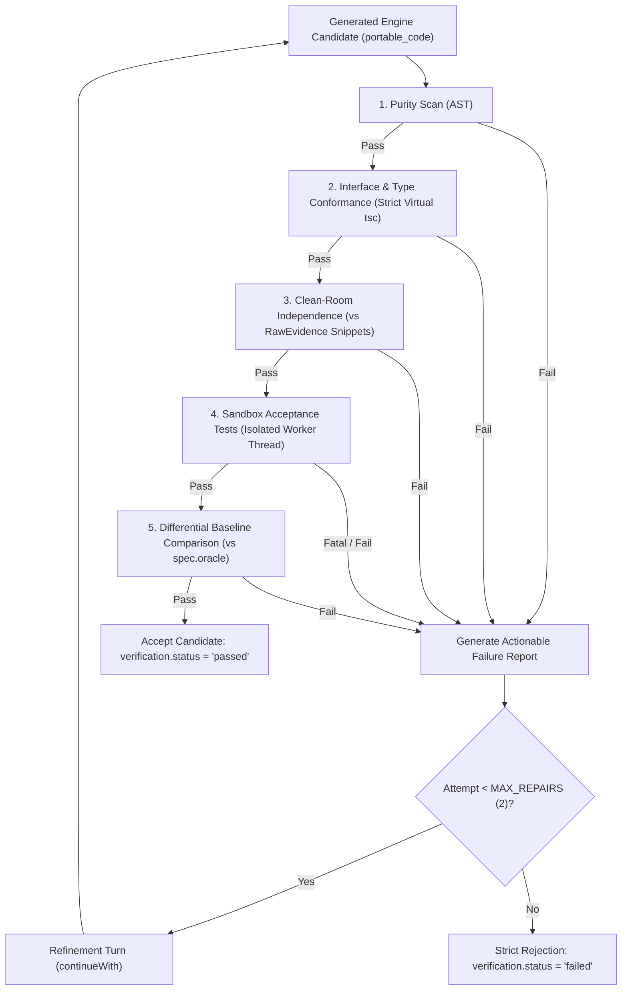

# Splice Step 3: Conformance Oracle & Refinement Specification
## Behavioral Verification, Failure Diagnosis, and Static Evidence Limitations

---

## 1. Executive Summary & Purpose

In Splice Step 3, clean-room TypeScript implementations ("engines") are synthesized from extracted feature specifications (`FeatureSpec`) without exposure to the original target application's private source code or adapter code.

The **Conformance Oracle** is the authoritative validation gate that evaluates whether a candidate engine adheres strictly to the approved specification before it can be accepted, fused into bundles, or deployed. If a candidate fails any check, the oracle produces a **structured, actionable failure report** and feeds it into a bounded **refinement loop** (`MAX_REPAIRS = 2`) via `continueWith`.

Candidates that fail mandatory checks are **strictly rejected**; compilation or typecheck success alone is never sufficient for approval.

---

## 2. Oracle Verification Pipeline

Every candidate engine (`portable_code`) undergoes a multi-stage deterministic evaluation:



### Verification Capabilities

1. **Environmental Purity (Static AST Analysis):**
   - Prohibits all `import` and `require` statements.
   - Prohibits Node.js and browser environment globals (`process`, `window`, `document`, `localStorage`, `globalThis`).
   - Prohibits non-deterministic functions (`Math.random()`, unparameterized `new Date()`, `Date.now()`).
   - Prohibits console logging and timers (`setTimeout`, `setInterval`).
   - Prohibits runtime code evaluation (`eval`, `new Function`).

2. **Interface & Type Conformance (TypeScript Strict Mode):**
   - Verifies that every exported function matches the exact signature declared in `spec.interface.types_code`.
   - Verifies bidirectional shape assignability for exported types/interfaces (no excess or missing properties).
   - Verifies exported constants match declared types.
   - Applies strict null and type checks (`--strict`).

3. **Clean-Room Source Independence (Anti-Plagiarism):**
   - Compares candidate lines against `RawEvidence.snippets`.
   - Rejects candidate implementations that copy verbatim source code lines from the original target application, ensuring clean-room provenance.

4. **Runtime Behavioral Acceptance Tests (Sandbox Runner):**
   - Executes the acceptance test suite (`spec.acceptance_tests`) within an isolated V8 context on a worker thread.
   - Captures detailed assertion failures (`assert.equal`, `assert.deepEqual`, `assert.closeTo`, `assert.throws`, `assert.ok`).
   - Enforces execution timeouts (`perTestTimeoutMs = 500ms`, `totalTimeoutMs = 8000ms`) to detect infinite loops and non-terminating recursion.

5. **Behavioral Invariant & Error Contract Enforcement:**
   - Evaluates requirements by kind (`error`, `invariant`, `edge_case`, `behavior`).
   - Detects contract violations: e.g. throwing generic `Error` when `RangeError` was mandated, or allowing numerical values to breach defined invariant floors/ceilings.

6. **Differential Comparison against Original Target Baseline:**
   - Correlates candidate test results with ground-truth test execution recorded in `spec.oracle.tests`.
   - Flags regressions where a test that passed against the original target code fails on the generated clean-room engine.

---

## 3. Documented Oracle Limitations

While the Conformance Oracle provides robust behavioral validation, there are intrinsic theoretical and practical limits on what can be established from available static evidence and discrete test vectors. The following limitations are explicitly documented and acknowledged:

### 1. Unexercised Code Paths and Input State Space
- **Limitation:** The oracle establishes behavioral equivalence **only for the input domain and execution paths exercised by the acceptance test suite**.
- **Theoretical Grounding:** By Rice's Theorem and the Halting Problem, non-trivial semantic equivalence of arbitrary computer programs is undecidable.
- **Evidence Gap:** If the original target application contained edge cases, hidden states, or branching logic that were neither exercised in the recorded evidence nor captured in the authored acceptance tests, the oracle cannot verify whether the clean-room engine behaves identically on those unexercised inputs.

### 2. Stripped Platform Glue and Host I/O
- **Limitation:** External interactions—such as Electron IPC communication (`ipcMain.handle`, `ipcRenderer.invoke`), filesystem storage, window event loops, and native OS dialogs—are deliberately stripped as "glue" during extraction to create pure, portable modules.
- **Evidence Gap:** The engine oracle verifies purely computational logic in isolation. It cannot verify whether the clean-room engine will interact seamlessly with legacy platform-specific glue without integration testing in the host application environment.

### 3. Non-Deterministic Dynamics and Wall-Clock Timing
- **Limitation:** Real-world targets frequently rely on asynchronous event timing, filesystem timestamps, hardware clocks (`Date.now()`), or random entropy (`Math.random()`).
- **Evidence Gap:** Pure engines require deterministic parameter injection (e.g. passing a `today` timestamp argument rather than querying system time). The oracle verifies that the engine functions correctly for injected values, but cannot verify real-time temporal dynamics or concurrent race conditions present in the original host application.

### 4. Native Binary Inaccessibility
- **Limitation:** When reversing compiled native targets (e.g. C/C++ DLLs, Mach-O binaries, or stripped executables) where high-level JavaScript source cannot be decompiled (`oracle.status === "not_executable"`), differential sandboxing against original code cannot run in the Node.js V8 sandbox.
- **Evidence Gap:** In these cases, conformance relies strictly on the extracted specification contracts rather than live differential comparison against the binary execution.

### 5. Runtime Sandbox Isolation Assumptions
- **Limitation:** Sandboxed test execution runs in an isolated Node.js V8 VM context with mocked globals.
- **Evidence Gap:** Specific runtime quirks of legacy browsers (e.g. Internet Explorer legacy DOM behaviors, differences between SpiderMonkey, JavaScriptCore, and V8 engines) are not replicated by the sandbox runner.

---

## 4. Structured Failure Reports & Actionable Feedback

When a candidate fails conformance, the oracle structures the failure into categorized, actionable feedback:

```ts
export interface ActionableFailure {
  category:
    | "purity"
    | "type"
    | "runtime_assertion"
    | "runtime_error"
    | "timeout"
    | "missing_tests"
    | "contract_violation"
    | "clean_room_violation"
    | "differential_divergence";
  requirement_id?: string;
  requirement_kind?: "behavior" | "invariant" | "edge_case" | "error";
  test_name?: string;
  message: string;
  expected?: string;
  actual?: string;
  suggestion?: string;
}
```

### Example Actionable Repair Prompt

When fed into `deps.llm.continueWith(messages, res.assistantContent, feedback)`, the model receives:

```
Your module does not meet the specification yet:
<failures>
1. [contract_violation] Test "REQ-1: RangeError on negative grade" failed: expected RangeError to be thrown, got Error: invalid grade
   - Requirement: REQ-1 [error] "Throws RangeError if grade is not an integer between 0 and 5 inclusive"
   - Expected: to throw RangeError
   - Actual:   Error: invalid grade
   - Suggestion: Requirement REQ-1 mandates throwing on invalid inputs: "Throws RangeError if grade is not an integer between 0 and 5 inclusive". Ensure the function validates input parameters and throws the exact specified Error class (e.g. RangeError or TypeError).

2. [contract_violation] Test "REQ-4: ease floor" failed: expected 1.30, got 1.25
   - Requirement: REQ-4 [invariant] "Ease factor cannot drop below MIN_EASE (1.30)"
   - Expected: 1.30
   - Actual:   1.25
   - Suggestion: Requirement REQ-4 specifies an invariant: "Ease factor cannot drop below MIN_EASE (1.30)". Ensure calculations enforce boundary constraints (e.g. using Math.max / Math.min or clamping).
</failures>
Fix the implementation so it satisfies all requirements and contracts (not just these specific test values). Return the complete TypeScript module matching the schema.
```

---

## 5. Bounded Attempts & Strict Rejection Policy

1. **Attempt Bound:** The refinement loop enforces `MAX_REPAIRS = 2`. The maximum number of model generation attempts is strictly capped at `1 + MAX_REPAIRS = 3` turns.
2. **Explicit Cancellation and Timeouts:**
   - An `AbortSignal` is checked before every model call and sandbox execution (`signal?.throwIfAborted()`).
   - An optional `timeoutMs` aborts execution cleanly if elapsed.
   - Client cancellation (e.g. closing an HTTP SSE connection) immediately halts further repair turns.
3. **Strict Rejection:**
   - If after `MAX_REPAIRS` attempts the engine still has any purity violation, type error, or failing acceptance test, the engine blueprint is marked `verification.status = "failed"`.
   - **Compiling is not passing:** A candidate that typechecks cleanly but fails runtime assertions is rejected.
   - In Step 3 bundle synthesis (`/api/synthesize`), unverified/failed engines cannot be fused (`fusionErrors` rejects any unverified engine).

---

## 6. OHI/O Hackathon Rubric Compliance Mapping

| Rubric Pillar & EMLO | Splice Conformance Implementation |
|---|---|
| **Pillar 1: Curiosity & Innovation (EMLO 2)** | Analyzes target behavior from collected evidence; derives formal invariants and contracts; verifies novel clean-room re-implementation without legacy flaws. |
| **Pillar 2: Technical Complexity (EMLO 3 & 9)** | Bridges static TypeScript compilation analysis (`virtualTsc`), AST purity inspection, and dynamic V8 sandbox execution with deterministic differential oracle comparison. |
| **Pillar 3: Navigating Challenges & Failure (EMLO 6)** | Implements a robust feedback-driven self-repair loop: captures failures, structures root causes, derives actionable suggestions, and tracks repair attempts. |
| **Pillar 3: Test & Validate Solutions (EMLO 10 & 12)** | Executes comprehensive acceptance tests verifying every requirement ID (`REQ-N`); strictly rejects non-conforming implementations; explicitly documents oracle limitations. |
