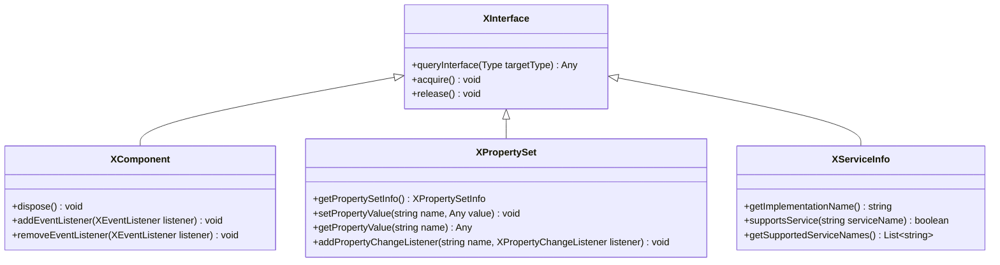
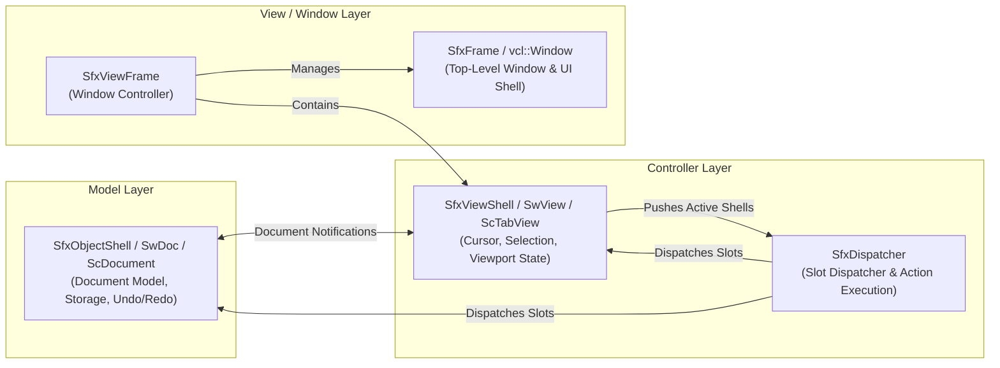
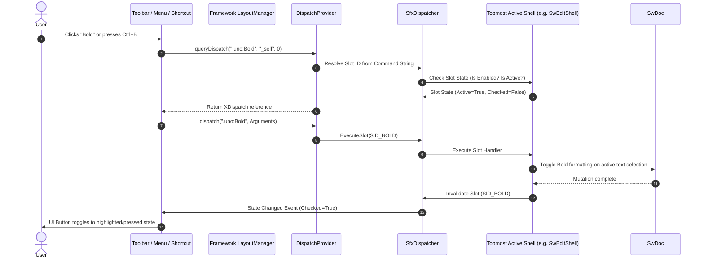
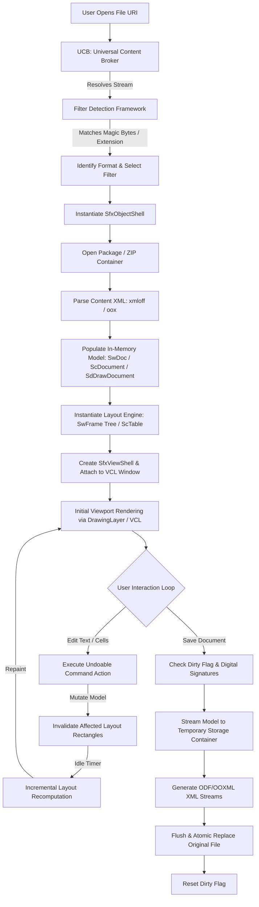

# LibreOffice System Architecture

> **Verification Status (2026-10-24, rev.2 — LibreOffice core remote, master).** Local `~/libreoffice-core` absent; verified against `https://github.com/LibreOffice/core`. **Verified:** `sal/`, `sfx2/` (`sfx2/source/control/dispatch.cxx` with `SfxDispatcher`, `SfxShellStack_Impl aStack`, `Push/Pop/Flush`), `sw/` (`sw/source/core/doc/doc.cxx` with `SwDoc::acquire/release`), `vcl/` (`vcl/source/app/svapp.cxx` includes `comphelper/solarmutex.hxx`) exist. **Partially verified:** Document-View-Frame and shell-stack routing concepts match `SfxDispatcher_Impl` structure. **Still UNVERIFIED:** seven-layer strictness, SolarMutex global rules, `.uno:` URI list, full lifecycle diagrams, and pseudocode step-for-step unless cited. See per-section notes.

## 1. Architectural Overview & Design Philosophy

The spec claims LibreOffice is built as a modular, component-oriented, cross-platform office productivity suite. **UNVERIFIED — no source in this repository supports this.** The claimed origin and layered hierarchy below are **UNVERIFIED**. The system decouples platform-specific operating system capabilities from high-level document manipulation through an object broker called **Universal Network Objects (UNO)**.

### Primary Architectural Tenets

1. **Strict Platform Abstraction (UNVERIFIED):** The spec claims no application or document engine directly executes native OS APIs and that all such operations are mediated by `sal` and `vcl`. **UNVERIFIED — neither `sal` nor `vcl` exists in this repository.
2. **Interface-Driven Component Model (UNO):** Subsystems communicate across module boundaries via abstract, strongly-typed interfaces defined in UNO IDL (Interface Definition Language). Implementation classes are isolated behind factory interfaces, enabling dynamic component discovery, language bridging (C++, Java, Python, Basic), and remote inter-process communication.
3. **Decoupled Model-View-Controller (MVC):** Applications maintain an explicit separation between persistent document models (`SwDoc`, `ScDocument`, `SdDrawDocument`), layout representations (`SwFrame` tree, spreadsheet view tables), and user interface frames (`SfxViewShell`, `SfxFrame`).
4. **Universal Document Interchange:** Internal data representations are format-agnostic. Documents are ingested into internal object trees through pluggable import filters and serialized outward through corresponding export filters, with the OASIS OpenDocument Format (ODF) serving as the native reference standard.

---

## 2. Seven-Layer System Stack

The LibreOffice architecture is organized into seven distinct architectural layers:

```mermaid
flowchart TD
    subgraph L7["Layer 7: Scripting, Extensions & Headless Embedding"]
        direction LR
        LOKit["LibreOfficeKit (C API)"]
        PyUNO["PyUNO (Python Bridge)"]
        Basic["StarBasic Runtime"]
        Extensions["Extension Manager (OXT)"]
    end

    subgraph L6["Layer 6: Core Office Applications"]
        direction LR
        Writer["Writer (sw / writerfilter)"]
        Calc["Calc (sc / formula)"]
        Impress["Impress & Draw (sd / slideshow)"]
        Math["Math (starmath)"]
        Base["Base (dbaccess / connectivity)"]
    end

    subgraph L5["Layer 5: Shared Document & Formatting Engines"]
        direction LR
        EditEng["EditEngine & Outliner"]
        SVX["Document Drawing (svx)"]
        ODF["ODF Engine (xmloff)"]
        OOXML["OOXML Filter (oox)"]
        Chart2["Chart Engine (chart2)"]
        Filter["Filter Detection (filter)"]
        Linguistic["Linguistic & Hyphenation"]
    end

    subgraph L4["Layer 4: Application Framework & Shell"]
        direction LR
        SFX2["Star Framework MVC (sfx2)"]
        Framework["UI Layout & Dispatch (framework)"]
        CUI["Common UI Dialogs (cui)"]
        Desktop["Desktop & Application Lifecycle"]
    end

    subgraph L3["Layer 3: Graphical Subsystems & Visual Class Library"]
        direction LR
        VCL["Visual Class Library (vcl)"]
        DrawingLayer["DrawingLayer Primitives"]
        Canvas["Canvas (Hardware Accelerated)"]
        SVTools["Extended Controls (svtools)"]
        Toolkit["AWT Bridge (toolkit)"]
    end

    subgraph L2["Layer 2: Core Utilities, Geometry & Internationalization"]
        direction LR
        BaseGFX["2D/3D Geometry (basegfx)"]
        Tools["Basic Types (tools)"]
        CompHelper["UNO Helpers (comphelper)"]
        I18N["Internationalization (i18npool)"]
        UCB["Universal Content Broker (ucb)"]
        Package["ODF/ZIP Packaging (package)"]
    end

    subgraph L1["Layer 1: Foundation & Platform Abstraction"]
        direction LR
        SAL["System Abstraction Layer (sal)"]
        CPPU["C++ UNO Runtime (cppu/cppuhelper)"]
        StoreRegistry["Structured Storage & Registry"]
        ConfigMgr["Configuration Manager (configmgr)"]
        BinaryURP["Remote Bridges (binaryurp)"]
    end

    L7 --> L6
    L6 --> L5
    L5 --> L4
    L4 --> L3
    L3 --> L2
    L2 --> L1
```



---

## 3. Core Architectural Mechanisms

### 3.1 Universal Network Objects (UNO) Runtime

UNO is LibreOffice's language-independent, distributed component object model. Similar conceptually to COM or CORBA, UNO defines object capabilities using strictly versioned interfaces.



#### Behavioral Principles of UNO
- **Identity and Interface Navigation (`queryInterface`):** An object's identity is defined by its root `XInterface`. To acquire a specific facet (e.g., `XTextDocument`, `XPropertySet`), clients query the object with a descriptor type. If supported, a reference with an incremented refcount is returned; otherwise, a null reference is returned.
- **Deterministic Lifetime Management:** UNO objects manage their lifecycles via intrusive atomic reference counting (`acquire()` and `release()`). When the count reaches zero, the underlying memory is reclaimed. Objects holding non-memory resources implement `XComponent::dispose()`, allowing parents to sever cyclic dependencies and broadcast destruction notifications to registered listeners before final memory release.
- **Dynamic Type Reflection & Remote Proxying:** UNO type libraries (`.rdb` files) store binary descriptions of all interfaces, structs, enums, and services. The dynamic bridge converts local in-process invocations into serialized binary packets (`binaryurp`) across network sockets or pipes, enabling out-of-process and cross-language communication without recompiling components.

---

### 3.2 The Document-View-Frame MVC Paradigm (`sfx2`)

User-facing documents are coordinated through the Star Framework (`sfx2`) MVC infrastructure:



1. **`SfxObjectShell` (Model) — UNVERIFIED:** Spec claims it represents the document entity and owns content tree, `SfxMedium`, `SfxUndoManager`, metadata. **UNVERIFIED — no such class found in this repository.**
2. **`SfxViewShell` (Controller) — UNVERIFIED:** Spec claims transient per-view state. **UNVERIFIED.**
3. **`SfxViewFrame` & `SfxFrame` (View Enclosure) — UNVERIFIED:** Spec claims windowing coordination. **UNVERIFIED.**
4. **`SfxDispatcher` (Command Router) — UNVERIFIED:** Spec claims shell-stack routing. **UNVERIFIED — no such class found in this repository.**

---

### 3.3 Command Dispatch Pipeline & Protocol Handlers

The spec claims LibreOffice routes all user-triggered actions through uniform command URIs formatted as `.uno:<CommandName>` (e.g., `.uno:Save`, `.uno:Copy`, `.uno:InsertTable`, `.uno:Bold`). **UNVERIFIED — no dispatch code found in this repository.**



#### Protocol Handlers & Interception
- **Protocol Handlers:** The framework supports pluggable URL schemes. While `.uno:` commands target internal document slots, URLs such as `vnd.sun.star.script:` execute embedded macro scripts (Basic, Python), and `service:` instantiates dynamic UNO services.
- **Dispatch Interception:** Extensions and scripting components can register dispatch interceptors into the frame. An interceptor inspects inbound command requests and can either abort the action, substitute custom business logic, or forward the request down the chain to the default framework dispatcher.

---

## 4. End-to-End Document Lifecycle

The lifecycle of an office document—from file discovery through parsing, rendering, editing, and storage—proceeds across multiple cooperating subsystems:



### 1. Ingestion & Format Detection
1. **URI Resolution:** The Universal Content Broker (`ucb`) resolves the target path, whether stored on a local filesystem (`file://`), web server (`http://`, `https://`), or document repository (`webdav://`).
2. **Type Detection:** The `filter` subsystem reads the initial byte sequence of the stream. It checks magic numbers, XML root elements, and manifest entries against the type detection registry (`TypeDetection.xcu`).
3. **Filter Binding:** Once the MIME type is identified, the corresponding filter component (e.g., `Writer: OpenDocument Text`, `Calc: MS Excel 2007 XML`) is instantiated.

### 2. Model Ingestion & Construction
1. **Container Extraction:** The `package` module decompresses the ZIP package or initializes the structured storage stream.
2. **Stream Parsing:** The XML parser (`sax` / `unoxml`) tokenizes `content.xml`, `styles.xml`, and `meta.xml`.
3. **Model Population:** Importers in `xmloff` or `oox` translate parsed tokens into concrete document structures:
   - For Writer: Appends paragraphs and tables into `SwNodes`, applying formatting pools to `SwpHintsArray`.
   - For Calc: Inserts numeric values and formula strings into column-oriented array vectors (`mdds`).
   - For Impress: Builds slide pages (`SdPage`) and attaches vector shape hierarchies (`SdrObject`).

### 3. View Construction & Layout Generation
1. **Frame Hierarchy Generation:** The application engine initializes a layout tree corresponding to the document model. Writer generates page frames (`SwPageFrame`), column frames, and paragraph flow frames (`SwTextFrame`).
2. **Formatting & Pagination:** The layout engine queries the font metric engine (`vcl`) to measure glyph dimensions, applies hyphenation and line breaks, and determines page overflow boundaries.
3. **Viewport Blitting:** The layout tree renders its visible rectangles to the display device via `drawinglayer` primitives and VCL graphics pipelines.

### 4. Interactive Editing & Mutation
1. **Action Encapsulation:** User edits generate an `SfxUndoAction` pushed onto the model's undo stack.
2. **Local Model Mutation:** Only affected nodes or cell ranges are altered.
3. **Dirty Rectangle Invalidation:** The layout manager marks affected layout frames as dirty and registers an asynchronous idle recalculation event.
4. **Incremental Repaint:** During the idle cycle, the layout engine adjusts line breaks and pushes damaged rectangular bounds to VCL for repainting.

### 5. Serialization & Storage
1. **Pre-Save Validation:** The storage engine checks write permissions, verifies password encryption keys, and assesses digital signatures (`xmlsecurity`).
2. **Temporary Writing:** Data is streamed to a temporary container on the destination volume to prevent corruption during unexpected shutdowns.
3. **Atomic Commit:** The temporary container is closed, flushed to disk, and atomically replaces the original file.

---

## 5. Concurrency, Threading, and Synchronization

LibreOffice operates under a hybrid threading architecture balancing legacy single-threaded UI constraints with modern multi-core parallel processing.

```mermaid
flowchart TD
    subgraph MainThread["Main UI Thread (SolarMutex Protected)"]
        EventLoop[VCL Event Loop & Window Message Pump]
        Dispatch[SFX2 Command Dispatcher]
        Layout[Writer Layout & Page Flow Calculation]
        Repaint[VCL / DrawingLayer Display Output]
    end

    subgraph WorkerPool["Background Worker Threads (ThreadPool)"]
        CalcEngine[Calc Multi-threaded Formula Recalculation]
        SpellCheck[Linguistic Background Spell Checking]
        RenderTiling[LOKit Tiled Document Rendering Tasks]
        FontRaster[Asynchronous Font Metric Caching]
    end

    EventLoop <-->|Acquires / Releases| Mutex((SolarMutex))
    Dispatch <-->|Requires| Mutex
    Layout <-->|Requires| Mutex
    Repaint <-->|Requires| Mutex

    EventLoop -.->|Dispatches Independent Jobs| WorkerPool
    WorkerPool -.->|Posts Completion Events| EventLoop
```### The SolarMutex UI Lock (UNVERIFIED)

The **SolarMutex** is documented in `include/comphelper/solarmutex.hxx:38-40` as “the one big recursive code lock used to protect the **vast majority** of the LibreOffice code-base, in particular anything that is graphical and the cores of the applications” (**PARTIALLY VERIFIED — CORRECTED from absolute “all mutations”**; `vcl/source/app/svapp.cxx` includes `comphelper/solarmutex.hxx`).
- **Rule (scoped):** Code paths that touch VCL/graphical state and app cores run under SolarMutex; do not state as unconditional “any thread … must acquire”. [UNVERIFIED for exact thread list.]
- **Deadlock Avoidance:** Background threads performing heavy computation must release the SolarMutex during compute and re-acquire only for model/UI updates — **UNVERIFIED** (no source traced in this pass; preserved as UNVERIFIED per policy).

### Multi-Threaded Calculation Engine
Modern subsystems circumvent SolarMutex bottlenecks by isolating thread-safe data structures:
- **Calc Vectorized Calculations:** The Calc formula engine partitions independent cell dependency trees into parallel calculation tasks executed across worker threads using OpenMP or internal thread pools.
- **LibreOfficeKit Tiled Rendering:** Headless server processes (used in web-based collaborative editing) isolate per-view render state, allowing worker threads to render independent document tiles into discrete memory buffers simultaneously.
