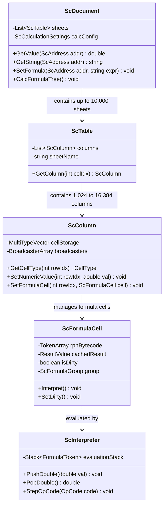
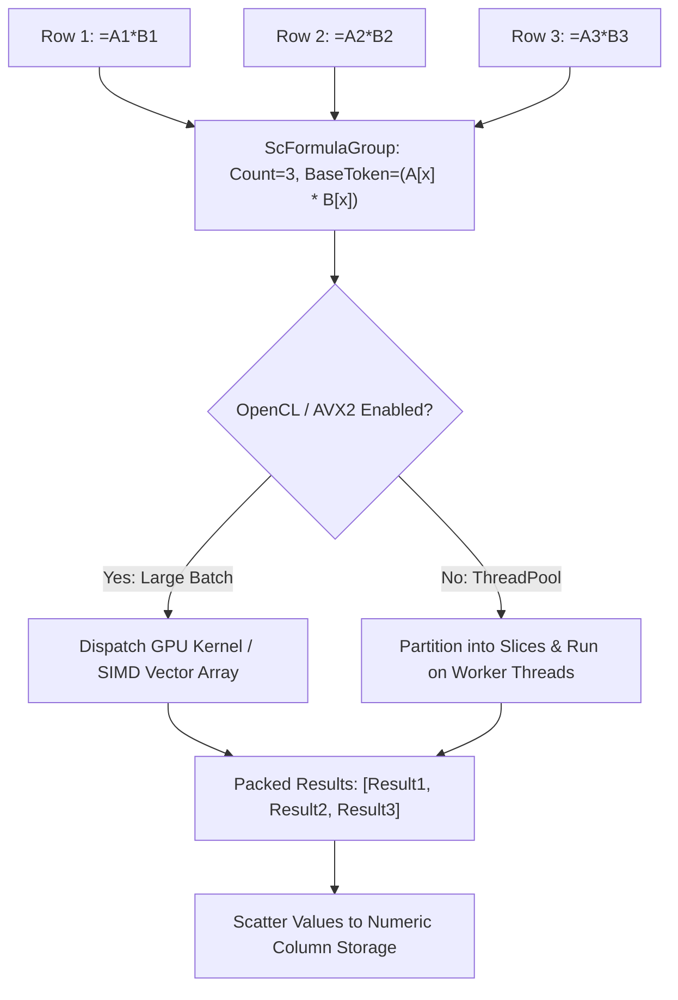

# Module Specification: Calc (Spreadsheet)

## 1. Overview & Purpose

**LibreOffice Calc** (`sc`, `formula`) is a high-performance spreadsheet computation engine supporting complex mathematical, statistical, financial, and engineering analysis. It features column-oriented contiguous array storage, vectorized calculation groups, multi-threaded formula evaluation, OpenCL GPU offloading, and pivot table modeling.

### Subsystems Covered
- **Document & Data Storage (`sc/source/core/data/`):**
  - Spreadsheet Model (`ScDocument`).
  - Sheet Container (`ScTable`).
  - Column Multi-Type Vector Storage (`ScColumn`, using `mdds::multi_type_vector`).
  - Cell Types (`ScValueCell`, `ScStringCell`, `ScFormulaCell`).
- **Formula Engine (`formula/`, `sc/source/core/tool/`):**
  - Grammatical Tokenizer & Compiler (`ScCompiler`).
  - Stack-Based Formula Interpreter (`ScInterpreter`).
  - OpenFormula (ODF 1.3) and Excel A1/R1C1 syntax support.
- **Dependency & Recalculation Subsystem:**
  - Dependency Tracking DAG (`ScBroadcastAreaSlotMachine`).
  - Dirty Flag Cascading (`SetDirty`).
  - Vectorized Formula Groups (`ScFormulaGroup`).
  - ThreadPool & OpenCL Execution.
- **Analysis & Pivoting:**
  - Pivot Tables / Data Pilot (`ScDPObject`).
  - Auto-Filtering, Sorting, and Conditional Formatting.

---

## 2. Component Architecture & Data Structures



### Conceptual Data Structures

#### 1. Column Multi-Type Vector Storage (`mdds`)
To maximize cache locality and reduce memory overhead, spreadsheet cells are stored column-wise in contiguous memory blocks partitioned by data type:
- **Block Types:** `EmptyBlock`, `NumericBlock` (contiguous IEEE-754 `double` arrays), `StringBlock` (string pointers), `FormulaBlock` (`ScFormulaCell` pointers).
- **Advantage:** Storing 1,000,000 numbers in a column requires only one contiguous array of 8 MB, avoiding object overhead and pointer indirection.

#### 2. `ScAddress` & Spatial Coordinates
- **Representation:** Struct containing 32-bit `Row`, 16-bit `Column`, and 16-bit `Tab` (Sheet index).
- **Limits:** Supports up to 16,384 columns and 16,777,216 rows per sheet.

#### 3. Formula Token Bytecode (`TokenArray`)
- Formulas are compiled from text into Reverse Polish Notation (RPN) token arrays. Tokens represent:
  - Immediate Literals (Double, String).
  - Cell References (`SingleRef`, `AreaRef`).
  - OpCodes (`ocAdd`, `ocMultiply`, `ocSUM`, `ocVLOOKUP`, `ocIF`).

---

## 3. Behavioral Rules & Algorithms

### 3.1 Formula Stack Machine Evaluation

```
Algorithm: InterpretFormulaRPN(formulaCell)
Input: formulaCell (ScFormulaCell)
Output: EvaluationResult

1. Stack := Empty Stack of FormulaTokens
2. InterpreterContext := InitContext(formulaCell.getDocument())

3. For each token in formulaCell.getRPNTokens():
     Switch token.getType():
       Case LITERAL_VALUE:
         Stack.push(token)
         
       Case CELL_REFERENCE:
         Val := FetchCellValue(token.getAddress())
         Stack.push(New Token(Val))
         
       Case AREA_REFERENCE:
         Stack.push(token) // Pushes range descriptor [StartAddr, EndAddr]
         
       Case OPERATOR_ADD:
         Right := Stack.pop().getDouble()
         Left := Stack.pop().getDouble()
         Stack.push(New Token(Left + Right))
         
       Case FUNCTION_SUM:
         RangeToken := Stack.pop()
         SumTotal := 0.0
         For each cell in RangeToken.iterateCells():
           SumTotal := SumTotal + cell.getNumericValue()
         Stack.push(New Token(SumTotal))
         
       Case FUNCTION_IF:
         FalseVal := Stack.pop()
         TrueVal := Stack.pop()
         Condition := Stack.pop().getBoolean()
         If Condition: Stack.push(TrueVal)
         Else: Stack.push(FalseVal)

4. FinalResult := Stack.pop()
5. formulaCell.setCachedResult(FinalResult)
6. formulaCell.clearDirty()
7. Return FinalResult
```

### 3.2 Dependency DAG Dirty Propagation

When a cell value changes:

```
Algorithm: PropagateCellDirty(changedAddress)
Input: changedAddress (ScAddress)
Output: None

1. Queue := Empty Queue of Broadcasters
2. Queue.enqueue(GetBroadcasterAt(changedAddress))

3. While Queue is Not Empty:
     Broadcaster := Queue.dequeue()
     For each listenerCell in Broadcaster.getListeners():
       If Not listenerCell.isDirty():
         listenerCell.setDirty(true)
         // Enqueue listeners that depend on this formula cell
         If listenerCell has Broadcaster:
           Queue.enqueue(listenerCell.getBroadcaster())

4. RegisterAsynchronousRecalculationEvent()
```

---

## 4. State Transitions & Vectorized Formula Groups

Contiguous formula cells containing identical logic across consecutive rows (e.g., `=A1*B1`, `=A2*B2`, `=A3*B3`) are consolidated into a **Formula Group**:



- **Vectorized SIMD Execution:** Instead of executing the interpreter loop 1,000,000 times row by row, the engine fetches contiguous memory pointers from columns `A` and `B` and executes vectorized multiplication in native SIMD instructions or an OpenCL GPU kernel.

---

## 5. Error Handling & Edge Cases

1. **Circular Reference Detection:** When formula evaluation encounters an indirect cycle ($A1 \to B1 \to C1 \to A1$):
   - The interpreter tracks evaluation depth on the active call stack (`RecursionCounter`).
   - If a cell is encountered while already in an evaluating state:
     - If Iterative Calculation is enabled, it stops when reaching `MaxIterations` or `MaxChange`.
     - If disabled, evaluation terminates immediately and sets the cell result to error code `522` (`#REF! / Circular reference`).
2. **Division by Zero:** Evaluates to error code `503` (`#DIV/0!`), propagating outward to all dependent formulas without crashing the calculation thread.
3. **Invalid Range Expansion on Deleted Sheet:** When a referenced sheet is deleted from the workbook:
   - References targeting the deleted sheet are rewritten to invalid ref tokens (`#REF!`).
