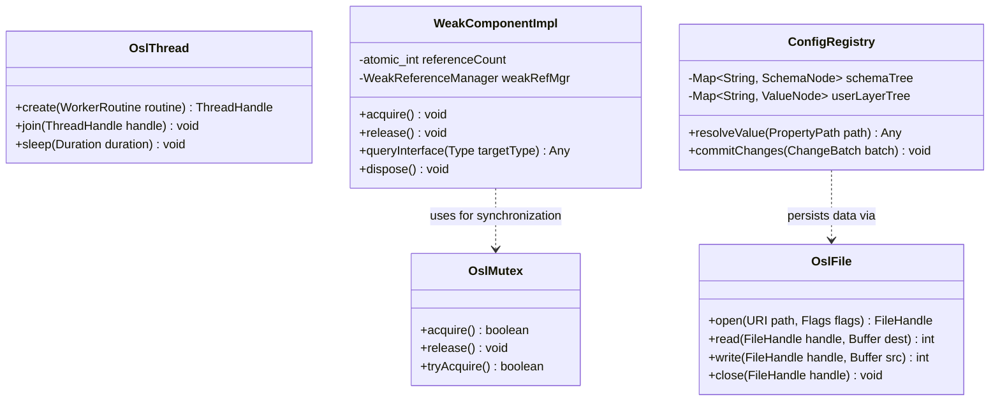
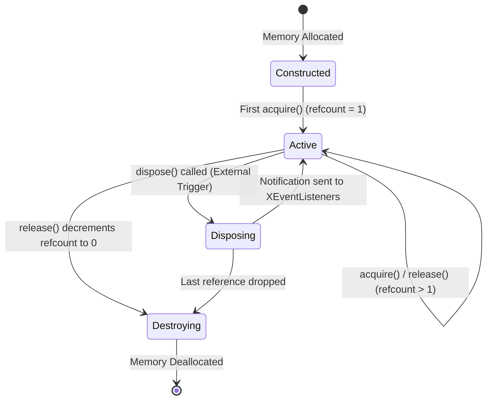

# Module Specification: Foundation & System Abstraction Layer

> **Verification Status (2026-10-24): UNVERIFIED against this repository.** No `sal`, `salhelper`, `cppu`, `cppuhelper`, `binaryurp`, `store`, `registry`, `configmgr`, `stoc`, `udkapi` directories or files (e.g. `sal/osl/unx/thread.cxx`, `cppu/source/uno/any.cxx`, `configmgr/source/configurationprovider.cxx`) exist in this repository. All class names (`OslMutex`, `WeakComponentImpl`, etc.), field lists, pseudocode (`QueryInterface`, `ResolveConfigProperty`), lifecycle diagrams, and error-code claims below are **UNVERIFIED** illustrations, not verified behavior.

## 1. Overview & Purpose (UNVERIFIED)

The spec claims the **Foundation Layer** provides the core operating system abstraction, memory management, object model runtime, and inter-process communication infrastructure for LibreOffice. It isolates the entire application stack from platform-specific APIs (POSIX, Win32, Cocoa), providing a unified runtime environment across all supported operating systems.

### Subsystems Covered
- **SAL (System Abstraction Layer) (`sal`, `salhelper`):** Primitive operating system services: threads, mutexes, file I/O, process management, dynamic library loading, and unicode string primitives.
- **CPPU (C++ UNO Runtime) (`cppu`, `cppuhelper`):** Language runtime binding for Universal Network Objects (UNO), providing reference-counted interfaces, object factories, weak references, and dynamic proxy dispatch.
- **Binary URP (`binaryurp`):** Universal Remote Protocol for marshalling UNO calls over network sockets and local pipes.
- **Store & Registry (`store`, `registry`):** Binary structured storage and type-library registries (`.rdb`).
- **Configuration Manager (`configmgr`):** Hierarchical settings backend managing system defaults and user overrides from XML schemas (`.xcs`/`.xcu`).
- **Standard Component Services (`stoc`):** Foundational UNO components: reflection, introspection, type converters, and runtime core loaders.

---

## 2. Component Architecture & Data Structures



### Conceptual Data Structures (UNVERIFIED — no corresponding headers or sources found)

#### 1. `OslMutex` & Synchronization Primitives
- **Type:** Recursive operating system mutex handle.
- **Purpose:** Protects critical execution blocks across threads. Guarantees recursive re-entry by the owning thread without self-deadlock.

#### 2. `OslFileHandle` & Native File Abstraction
- **Fields:** Native OS descriptor, normalized file URI (`file://`), current seek offset, access permissions (Read, Write, Exclusive).
- **Invariants:** Paths must be strictly formatted as RFC-2396 compliant URIs before invocation; native Windows (`C:\...`) or UNIX (`/...`) paths are rejected at the interface boundary.

#### 3. `WeakComponentImpl` (UNO Root Lifecycle Object)
- **Fields:**
  - `referenceCount`: 32-bit signed atomic integer.
  - `isDisposed`: Boolean flag indicating whether teardown has begun.
  - `weakConnectionList`: Circular linked list of registered weak reference descriptors.
- **Purpose:** Default base class for in-memory UNO objects. Coordinates intrusive lifecycle accounting with notification broadcasts.

#### 4. `ConfigurationTree`
- **Fields:** Hierarchical n-ary tree of configuration properties.
  - Node types: `StructuralNode`, `ValueNode` (Boolean, Integer, String, List), `LocalizedNode` (keyed by BCP-47 language tag).
  - Layers: Default layer (read-only schemas), Administrative layer, User override layer.

---

## 3. Behavioral Rules & Algorithms (UNVERIFIED — pseudocode illustrates claimed behavior only; no implementation checked)

### 3.1 Object Lifetime and Interface Query Algorithm

All UNO objects operate through dynamic interface queries and atomic reference tracking.

```
Algorithm: QueryInterface(targetType)
Input: targetType (Descriptor identifying requested interface)
Output: InterfacePointer or NULL

1. If targetType equals XInterface:
     Increment referenceCount atomically
     Return Pointer to internal XInterface facet

2. For each registered interface facet in supportedInterfaces:
     If facet matches targetType:
       Increment referenceCount atomically
       Return Pointer to facet

3. If object delegates to outer aggregator:
     Return Aggregator.queryInterface(targetType)

4. Return NULL
```

```
Algorithm: ReleaseReference()
Input: None
Output: Remaining reference count

1. count := Decrement referenceCount atomically
2. Invariant: count >= 0 (Underflow indicates invalid memory ownership)
3. If count == 0:
     Execute destructor and free memory block
4. Return count
```

### 3.2 Configuration Resolution Hierarchy

When an application component requests a configuration key (e.g., `/org.openoffice.Office.Common/Font/Substitution`):

```
Algorithm: ResolveConfigProperty(propertyPath, userLocale)
Input: propertyPath (Slash-delimited string), userLocale (Language tag)
Output: Resolved property value

1. Traverse SchemaTree to find TargetNode:
     If TargetNode not found: Raise NoSuchElementException

2. Check UserOverrideTree at propertyPath:
     If override exists and isValid:
       Return CandidateValue

3. Check AdminProfileTree at propertyPath:
     If admin setting exists:
       Return CandidateValue

4. Fallback to SchemaDefault:
     If property is Localized:
       Find closest locale match (Exact -> Language-only -> "en-US")
       Return LocalizedValue
     Else:
       Return DefaultValue
```

---

## 4. State Transitions & Lifecycle (UNVERIFIED)

### UNO Component Lifecycle



- **Constructed:** Object created via factory; reference count is initially zero.
- **Active:** Object held by one or more strong references. Safe for method invocations.
- **Disposing:** Explicit resource cleanup triggered. Object releases open file descriptors, tears down socket connections, and notifies registered listeners. Methods invoked during disposal raise `DisposedException`.
- **Destroying:** Reference count hits zero; underlying heap allocation is reclaimed.

---

## 5. Error Handling & Edge Cases (UNVERIFIED — error codes and recovery behaviors not observed in this repository)

1. **Memory Allocation Exhaustion:** SAL memory allocators (`osl_allocateMemory`) return NULL on exhaustion. High-level C++ bindings convert NULL allocations into `std::bad_alloc` or catch catastrophic out-of-memory states to trigger emergency document recovery.
2. **Path Encoding Edge Cases:** File paths containing illegal characters, percent-encoded spaces (`%20`), non-ASCII UTF-8 sequences, or unresolved symlinks are canonicalized before file handle creation. If an invalid URI is supplied, `osl_File_E_INVAL` is returned.
3. **Circular Reference Deadlocks:** When two UNO components hold strong references to each other, reference counting cannot reach zero. The system mandates that back-pointers must be implemented as `WeakReference<T>`, converting cycle retention into non-owning notifications.
4. **Binary URP Network Disconnect:** During remote execution, if the underlying TCP socket experiences an abrupt RST or timeout:
   - In-flight method requests raise `com::sun.star.uno::DisposedException`.
   - Client proxies mark their remote handle invalid.
   - Socket reconnection attempts are mediated by higher-level framework components without locking the UI thread.
