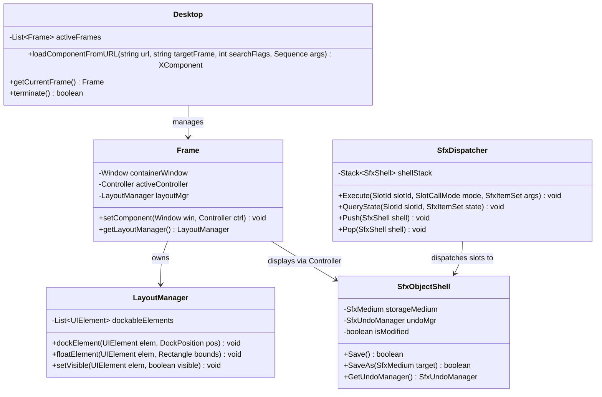

# Module Specification: Application Framework & Document Shell

> **Verification Status (2026-10-24): UNVERIFIED against this repository.** No `sfx2`, `framework`, `cui`, `desktop` sources (e.g. `sfx2/source/control/dispatch.cxx`, `framework/source/layoutmanager/layoutmanager.cxx`, `desktop/source/app/app.cxx`) exist here. All `SfxObjectShell`/`SfxDispatcher`/`LayoutManager` definitions, slot-routing/docking pseudocode, `--headless`/`--convert-to` startup claims, and recovery behaviors below are **UNVERIFIED**.

## 1. Overview & Purpose (UNVERIFIED)

The spec claims the **Application Framework Layer** coordinates the high-level life cycle of LibreOffice: launching processes, constructing desktop frames, routing user interface commands, managing document views, and maintaining persistent undo/redo history. It connects generic visual widgets with specific document applications.

### Subsystems Covered
- **SFX2 (Star Framework 2) (`sfx2`):** Classic document-frame-view coordination: `SfxObjectShell` (document model wrapper), `SfxViewShell` (view controller), `SfxDispatcher` (slot execution router), `SfxUndoManager` (multi-level undo/redo), and `SfxMedium` (storage stream wrapper).
- **Framework (`framework`):** Modern UNO desktop and UI layout framework: `Desktop` service, `Frame`, `Controller`, `LayoutManager` (dockable toolbars, sidebars, status bars), and command dispatch providers.
- **Common UI (`cui`):** Reusable office-wide configuration dialogs: Options, Font/Paragraph styling, Macro Security, and UI Customization.
- **Desktop (`desktop`):** Main entry point, command-line argument parser, splash screen coordinator, single-instance lock socket, and crash recovery manager.

---

## 2. Component Architecture & Data Structures



### Conceptual Data Structures (UNVERIFIED — no corresponding sources found)

#### 1. `SfxSlot` & Slot Pool
- **Fields:** Unique integer `SlotId`, UNO command URL (`.uno:CommandName`), shell member function pointer, status query function pointer, permission flags (Read-only allowed, Asynchronous, Recordable).
- **Purpose:** Associates user commands with application handlers while abstracting whether commands originated from a toolbar click, menu selection, keyboard shortcut, or macro script.

#### 2. `SfxUndoManager`
- **Fields:**
  - `undoStack`: Double-ended list of `SfxUndoAction` elements.
  - `redoStack`: Stack of cleared actions available for reapplication.
  - `markedPosition`: Index tracking the document's unmodified (clean) state on disk.
- **Invariants:** Executing any new mutating action clears the `redoStack` entirely and appends the action to `undoStack`.

---

## 3. Behavioral Rules & Algorithms (UNVERIFIED — pseudocode not verified)

### 3.1 SfxDispatcher Slot Routing Algorithm

When a command arrives at the dispatcher:

```
Algorithm: DispatchSlot(slotId, commandArgs)
Input: slotId (Integer / SID_*), commandArgs (SfxItemSet)
Output: ExecutionResult

1. For each shell in SfxDispatcher.shellStack (Top to Bottom):
     Slot := shell.findSlotInPool(slotId)
     If Slot is Found:
       // Check if slot is enabled in current context
       State := shell.querySlotState(Slot)
       If State.isDisabled():
         Return ExecutionResult.DISABLED
       
       // Execute the matching member function
       shell.executeSlot(Slot, commandArgs)
       
       // Invalidate cached UI status for affected controls
       SfxDispatcher.invalidateSlots(Slot.getInvalidationGroup())
       Return ExecutionResult.SUCCESS

2. Return ExecutionResult.UNHANDLED
```

### 3.2 LayoutManager Docking Calculation

```
Algorithm: DockElement(element, targetPosition)
Input: element (UIElement), targetPosition (Top | Bottom | Left | Right)
Output: None

1. DockArea := LayoutManager.getDockArea(targetPosition)
2. element.setFloating(false)
3. DockArea.insertElement(element)

4. AvailableSpace := LayoutManager.getRemainingClientArea()
5. CenterEditWindow.resize(AvailableSpace)

6. PersistLayoutState(element.getId(), targetPosition, element.getSize())
```

---

## 4. Desktop Startup & Command-Line Processing (UNVERIFIED — `soffice.bin`, lock socket, splash, crash-recovery flow not observed)

The `desktop` module controls startup execution before document windows appear:

```mermaid
flowchart TD
    Start[Process Invocation: soffice.bin] --> ParseArgs[Parse Command-Line Arguments]
    ParseArgs --> LockCheck{Check Single-Instance Lock}
    
    LockCheck -->|Instance Running| SendPipe[Send Arguments via Named Pipe / Socket]
    SendPipe --> Terminate[Exit Current Process]
    
    LockCheck -->|First Instance| InitCore[Initialize SAL, CPPU & Service Manager]
    InitCore --> Splash[Display Splash Screen Window]
    InitCore --> InitVCL[Initialize VCL Graphics Backend]
    InitVCL --> CheckCrash{Check Crash Recovery State}
    
    CheckCrash -->|Recovery Found| ShowRecoveryDialog[Present Crash Recovery Wizard]
    CheckCrash -->|Clean State| ProcessCLIArgs
    
    ProcessCLIArgs -->|Argument: --headless| HeadlessMode[Suppress UI & Start IPC Service]
    ProcessCLIArgs -->|Argument: --convert-to| ConvertFile[Execute Batch Conversion & Exit]
    ProcessCLIArgs -->|Argument: file.odt| LoadDoc[Load Document into New Frame]
    ProcessCLIArgs -->|No Arguments| StartCenter[Display StartCenter Launcher View]
```



### Command-Line Execution Modes
- `--headless`: Suppresses all X11/Wayland/Win32 display surface initialization. Allows execution in terminal servers, Docker containers, and cloud environments.
- `--convert-to <format> <file>`: Ingests the specified file, invokes the matching export filter without displaying a window, flushes the output to disk, and exits with code 0.

---

## 5. Error Handling & Edge Cases (UNVERIFIED — recovery/read-only/modal claims not observed)

1. **Document Recovery on Abrupt Termination:** If the office process experiences an unhandled signal (`SIGSEGV`, `SIGILL`) or power loss:
   - The crash signal handler traps the event and flushes emergency recovery XML manifests containing pointers to auto-saved temporary files.
   - On the subsequent launch, the Desktop detects the un-cleared recovery manifest and opens the Document Recovery Wizard, guiding the user through document restoration.
2. **Read-Only Storage Elevation:** When a document is opened from a read-only filesystem or locked network share:
   - The `SfxObjectShell` marks its state as `Read-Only`.
   - Modifying actions in `SfxDispatcher` are disabled (`DISABLED`).
   - The UI displays an info bar prompting the user to "Edit Copy" or "Save As" on a writable volume.
3. **Modal Dialog Re-Entry Deadlock:** VCL prevents re-entering dispatch while a modal dialog is executing:
   - While a modal dialog is active, incoming window events outside the modal hierarchy are intercepted and routed to an audible alert or ignored.
