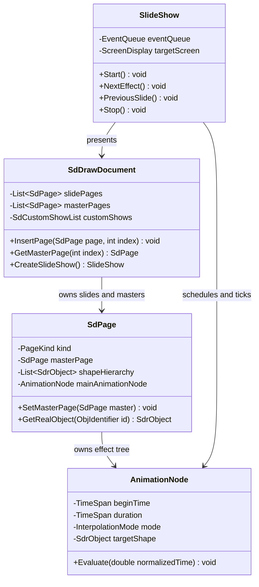
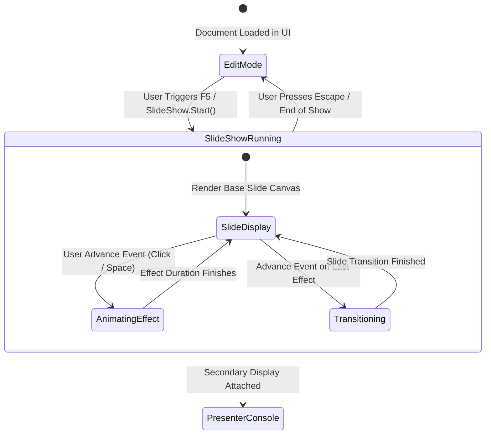

# Module Specification: Impress & Draw (Presentations & Graphics)

## 1. Overview & Purpose

**LibreOffice Impress & Draw** (`sd`, `slideshow`, `animations`) manage presentation authoring, slide show delivery, and vector drawing. While sharing a common document model, Impress specializes in slide sequencing, transitions, speaker notes, and interactive animations, whereas Draw focuses on technical drafting, page flowcharts, and multi-layer graphics.

### Subsystems Covered
- **Document Model (`sd/source/core/`):**
  - Presentation Document (`SdDrawDocument`, inheriting `SdrModel`).
  - Slide Pages & Sub-Views (`SdPage`: Standard, Master, Notes, Handout).
  - Layer System (`SdrLayerAdmin`: Layout, Controls, MeasureLines, Background).
- **View Controllers (`sd/source/ui/`):**
  - Multi-Pane Framework (Normal View, Slide Sorter, Outline, Notes).
  - Presenter Console (`sdext/source/presenter/`).
- **Animation & Presentation Runtime (`slideshow/`, `animations/`):**
  - SMIL-Compliant Animation Tree (`com.sun.star.animations.*`).
  - Time-Based Event Queue & Property Interpolation.
  - Hardware-Accelerated 3D Slide Transitions.

---

## 2. Component Architecture & Data Structures



### Conceptual Data Structures

#### 1. Page Multi-Model Layout (`SdPage`)
Each slide page maintains three auxiliary twin pages:
- **Presentation Slide:** The primary visual slide canvas.
- **Notes Page:** Page containing a thumbnail of the slide and an `EditEngine` text frame for speaker notes.
- **Master Page (`MasterPage`):** Template defining background fills, default headers/footers, date fields, and slide numbering.

#### 2. SMIL Animation Node Hierarchy
Effects (Entrance, Emphasis, Exit, Motion Paths) are modeled as declarative SMIL trees:
- **Parallel Nodes (`ParallelTimeContainer`):** Multiple animations occurring simultaneously (e.g., shape fades in while scaling up).
- **Sequential Nodes (`SequenceTimeContainer`):** Effects executed in series, triggered by user clicks or automated timeouts.

---

## 3. Behavioral Rules & Algorithms

### 3.1 Master Page Style & Attribute Inheritance

```
Algorithm: ResolveShapeFormatting(shape, page)
Input: shape (SdrObject), page (SdPage)
Output: ResolvedItemSet

1. ItemSet := shape.getLocalItemSet()
2. If ItemSet contains complete formatting:
     Return ItemSet

3. // Check Presentation Layout Style (e.g., Title, Subtitle, Outline 1-5)
4. LayoutStyle := page.getPresentationStyle(shape.getPresObjKind())
5. ItemSet.mergeDefaults(LayoutStyle.getProperties())

6. // Inherit from Master Page
7. MasterPage := page.getMasterPage()
8. If MasterPage is Not Null:
     MasterStyle := MasterPage.getPresentationStyle(shape.getPresObjKind())
     ItemSet.mergeDefaults(MasterStyle.getProperties())
     
     // Inherit Master Background Fill
     If shape.isBackgroundShape():
       ItemSet.mergeDefaults(MasterPage.getBackgroundProperties())

9. Return ItemSet
```

### 3.2 Slide Show Event Queue & Time Tick Scheduling

```
Algorithm: TickSlideShow(wallClockDelta)
Input: wallClockDelta (Milliseconds elapsed since last frame)
Output: None

1. currentTime := SlideShow.getCurrentTime() + wallClockDelta
2. SlideShow.setCurrentTime(currentTime)

3. While Not EventQueue.isEmpty() And EventQueue.peek().getTriggerTime() <= currentTime:
     ScheduledEvent := EventQueue.dequeue()
     ScheduledEvent.execute()

4. For each activeAnimation in SlideShow.getActiveAnimations():
     Elapsed := currentTime - activeAnimation.getStartTime()
     Progress := Clamp(Elapsed / activeAnimation.getDuration(), 0.0, 1.0)
     
     // Apply Easing Function (e.g., Ease-In, Ease-Out, Cubic Bezier)
     NormalizedT := ApplyEasing(Progress, activeAnimation.getEasing())
     activeAnimation.interpolateProperty(NormalizedT)
     
     If Progress >= 1.0:
       activeAnimation.markCompleted()
       SlideShow.removeActiveAnimation(activeAnimation)

5. RepaintPresentationViewport()
```

---

## 4. State Transitions & Presentation Flow



- **Dual-Screen Presenter Console:** When an external display is detected, the full-screen slide canvas outputs to the secondary display, while the primary laptop screen displays slide thumbnails, speaker notes, upcoming build previews, and an elapsed presentation timer.

---

## 5. Error Handling & Edge Cases

1. **Embedded Video Codec Missing:** If an inserted media file (`avmedia`) requires a codec not supported by the OS media framework (e.g., GStreamer, Media Foundation, AVFoundation):
   - Media playback fails gracefully.
   - The slide renders a static placeholder frame showing a speaker icon and filename, avoiding a presentation freeze.
2. **Circular Master Page Inheritance:** If a document contains corrupted master page pointers forming a cycle ($Master_A \to Master_B \to Master_A$):
   - The traversal algorithm maintains a visited set of pointer handles.
   - If an already visited master page is detected, inheritance terminates immediately and falls back to standard factory document defaults.
3. **Hardware Acceleration Failure During 3D Transition:** If OpenGL/Vulkan texture compilation fails during a 3D slide transition (e.g., Cube rotate):
   - The engine catches the shader compilation error.
   - It aborts the 3D transition and substitutes an immediate 2D cross-fade transition.
