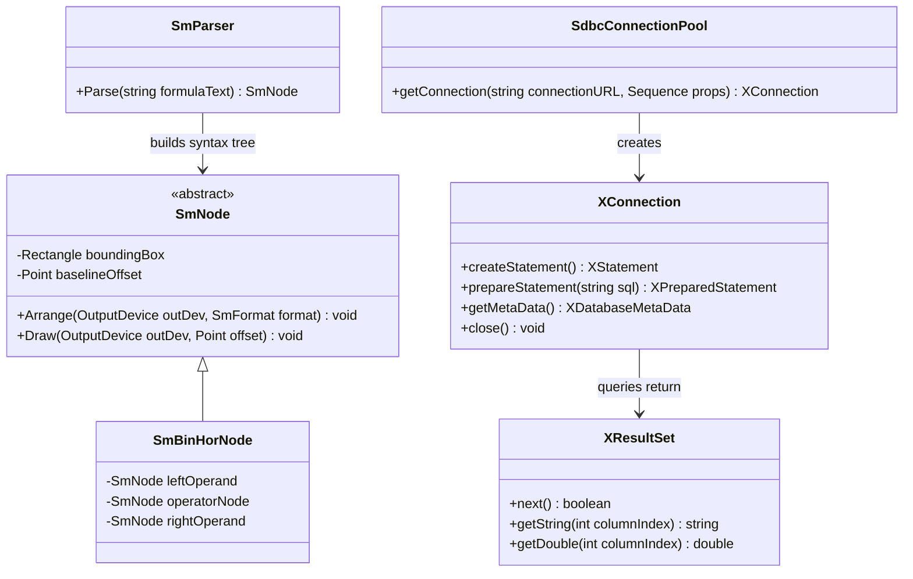
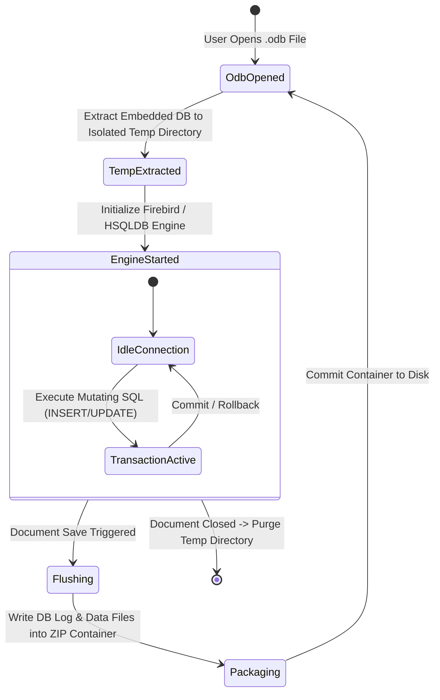

# Module Specification: Math & Base (Formula Editor & Database Subsystems)

> **Verification Status (2026-10-24): UNVERIFIED against this repository.** No `starmath/`, `dbaccess/`, `connectivity/`, `reportdesign/` sources (e.g. `starmath/source/parse.cxx`, `dbaccess/source/core/dataaccess/Model.cxx`, `connectivity/source/manager/vclman.cxx`) exist here. All `SmNode`/`XConnection`/`XResultSet` definitions, fraction-layout/SDBC-dispatch pseudocode, `.odb`/Firebird lifecycle and `¿`/WAL-recovery claims below are **UNVERIFIED**.

## 1. Overview & Purpose (UNVERIFIED)

The spec claims this module covers two specialized LibreOffice applications: **Math** (`starmath`), the equation typography engine, and **Base** (`dbaccess`, `connectivity`, `reportdesign`), the relational database management and visual reporting suite.

### Subsystems Covered
- **Math (`starmath/`):**
  - Equation Syntax Scanner & Grammar Parser.
  - Abstract Formula Node Tree (`SmNode`, `SmTableNode`, `SmOperNode`, `SmSubSupNode`).
  - Mathematical Typography Layout Engine.
  - MathML (XML) Import & Export Filters.
- **Base Document Architecture (`dbaccess/`):**
  - ODB Container & Embedded Database Storage.
  - SQL Query Designer & Join Resolver.
  - Table Designer & Schema Management.
- **Database Connectivity Framework (`connectivity/`):**
  - SDBC / SDBCX Driver Interface Hierarchy.
  - Driver Implementations: Firebird Embedded, PostgreSQL, MySQL/MariaDB, JDBC, ODBC, Flat Files.
- **Report Design (`reportdesign/`):**
  - Band-Oriented Visual Report Designer (Header, Detail, Grouping, Footer bands).

---

## 2. Component Architecture & Data Structures



### Conceptual Data Structures (UNVERIFIED — no `SmNode`/SDBC sources found)

#### 1. Formula Node Tree (`SmNode`)
Equations are parsed into a recursive typographical tree:
- **`SmTableNode`:** 2D grid matrix of equation terms.
- **`SmOperNode`:** Mathematical operators ($\sum$, $\prod$, $\int$) with limits.
- **`SmBinHorNode`:** Horizontal binary operations (e.g., $a + b$).
- **`SmSubSupNode`:** Base term with upper (superscript) and lower (subscript) anchors.
- **Invariants:** Nodes calculate their typographical baseline and bounding box dynamically based on font metrics, ensuring fraction bars and radical root symbols expand to enclose their inner children.

#### 2. SDBC Database Abstraction Layer
Modeled closely on JDBC/ODBC, SDBC exposes relational data through pure UNO interfaces:
- `XDriver`: Dynamic factory capable of parsing specific connection URLs (e.g., `sdbc:embedded:firebird`, `sdbc:mysqlc:...`).
- `XConnection`: Active database session managing transactions and SQL statements.
- `XResultSet`: Cursor-based tabular result stream.

---

## 3. Behavioral Rules & Algorithms (UNVERIFIED — pseudocode not verified)

### 3.1 Mathematical Layout & Baseline Alignment

```
Algorithm: LayoutFraction(fractionNode, outputDevice, formatConfig)
Input: fractionNode (NumeratorNode, DenominatorNode), outputDevice, formatConfig
Output: None

1. // Measure child bounding boxes
2. fractionNode.Numerator.Arrange(outputDevice, formatConfig)
3. fractionNode.Denominator.Arrange(outputDevice, formatConfig)

4. WidthNumerator := fractionNode.Numerator.getWidth()
5. WidthDenominator := fractionNode.Denominator.getWidth()
6. TotalWidth := Max(WidthNumerator, WidthDenominator) + (2 * formatConfig.getHorizontalPadding())

7. // Calculate vertical positioning relative to formula math axis
8. MathAxisY := formatConfig.getMathAxisHeight()
9. BarThickness := formatConfig.getFractionBarThickness()

10. NumeratorY := MathAxisY - BarThickness - fractionNode.Numerator.getDescent() - formatConfig.getGap()
11. DenominatorY := MathAxisY + BarThickness + fractionNode.Denominator.getAscent() + formatConfig.getGap()

12. fractionNode.Numerator.setPosition(CenterAlign(WidthNumerator, TotalWidth), NumeratorY)
13. fractionNode.Denominator.setPosition(CenterAlign(WidthDenominator, TotalWidth), DenominatorY)

14. fractionNode.setBoundingBox(TotalWidth, CalculateTotalHeight())
15. fractionNode.setBaseline(MathAxisY)
```

### 3.2 SDBC Connection Resolution & Dispatch

```
Algorithm: OpenDatabaseConnection(connectionURI, userCredentials)
Input: connectionURI (String), userCredentials (PropertySet)
Output: XConnection

1. DriverRegistry := GetService("com.sun.star.sdbc.DriverManager")
2. For each driver in DriverRegistry.getRegisteredDrivers():
     If driver.acceptsURL(connectionURI):
       Connection := driver.connect(connectionURI, userCredentials)
       If Connection is Not Null:
         Return Connection

3. Raise SQLException("No suitable driver found for URL: " + connectionURI)
```

---

## 4. State Transitions & Embedded Database Lifecycle (UNVERIFIED — temp-extract/repack lifecycle not observed)



- **Embedded Isolation:** To prevent file locks and data corruption inside the `.odb` ZIP package, embedded database files are unpacked into a private temporary working directory on startup, accessed exclusively through localhost ports/pipes, and repacked into the ZIP archive upon closing.

---

## 5. Error Handling & Edge Cases (UNVERIFIED — syntax-error/SQL-dialect/crash-recovery claims not observed)

1. **Math Syntax Errors:** When the formula parser encounters illegal syntax (e.g., `x over` without a denominator):
   - The parser constructs an `SmErrorNode` at the error offset.
   - The visual rendering replaces the invalid token with an inverted question mark `¿` displaying red highlighting, allowing the rest of the equation to render normally.
2. **SQL Syntax Incompatibility Across Drivers:**
   - Base features a built-in SQL parsing engine (`connectivity/source/parse/`).
   - If "Run SQL Directly" (Pass-through mode) is toggled off, Base translates generic SQL expressions into the target driver's specific SQL dialect.
   - If translation fails, an `sdbc::SQLException` detailing the dialect mismatch is reported.
3. **Database File Corruption on Unexpected Crash:**
   - The embedded Firebird driver maintains a write-ahead transaction log (`.wal`).
   - On startup, the driver inspects the log; if uncommitted writes exist, it executes automatic crash recovery rollback before opening tables.
