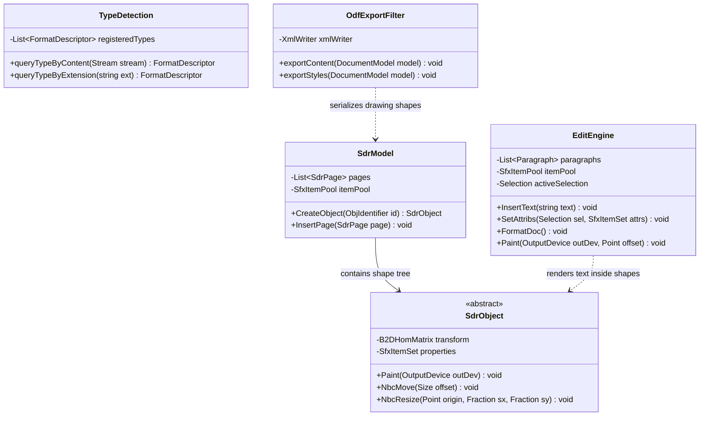
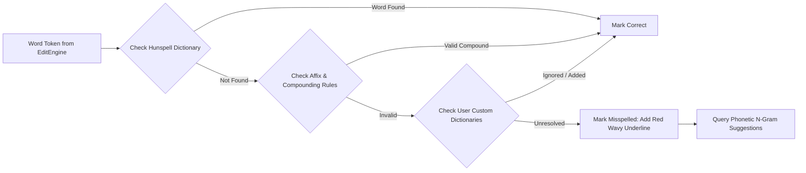

# Module Specification: Shared Document & Formatting Engines

> **Verification Status (2026-10-24): UNVERIFIED against this repository.** No `editeng`, `svx`, `xmloff`, `oox`, `filter`, `linguistic`, `chart2`, `forms` sources (e.g. `editeng/source/editeng/editeng.cxx`, `xmloff/source/core/xmlimp.cxx`, `filter/source/config/cache/typedetection.cxx`) exist here. All `EditEngine`/`SdrModel`/`TypeDetection` definitions, magic-byte sniffing and ODF-export pseudocode, spell-check/hyphenation and placeholder claims below are **UNVERIFIED**.

## 1. Overview & Purpose (UNVERIFIED)

The spec claims the **Shared Document Engines Layer** provides cross-application features: rich-text editing, vector shape manipulation, file format parsing and serialization, linguistic verification, charting, and embedded form controls. These engines ensure that features like vector shapes or spell checking operate identically whether embedded in a Writer document, a Calc sheet, or an Impress presentation.

### Subsystems Covered
- **EditEngine & Outliner (`editeng`):** Core multi-line rich text editor supporting inline formatting attributes, spell checking markers, and hierarchical outline indentation.
- **Document Drawing Engine (`svx`):** Object-oriented vector shape engine (`SdrModel`, `SdrPage`, `SdrObject`), connectors, 3D scenes, and text-in-shape layout.
- **OpenDocument Format (ODF) Engine (`xmloff`):** Reference implementation of OASIS ODF (ISO/IEC 26300) import and export filters.
- **Office Open XML (OOXML) Engine (`oox`):** Shared parsing and generation engine for Microsoft formats (`.docx`, `.xlsx`, `.pptx`, DrawingML, VML).
- **Filter Detection Subsystem (`filter`):** MIME type sniffing, magic byte matching, and filter selection.
- **Linguistic Subsystem (`linguistic`, `lingucomponent`):** Spell checking, hyphenation, and thesaurus integration (Hunspell, Libhyphen).
- **Chart Engine (`chart2`):** 2D/3D business charting, data series mapping, and coordinate transformation.
- **Forms Engine (`forms`):** Interactive database-aware form widgets (buttons, checkboxes, text inputs).

---

## 2. Component Architecture & Data Structures



### Conceptual Data Structures (UNVERIFIED — no corresponding sources found)

#### 1. `EditEngine` Paragraph & Character Portions
- **Paragraphs:** Ordered list of paragraph objects. Each paragraph owns an `SfxItemSet` for paragraph-level styling (margins, alignment, tab stops) and a list of `EditCharAttrib` spans.
- **Text Portions:** Internal layout breaks paragraphs into homogenous rendering portions (runs of text sharing identical font, weight, color, and script properties).

#### 2. `SdrObject` (Drawing Engine Primitive)
- **Hierarchy:** `SdrRectObj`, `SdrCircObj`, `SdrPathObj`, `SdrTextObj`, `SdrGrafObj`, `SdrGroupObj`.
- **Invariants:** Every shape maintains its bounding rectangle in logical 100th mm units. Geometric mutations (`NbcMove`, `NbcResize`, `NbcRotate`) transform the shape's internal polygon coordinates and invalidate its display cache.

---

## 3. Behavioral Rules & Algorithms (UNVERIFIED — magic-byte values, ZIP-entry names, export order not verified)

### 3.1 Content-Based Format Sniffing Algorithm

```
Algorithm: DetectDocumentFormat(stream, fileExtension)
Input: stream (StreamHandle), fileExtension (String)
Output: FormatDescriptor

1. Read initial 2048 header bytes into Buffer
2. If Buffer starts with PK [0x50, 0x4B, 0x03, 0x04]:
     // ZIP Archive detected (ODF, OOXML, or EPUB)
     Open ZIP directory table
     If "mimetype" entry exists at offset 30:
       MimeString := ReadEntry("mimetype")
       Return MatchRegistryByMime(MimeString) // e.g. application/vnd.oasis.opendocument.text
     Else If "[Content_Types].xml" exists:
       TypesXML := ReadEntry("[Content_Types].xml")
       If TypesXML contains "wordprocessingml": Return FORMAT_DOCX
       Else If TypesXML contains "spreadsheetml": Return FORMAT_XLSX
       Else If TypesXML contains "presentationml": Return FORMAT_PPTX

3. If Buffer starts with OLE Compound File Header [0xD0, 0xCF, 0x11, 0xE0]:
     Inspect root directory entry names:
     If "WordDocument" stream exists: Return FORMAT_DOC_WW8
     Else If "Workbook" stream exists: Return FORMAT_XLS_BIFF8
     Else If "PowerPoint Document" stream exists: Return FORMAT_PPT

4. If Buffer starts with "{\rtf": Return FORMAT_RTF
5. If Buffer starts with "<?xml":
     Scan root XML element:
     If RootTag equals "<office:document>": Return FORMAT_FODT
     If RootTag equals "<math>": Return FORMAT_MATHML

6. Fallback: QueryRegistryByExtension(fileExtension)
```

### 3.2 ODF Streaming Serialization Pipeline

```
Algorithm: ExportDocumentToODF(documentModel, targetStorage)
Input: documentModel (SfxObjectShell), targetStorage (PackageStorage)
Output: None

1. targetStorage.WriteEntry("mimetype", documentModel.getODFMimeType(), Compression=NONE)
2. ManifestWriter := targetStorage.OpenStream("META-INF/manifest.xml")

3. StylesStream := targetStorage.OpenStream("styles.xml", Compression=DEFLATE)
4. xmloff.ExportStyles(documentModel.getStylePool(), StylesStream)
5. ManifestWriter.RegisterEntry("styles.xml", "text/xml")

6. ContentStream := targetStorage.OpenStream("content.xml", Compression=DEFLATE)
7. xmloff.ExportBodyContent(documentModel.getContentRoot(), ContentStream)
8. ManifestWriter.RegisterEntry("content.xml", "text/xml")

9. MetaStream := targetStorage.OpenStream("meta.xml", Compression=DEFLATE)
10. xmloff.ExportMetadata(documentModel.getMetadata(), MetaStream)
11. ManifestWriter.RegisterEntry("meta.xml", "text/xml")

12. For each embedded media object in documentModel:
      MediaStream := targetStorage.OpenStream("Pictures/" + media.getName())
      MediaStream.Write(media.getBytes())
      ManifestWriter.RegisterEntry("Pictures/" + media.getName(), media.getMimeType())

13. ManifestWriter.Close()
14. targetStorage.Flush()
```

---

## 4. Linguistic Verification & Spell Checking Pipeline (UNVERIFIED — Hunspell/Libhyphen integration not observed)



- **Asynchronous Execution:** Spell-checking executes via an idle timer thread. Edits made in visible viewports mark local paragraphs as dirty; background passes process paragraphs outside the viewport, updating error flag bitmaps without stalling user input.
- **Hyphenation Points:** Hyphenation queries Libhyphen tables using the paragraph's language tag. Break algorithms respect minimum word length, minimum prefix characters (e.g., 2), and minimum suffix characters (e.g., 2).

---

## 5. Error Handling & Edge Cases (UNVERIFIED — unknown-element, missing-dictionary, corrupt-graphic claims not observed)

1. **Unsupported XML Elements in ODF/OOXML:** When parsing future format versions containing unrecognized XML tags:
   - The XML parser ignores unknown elements without aborting the parse loop.
   - For foreign markup inside shapes or styles, elements are stored in an unrecognized XML extension bag (`ExtensionList`), preserving round-trip fidelity when saving back to disk.
2. **Missing Linguistic Dictionaries:** If a document contains text in a language for which no Hunspell dictionary is installed:
   - Spell checking is silently bypassed for that text span.
   - The UI displays an info indicator stating "Spell checking unavailable for language X", preventing false-positive spell error markers across the document.
3. **Corrupted Graphic Streams:** If an embedded JPEG or PNG stream is truncated or malformed:
   - The graphic parser traps the decode exception.
   - It substitutes a standard broken image placeholder graphic displaying the error string "Image cannot be displayed", allowing the document to remain fully readable.
